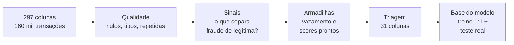
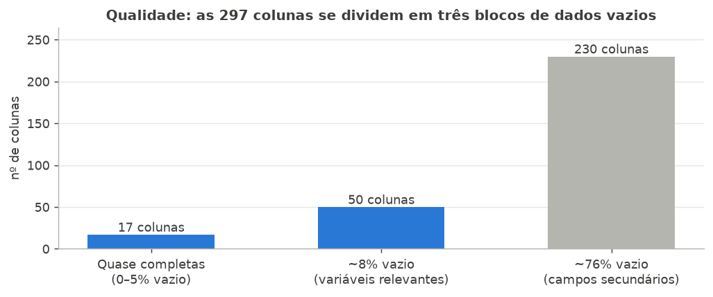
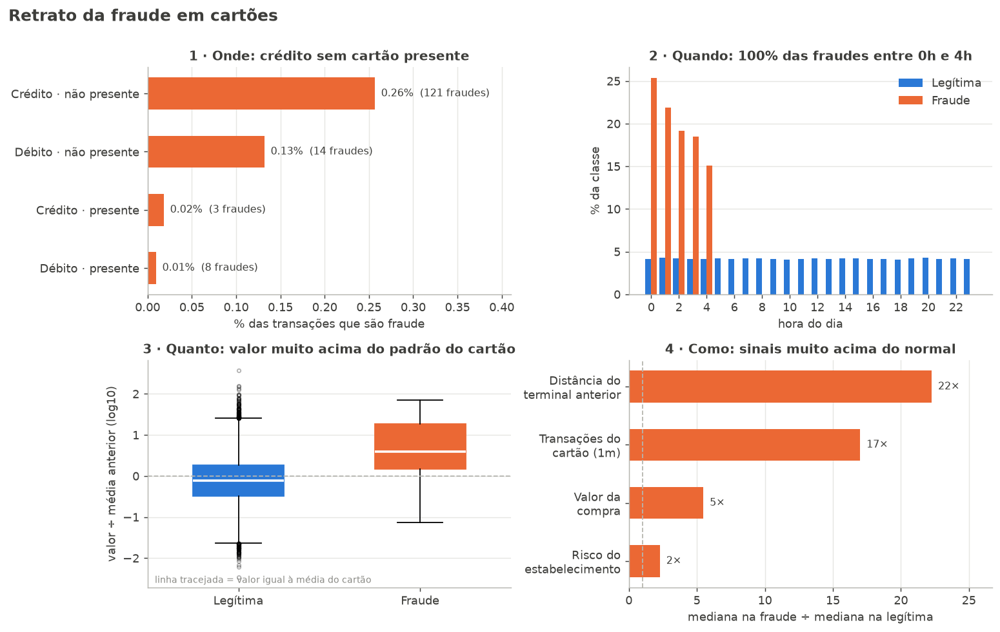
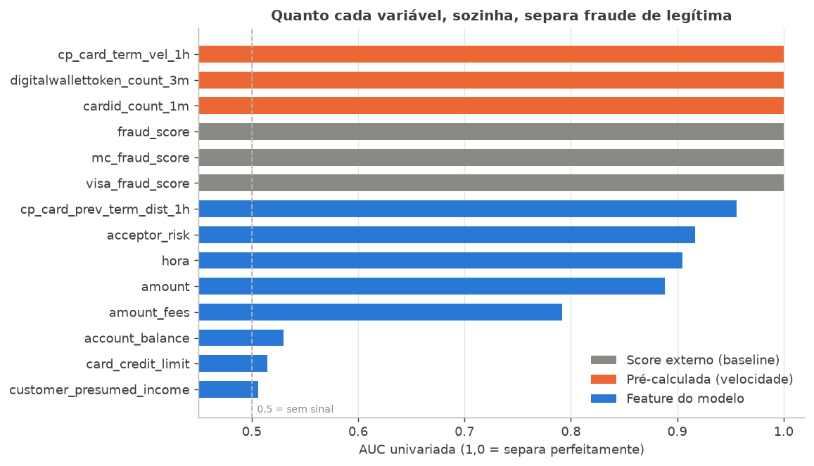
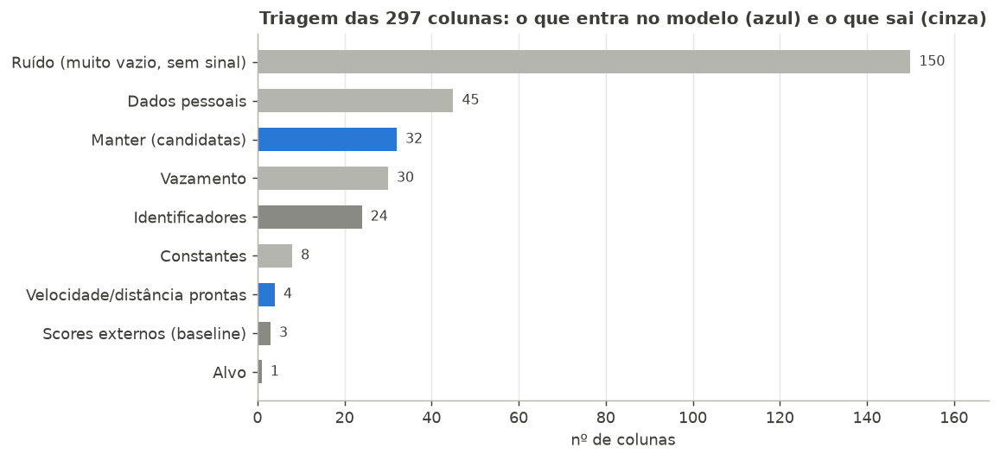
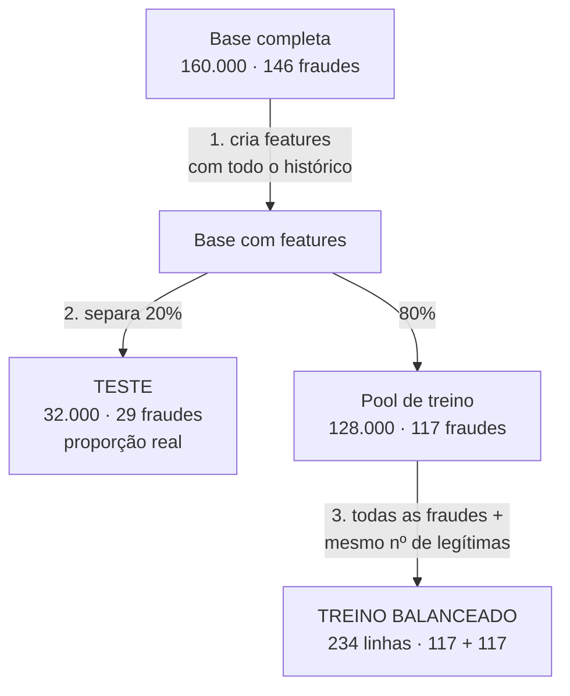

# Análise Exploratória: Prevenção a Fraudes em Cartões (Sicredi)

> **Trilha 4, IBM AI Experiential Learning Lab 2026:** *Como podemos utilizar IA Agêntica para prever e intervir em possíveis fraudes relacionadas a compras com cartões, aumentando a segurança dos associados e reduzindo perdas para o Sicredi?*

## Sumário

1. [Introdução](#1-introdução)
2. [Linha de raciocínio](#2-linha-de-raciocínio)
3. [Qualidade dos dados](#3-qualidade-dos-dados)
4. [Retrato da fraude: os insights](#4-retrato-da-fraude-os-insights)
5. [As armadilhas: vazamento e scores prontos](#5-as-armadilhas-vazamento-e-scores-prontos)
6. [Triagem: de 297 para 31 colunas](#6-triagem-de-297-para-31-colunas)
7. [A base para o modelo](#7-a-base-para-o-modelo)
8. [Conclusão](#8-conclusão)

---

## 1. Introdução

**O problema.** O Sicredi quer identificar compras fraudulentas com cartão **antes** que causem prejuízo ao associado. Para isso, disponibilizou uma base sintética de transações, com IDs, nomes e contas fictícios.

**A base.**

| | |
|---|---|
| Arquivo | `case_transacoes_cartoes_sintetico_900k.csv` |
| Linhas analisadas | **160.000 transações** (jan–dez/2025) |
| Colunas | **297**, em 7 grupos: evento, cliente, dispositivo, conta, cartão, estabelecimento e transação |
| Alvo | `feedback_label` (fraude confirmada) |
| Fraudes | **146 (0,09%)**, ou seja, menos de 1 a cada 1.000 transações |

> **Limitação:** as orientações do case descrevem 900 mil linhas e 900 fraudes. O arquivo disponível tem 160 mil, e todas as conclusões abaixo valem para esse recorte. Ao obter a base completa, basta rodar os notebooks novamente.

**Objetivo da EDA.** Não era só "olhar os dados". Queríamos responder três perguntas:
1. **O que diferencia uma fraude de uma compra legítima?** São os insights para o modelo e para o agente explicar o risco.
2. **Quais colunas são confiáveis e úteis?** É a base limpa para o modelo.
3. **Que armadilhas podem enganar o modelo?** Vazamento e desbalanceamento.

---

## 2. Linha de raciocínio

Cada etapa terminou com uma **decisão**: manter, remover, transformar ou investigar. Os detalhes técnicos estão nos notebooks:

| Notebook | Conteúdo |
|---|---|
| [`01_eda.ipynb`](../notebooks/01_eda.ipynb) | Análise completa: 14 seções, da estrutura à triagem |
| [`02_base_balanceada.ipynb`](../notebooks/02_base_balanceada.ipynb) | Criação de features e montagem da base de treino/teste |

---

## 3. Qualidade dos dados

A base tem três blocos bem definidos de dados vazios, e cada bloco recebeu um tratamento:

| Bloco | O que contém | Decisão |
|---|---|---|
| **17 colunas** quase completas | tipo e modalidade da transação, valor, data, IDs | Usar como estão |
| **50 colunas** com ~8% vazio | valor da taxa, risco do estabelecimento, velocidade, limite, renda | Manter e **preencher os vazios** no treino |
| **230 colunas** com ~76% vazio | códigos técnicos (`SYN_...`), disputas, coordenadas | Avaliar sinal; a maioria foi descartada |

**Outros achados:**
- **8 colunas constantes** (país sempre "BR", moeda sempre "BRL"). Não ajudam a diferenciar nada e foram **removidas**.
- **Colunas repetidas:** `pos_environment` é igual a `modalidade_transacao`, e `local_datetime` é igual a `event_occurred_at`. **Mantivemos uma de cada par.**
- **Faltas pontuais:** 599 transações sem valor e 311 sem data, que serão tratadas na limpeza.
- **Nenhuma linha duplicada** e nenhum valor impossível (valor negativo, coordenada inválida).

> **O vazio é uma pista?** Testamos se as fraudes têm mais campos vazios que as legítimas. **Não têm:** nenhuma diferença foi estatisticamente significativa. Então o vazio aqui é só falta de dado, não um sinal de fraude.

---

## 4. Retrato da fraude: os insights

| # | Insight | Evidência | O que significa para a solução |
|---|---|---|---|
| 1 | **Onde:** a fraude mora no crédito sem cartão presente (e-commerce) | 121 das 146 fraudes (83%); 0,26% das transações desse segmento são fraude, contra 0,01% no débito presencial | Primeiro filtro de risco; o agente pode ser mais rigoroso nesse canal |
| 2 | **Quando:** 100% das fraudes acontecem entre 0h e 4h | As compras legítimas se distribuem igualmente nas 24h | Compra de madrugada no e-commerce → pedir confirmação ao associado |
| 3 | **Quanto:** a fraude é uma compra fora do padrão **daquele associado** | Fraude vale **3,9×** a média histórica do cartão; a compra legítima vale 0,76× | O sinal não é "valor alto", é "alto **para esse associado**", o que é mais justo e mais explicável |
| 4 | **Como:** sinais de comportamento muito acima do normal | Distância do terminal anterior **22×** maior, uso do cartão **17×**, valor **5×**, risco do estabelecimento **2×** | O agente tem argumentos concretos para explicar o alerta |
| 5 | **Sem segunda chance:** cada cartão fraudado sofreu **uma única** fraude | 145 cartões, 1 fraude cada; 70% das fraudes foram a 1ª compra do cartão na base | A prevenção precisa agir **na primeira transação**, não dá para esperar o padrão se repetir |

O gráfico acima mede o quanto cada variável, **sozinha**, separa fraude de legítima (AUC: 0,5 = nenhum sinal, 1,0 = separação perfeita):
- **Azul:** sinais fortes e legítimos (distância, risco do estabelecimento, hora, valor). São a base do modelo.
- **Laranja:** colunas de velocidade já calculadas, que separam *perfeitamente*. São válidas, mas suspeitas de serem um artefato do dado sintético. Por isso o modelo será testado com e sem elas.
- **Cinza:** scores de fraude prontos (ver seção 5).
- **Campos cadastrais** (saldo, limite, renda) praticamente não têm sinal.

---

## 5. As armadilhas: vazamento e scores prontos

**Vazamento** é quando uma coluna contém informação que só existe **depois** de saber se a compra foi fraude. O modelo "cola" a resposta: parece perfeito no papel e falha na vida real.

| Coluna | Por que é vazamento | Evidência |
|---|---|---|
| `decision = deny` | É a decisão tomada **sobre** a transação | 77 transações, **100% fraude** |
| `transaction_status = declined` | É o resultado final | 48 transações, **100% fraude** |
| `device_ip_country_code = ZZ` | Marcador artificial do gerador | 38 transações, **100% fraude** |
| `dispute_*`, `fdz_*`, `oob_*`, `alert_id` | Disputa, feedback, contato pós-compra | Acontecem depois do fato |

**Decisão:** as 30 colunas de vazamento foram **removidas**.

**Scores prontos.** A base já traz `fraud_score`, `visa_fraud_score` e `mc_fraud_score`, notas de outros modelos de fraude. Sozinho, o `fraud_score` acima de 600 encontra **98% das fraudes com 91% de precisão**.

**Decisão:** não usamos esses scores como feature, porque o modelo só copiaria um modelo existente. Eles viram o **baseline**: a régua contra a qual vamos comparar a nossa solução.

> **Insight principal da etapa:** *detectar* a fraude já é um problema quase resolvido nesta base. **O diferencial está no que acontece depois do alerta:** explicar o motivo, falar com o associado e decidir entre bloquear, pedir confirmação ou liberar. É aí que entra a IA agêntica.

---

## 6. Triagem: de 297 para 31 colunas

Cada coluna recebeu uma decisão por regras (notebook 01). Depois, as 36 candidatas foram revisadas uma a uma no notebook 02, e saíram as redundantes e as sem sinal. A lista completa, com o motivo de cada decisão, está em [`outputs/triagem_colunas.csv`](../outputs/triagem_colunas.csv).

**Quase 2/3 das colunas eram ruído:** códigos sintéticos com 76% de vazios e nenhuma associação significativa com fraude. Uma categoria com 1.000 transações e 3 fraudes pode *parecer* 3× mais arriscada só por acaso. Por isso usamos **teste estatístico** (qui-quadrado), e não só a taxa de fraude, para decidir.

**A base final tem 31 features:** 24 originais + 7 criadas a partir dos insights.

| Grupo | Features |
|---|---|
| Contexto da compra | tipo, modalidade, presença do cartão, tipo/bandeira do cartão, MCC |
| Valor | valor, taxa |
| Estabelecimento | risco, região |
| Associado | rating de risco, renda presumida/declarada, região, saldo, crédito disponível, limite |
| Velocidade/distância (prontas) | transações do cartão, velocidade no terminal, distância do terminal anterior, uso de wallet |
| **Criadas por nós** | `madrugada`, `cnp_credito`, `valor_vs_media_cartao`, `valor_vs_limite`, `primeira_compra_cartao`, `hora`, `dia_semana` |

---

## 7. A base para o modelo

Com 146 fraudes e 160 mil legítimas, um modelo que diz "nunca é fraude" acerta 99,9%, e não serve para nada. Seguindo a recomendação do professor, **balanceamos o treino**, mas tomando três cuidados:

| Cuidado | Por quê |
|---|---|
| **Features antes do sorteio** | "Valor ÷ média do cartão" precisa de todo o histórico. Depois de reduzir a base, ele se perde |
| **Teste com proporção real** | Num teste 50/50, uma precisão de 90% pode virar menos de 5% no mundo real. O modelo é avaliado como vai operar |
| **Conferir a amostra** | As 117 legítimas sorteadas representam as 160 mil (valor médio R$ 63 contra R$ 60; 32% de crédito não presente contra 29%) |

**Por que não separar por data?** O ideal seria treinar com o passado e testar com o futuro. Mas, neste arquivo, **todas as fraudes estão em jan–mar**, e um corte por data deixaria o teste sem fraudes. Usamos um sorteio estratificado, e voltamos ao corte temporal se a base completa permitir.

**Arquivos gerados** (`data/processed/`): `treino_balanceado.csv`, `teste_proporcao_real.csv` e `dicionario_base_modelo.csv`.

---

## 8. Conclusão

**O que aprendemos.** A fraude nesta base tem um perfil claro e previsível: **compra de crédito sem cartão presente, de madrugada, com valor muito acima do padrão do associado, em estabelecimento de risco, no primeiro uso do cartão.**

**Decisões principais:**
1. **Das 297 colunas, só 24 viram features.** Saíram 150 de ruído, 45 de dados pessoais, 30 de vazamento e 8 constantes. IDs e scores ficam guardados, mas fora do modelo.
2. **Os scores prontos viram baseline**, não feature.
3. **Criamos 7 features** que traduzem os insights em números.
4. **O treino é balanceado (1:1), mas o teste mantém a proporção real.**

**Implicações para a solução agêntica.** Como detectar é relativamente fácil, nossa proposta foca no **depois do alerta**:

| Etapa | O que o agente faz | Insight que sustenta |
|---|---|---|
| Avaliar | Calcula o risco da transação | Seções 4 e 6 |
| Explicar | "Compra de R$ 800 às 3h, 4× acima do seu padrão, em loja online de alto risco" | Insights 1–4 |
| Decidir | Bloquear, pedir confirmação ao associado ou liberar | Score + regras de negócio |
| Comunicar | Alerta em tempo real para o associado validar a compra | Insight 5: agir na 1ª transação |

**Limitações e próximos passos:**
- [ ] Obter a base completa (900 mil linhas) e repetir a análise.
- [ ] Verificar se a concentração em jan–mar e na madrugada se mantém (pode ser artefato do dado sintético).
- [ ] Preencher os vazios e codificar as categorias, ajustando só no treino.
- [ ] Treinar o modelo e compará-lo ao `fraud_score`, com e sem as features de velocidade.
- [ ] Definir o limiar de decisão pelo custo: fraude não detectada × associado incomodado.
