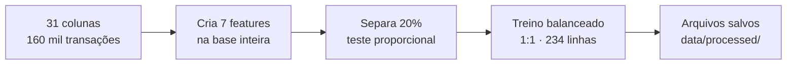
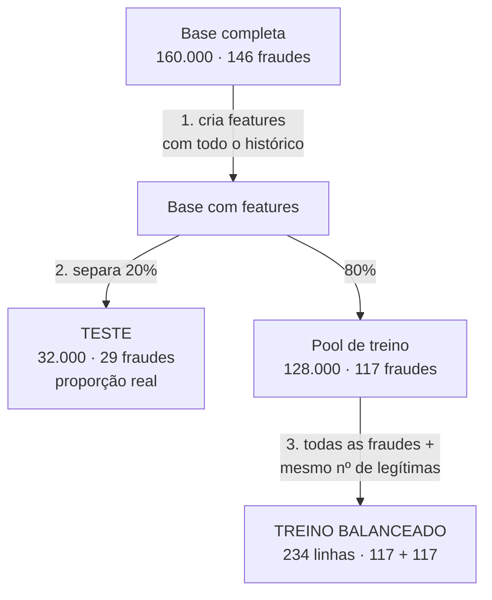

# Base Balanceada: Prevenção a Fraudes em Cartões (Sicredi)

> **Trilha 4, IBM AI Experiential Learning Lab 2026:** *Como podemos utilizar IA Agêntica para prever e intervir em possíveis fraudes relacionadas a compras com cartões, aumentando a segurança dos associados e reduzindo perdas para o Sicredi?*

## Sumário

1. [Introdução](#1-introdução)
2. [Linha de raciocínio](#2-linha-de-raciocínio)
3. [Construção da base balanceada](#3-construção-da-base-balanceada)
4. [Features criadas](#4-features-criadas)
5. [Conclusão](#5-conclusão)

---

## 1. Introdução

Este documento continua de onde a [Análise Exploratória](01_analise_exploratoria.md) parou. Lá, respondemos o que diferencia uma fraude de uma compra legítima e quais colunas são confiáveis. Aqui, transformamos essas conclusões em uma base pronta para o modelo: criamos as features, balanceamos o treino e separamos um teste com a proporção real de fraudes.

**O ponto de partida.**

| | |
|---|---|
| Base de origem | 160.000 transações · 146 fraudes (0,09%) |
| Colunas disponíveis | 31 (após triagem da EDA) |
| Objetivo | Gerar treino balanceado 1:1 + teste com proporção real |

**O notebook deste documento.**

| Notebook | Conteúdo |
|---|---|
| [`02_base_balanceada.ipynb`](../notebooks/02_base_balanceada.ipynb) | Criação de features e montagem das bases de treino/teste |

---

## 2. Linha de raciocínio

A ordem dos passos não é arbitrária — cada etapa depende do que veio antes. Os detalhes estão nas seções abaixo.

---

## 3. Construção da base balanceada

Com 146 fraudes em 160 mil transações, um modelo que responde "nunca é fraude" acerta 99,9% e não serve para nada. O desbalanceamento precisa ser tratado — mas com cuidado para não distorcer a avaliação.

**Por que a ordem importa:**

| Cuidado | Por quê |
|---|---|
| **Features antes do sorteio** | `valor_vs_media_cartao` (valor ÷ média histórica do cartão) precisa de todo o histórico disponível. Calculado depois do sorteio, o resultado muda |
| **Teste com proporção real** | Num teste 50/50, uma precisão de 90% pode ser menos de 5% no mundo real. O modelo deve ser avaliado como vai operar de fato |
| **Conferir a amostra sorteada** | As 117 legítimas sorteadas representam as 160 mil: valor médio R$ 63 vs. R$ 60 na base completa; 32% de crédito não presente vs. 29% |

**Por que não separar por data?** O ideal seria treinar com o passado e testar com o futuro. Mas neste arquivo **todas as fraudes estão em jan–mar**, e um corte temporal deixaria o teste sem fraudes. Usamos sorteio estratificado e voltamos ao corte temporal se a base completa permitir.

**Arquivos gerados** (`data/processed/`):

| Arquivo | Linhas | Fraudes |
|---|---|---|
| `treino_balanceado.csv` | 234 | 117 (50%) |
| `teste_proporcao_real.csv` | 32.000 | 29 (0,09%) |
| `dicionario_base_modelo.csv` | — | dicionário das 35 colunas |

---

## 4. Features criadas

Cada feature nova traduz diretamente um dos 5 insights da EDA. Todas usam **apenas informação disponível no momento da compra** — sem vazar o futuro.

| Feature | Sinal da EDA | Como é calculada |
|---|---|---|
| `hora` | Horários concentrados | Hora extraída do timestamp da transação |
| `dia_semana` | Padrão temporal | Dia da semana (0 = segunda, 6 = domingo) |
| `madrugada` | **100% das fraudes entre 0h e 4h** | 1 se hora ∈ [0, 4), 0 caso contrário |
| `cnp_credito` | **83% das fraudes são crédito sem cartão presente** | 1 se crédito **e** cartão não presente, 0 caso contrário |
| `valor_vs_media_cartao` | Fraude vale 3,9× a média do cartão | Valor ÷ média das compras **anteriores** do mesmo cartão |
| `primeira_compra_cartao` | 70% das fraudes ocorrem na 1ª compra | 1 se o cartão não tem compra anterior na base |
| `valor_vs_limite` | Valor alto para o perfil do associado | Valor ÷ limite do cartão |

> `valor_vs_media_cartao` fica `NaN` quando é a primeira compra do cartão — não há histórico para calcular. Por isso `primeira_compra_cartao` existe como flag separado.

---

## 5. Conclusão

**O que foi feito.** Partindo das 31 colunas selecionadas na EDA, criamos 7 features que traduzem os insights em números, montamos um treino balanceado 1:1 e separamos um teste com a proporção real de fraudes.

**Decisões principais:**
1. **Features calculadas na base inteira**, antes do sorteio — garante que o histórico do cartão esteja completo.
2. **Teste com proporção real (0,09%)** — o modelo será avaliado como vai operar, não num cenário artificial de 50/50.
3. **Treino 1:1 (117 fraudes + 117 legítimas)** — dá ao modelo exemplos suficientes de fraude sem distorcer a avaliação.

O próximo passo está documentado em [03 — Modelo](03_modelo.md): usar essas bases para treinar e avaliar um classificador.
