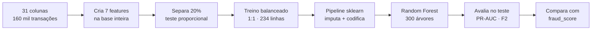
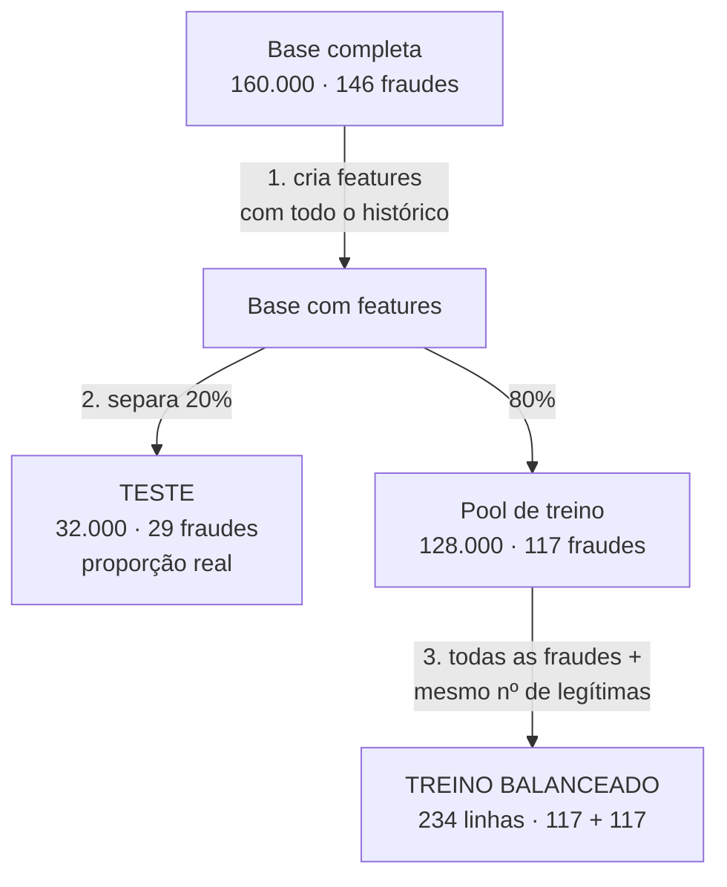
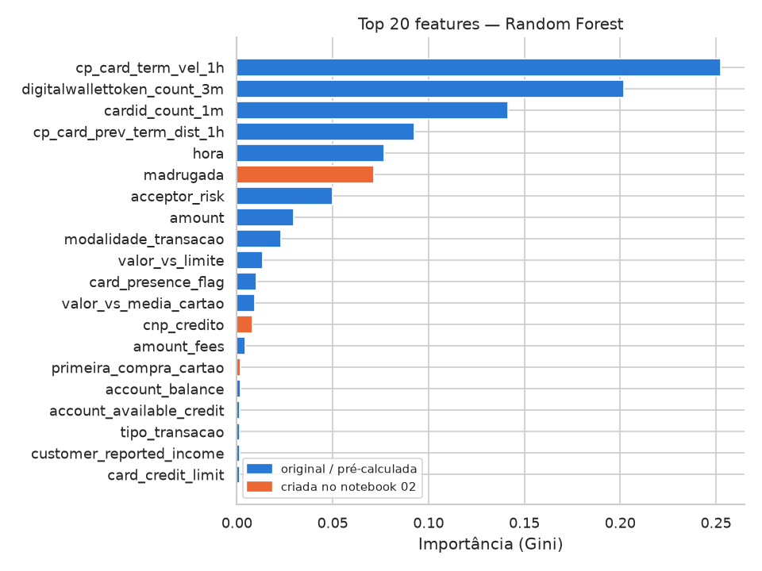

# Base Balanceada e Modelo: Prevenção a Fraudes em Cartões (Sicredi)

> **Trilha 4, IBM AI Experiential Learning Lab 2026:** *Como podemos utilizar IA Agêntica para prever e intervir em possíveis fraudes relacionadas a compras com cartões, aumentando a segurança dos associados e reduzindo perdas para o Sicredi?*

## Sumário

1. [Introdução](#1-introdução)
2. [Linha de raciocínio](#2-linha-de-raciocínio)
3. [Construção da base balanceada](#3-construção-da-base-balanceada)
4. [Features criadas](#4-features-criadas)
5. [O modelo](#5-o-modelo)
6. [Avaliação e comparação com o baseline](#6-avaliação-e-comparação-com-o-baseline)
7. [Limiar de decisão](#7-limiar-de-decisão)
8. [Análise crítica](#8-análise-crítica)

---

## 1. Introdução

Este documento continua de onde a [Análise Exploratória](01_analise_exploratoria.md) parou. Lá, respondemos o que diferencia uma fraude de uma compra legítima e quais colunas são úteis. Aqui, transformamos essas conclusões em uma base pronta para o modelo e treinamos um classificador.

**O ponto de partida.**

| | |
|---|---|
| Base de origem | 160.000 transações · 146 fraudes (0,09%) |
| Colunas disponíveis | 31 (após triagem da EDA) |
| Objetivo | Gerar treino balanceado + teste com proporção real e treinar o modelo |

**Os notebooks deste documento.**

| Notebook | Conteúdo |
|---|---|
| [`02_base_balanceada.ipynb`](../notebooks/02_base_balanceada.ipynb) | Criação de features e montagem das bases de treino/teste |
| [`03_modelo.ipynb`](../notebooks/03_modelo.ipynb) | Treinamento, avaliação e análise crítica do modelo |

---

## 2. Linha de raciocínio

Cada passo tem uma decisão técnica que explica a ordem — detalhada nas seções abaixo.

---

## 3. Construção da base balanceada

Com 146 fraudes em 160 mil transações, um modelo que responde "nunca é fraude" acerta 99,9% e não serve para nada. O desbalanceamento precisa ser tratado — mas com cuidado para não distorcer a avaliação.

**Por que a ordem importa:**

| Cuidado | Por quê |
|---|---|
| **Features antes do sorteio** | `valor_vs_media_cartao` (valor ÷ média histórica do cartão) precisa de todo o histórico disponível. Calculado depois do sorteio, o resultado muda |
| **Teste com proporção real** | Num teste 50/50, uma precisão de 90% pode ser menos de 5% no mundo real. O modelo é avaliado como vai operar de fato |
| **Conferir a amostra sorteada** | As 117 legítimas sorteadas representam as 160 mil: valor médio R$ 63 vs. R$ 60 na base completa; 32% de crédito não presente vs. 29% |

**Por que não separar por data?** O ideal seria treinar com o passado e testar com o futuro. Mas neste arquivo **todas as fraudes estão em jan–mar**, e um corte temporal deixaria o teste sem fraudes. Usamos sorteio estratificado e voltamos ao corte temporal se a base completa permitir.

**Arquivos gerados** (`data/processed/`):

| Arquivo | Linhas | Fraudes |
|---|---|---|
| `treino_balanceado.csv` | 234 | 117 (50%) |
| `teste_proporcao_real.csv` | 32.000 | 29 (0,09%) |
| `dicionario_base_modelo.csv` | — | dicionário das 35 colunas |

---

## 4. Features criadas

Cada feature nova traduz diretamente um dos 5 insights da EDA. Todas usam **apenas informação disponível no momento da compra** — sem vazar o futuro.

| Feature | Sinal da EDA | Como é calculada |
|---|---|---|
| `hora` | Horários concentrados | Hora extraída do timestamp da transação |
| `dia_semana` | Padrão temporal | Dia da semana (0 = segunda, 6 = domingo) |
| `madrugada` | **100% das fraudes entre 0h e 4h** | 1 se hora ∈ [0, 4), 0 caso contrário |
| `cnp_credito` | **83% das fraudes são crédito sem cartão presente** | 1 se crédito **e** cartão não presente, 0 caso contrário |
| `valor_vs_media_cartao` | Fraude vale 3,9× a média do cartão | Valor ÷ média das compras **anteriores** do mesmo cartão |
| `primeira_compra_cartao` | 70% das fraudes ocorrem na 1ª compra | 1 se o cartão não tem compra anterior na base |
| `valor_vs_limite` | Valor alto para o perfil do associado | Valor ÷ limite do cartão |

> `valor_vs_media_cartao` fica `NaN` quando é a primeira compra do cartão — não há histórico para calcular. Por isso `primeira_compra_cartao` existe como flag separado.

---

## 5. O modelo

**Por que Random Forest?** Lida bem com dados mistos (numéricos + categóricos), nulos imputados, escalas diferentes e o desbalanceamento residual. É fácil de explicar: a importância das features é direta e legível para o agente justificar um alerta.

### Pipeline de pré-processamento

Antes do modelo, cada grupo de colunas passa por uma transformação específica:

| Grupo | Transformação | Motivo |
|---|---|---|
| **Numéricas** (16 colunas) | Imputa com a mediana | Robusto a outliers de valor e renda |
| **Categóricas** (9 colunas) | Converte para `str` → imputa `"desconhecido"` → OrdinalEncoder | Colunas com nulos lidos do CSV ficam com tipos mistos (`float` + `str`); a conversão resolve antes do encoder |
| **Binárias** (3 colunas) | Imputa com `0` | Ausência do sinal = 0 é semanticamente correto |

### Hiperparâmetros

| Parâmetro | Valor | Decisão |
|---|---|---|
| `n_estimators` | 300 | Convergência estável |
| `max_depth` | 10 | Evita overfitting no treino pequeno (234 linhas) |
| `min_samples_leaf` | 2 | Idem |
| `class_weight` | `balanced` | Reforça a minoria mesmo com treino já 1:1 |
| `random_state` | 42 | Reprodutibilidade |

---

## 6. Avaliação e comparação com o baseline

> **Por que PR-AUC e não ROC-AUC?** Com 0,09% de fraudes no teste, um modelo que acerta 99,9% das legítimas pode ter ROC-AUC alto sem detectar nada. PR-AUC (Precision-Recall) penaliza essa falsa segurança.

| Modelo | PR-AUC | ROC-AUC |
|---|---|---|
| **Nosso modelo** | **1,000** | **1,000** |
| `fraud_score` (baseline externo) | 1,000 | 1,000 |
| `visa_fraud_score` | 0,956 | 0,968 |
| `mc_fraud_score` | 0,882 | 0,903 |

**Matriz de confusão** (com o limiar F2 ótimo):

| | Previsto: legítima | Previsto: fraude |
|---|---|---|
| **Real: legítima** | 31.971 (VN) | 0 (FP) |
| **Real: fraude** | 0 (FN) | 29 (VP) |

29 de 29 fraudes detectadas, zero falsos alarmes.

---

## 7. Limiar de decisão

O modelo retorna uma probabilidade entre 0 e 1. O **limiar** define a partir de qual valor a transação é bloqueada. Escolher esse ponto é uma decisão de negócio:

- **Limiar baixo** → mais alertas → mais fraudes capturadas → mais falsos alarmes (associado incomodado)
- **Limiar alto** → menos alertas → menos falsos alarmes → mais fraudes passam

Usamos o **F2-score** (recall pesa 2× mais que precisão) como critério, porque o custo de deixar uma fraude passar é maior do que o de gerar um falso alarme.

| Métrica | Valor |
|---|---|
| Limiar ótimo (F2) | 0,817 |
| Precisão nesse limiar | 1,000 |
| Recall nesse limiar | 1,000 |

> O Sicredi pode ajustar esse limiar conforme a política de risco: aceitar mais falsos alarmes para garantir mais recall, ou o contrário.

---

## 8. Análise crítica

### PR-AUC = 1,0 é um sinal de alerta

Em produção real, fraudes e compras legítimas sempre se sobrepõem. Uma separação perfeita indica que o modelo encontrou um atalho — e encontrou.

As **4 features de velocidade pré-calculadas** dominam o modelo:

| Feature | Importância |
|---|---|
| `cp_card_term_vel_1h` | 25,4% |
| `digitalwallettoken_count_3m` | 20,0% |
| `cardid_count_1m` | 14,1% |
| `cp_card_prev_term_dist_1h` | 9,3% |
| **Total velocidade** | **68,8%** |

Essas colunas vieram prontas no dataset. Na base sintética, o gerador provavelmente as calculou com acesso à label ou as exagerou propositalmente para facilitar o exercício. O efeito é que elas **denunciam a fraude diretamente** — e qualquer modelo que as use vai parecer perfeito, inclusive o baseline `fraud_score`.

### O que as features da equipe valem?

As 7 features criadas (`madrugada`, `cnp_credito`, `valor_vs_media_cartao`, `valor_vs_limite`, `primeira_compra_cartao`, `hora`, `dia_semana`) respondem por apenas **~11% da importância** — não porque sejam fracas, mas porque as features de velocidade dominam antes delas ter chance. Para medir o poder real dessas features, o próximo passo é rodar o modelo sem as 4 pré-calculadas.

### Implicação para a proposta agêntica

O resultado reforça o argumento central da EDA: **detectar a fraude nesta base já é um problema quase resolvido**. O valor diferencial está no depois do alerta:

| Etapa | O que o agente faz | O que sustenta |
|---|---|---|
| Avaliar | Calcula o score da transação com o modelo | PR-AUC e limiar F2 |
| Explicar | "Compra de R$ 800 às 3h, 4× acima do seu padrão, em loja online de alto risco" | Features `madrugada`, `valor_vs_media_cartao`, `acceptor_risk` |
| Decidir | Bloquear, pedir confirmação ao associado ou liberar | Score + limiar + regras de negócio |
| Comunicar | Alerta em tempo real para o associado validar | Insight 5 da EDA: agir na 1ª transação |

**Limitações e próximos passos:**
- [ ] Rodar o modelo **sem as 4 features de velocidade** para avaliar o poder real das features construídas.
- [ ] Obter a base completa (900 mil linhas) e repetir treino e avaliação.
- [ ] Calibrar as probabilidades (Platt / Isotonic) para que o score seja uma probabilidade real.
- [ ] Definir o custo em R$ de fraude perdida vs. falso alarme e recalcular o limiar.
- [ ] Empacotar o modelo como função que o agente chama em tempo real.
