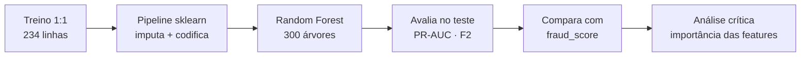
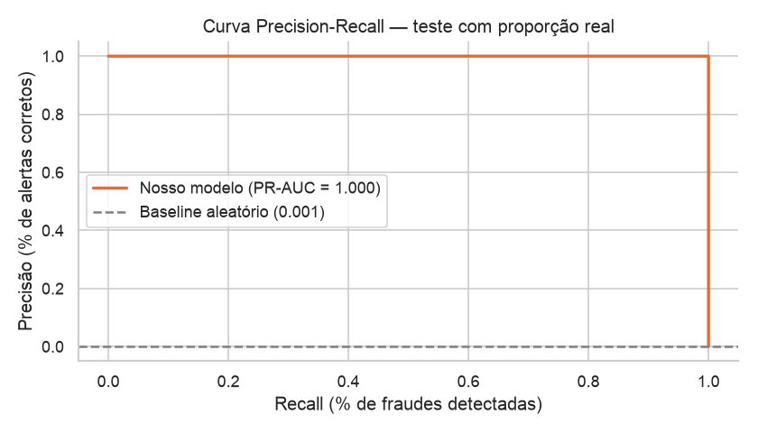
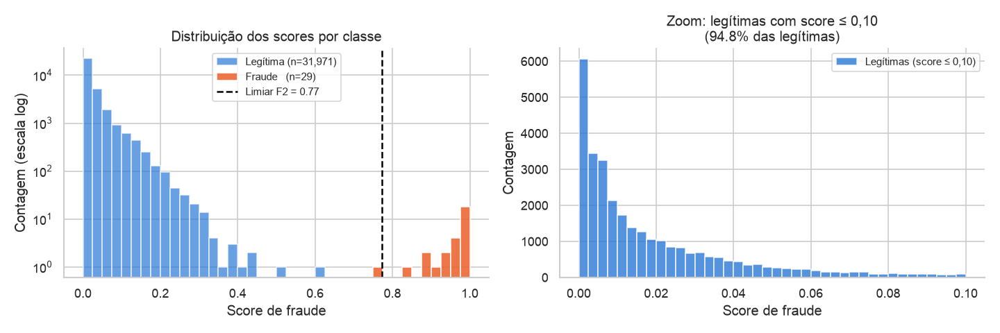
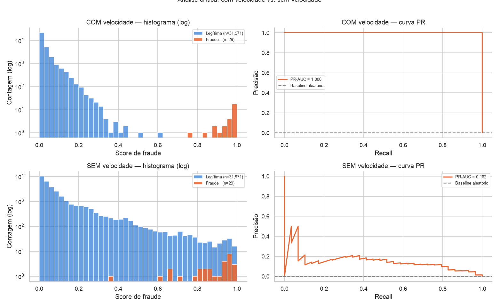
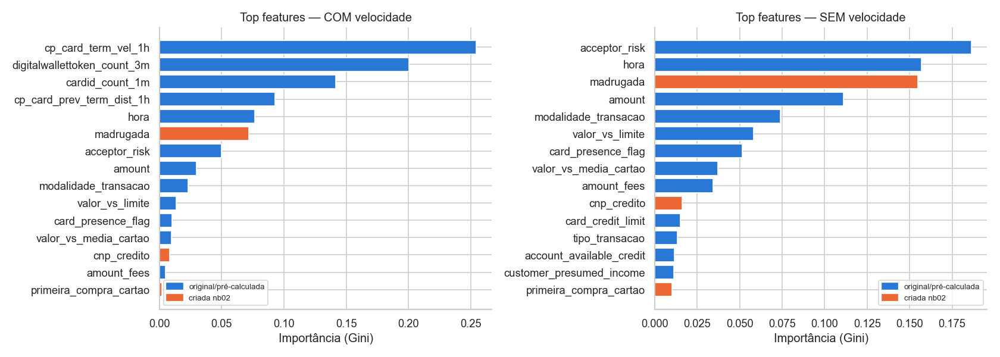

# Modelo: Prevenção a Fraudes em Cartões (Sicredi)

> **Trilha 4, IBM AI Experiential Learning Lab 2026:** *Como podemos utilizar IA Agêntica para prever e intervir em possíveis fraudes relacionadas a compras com cartões, aumentando a segurança dos associados e reduzindo perdas para o Sicredi?*

## Sumário

1. [Introdução](#1-introdução)
2. [Linha de raciocínio](#2-linha-de-raciocínio)
3. [O modelo](#3-o-modelo)
4. [Avaliação e comparação com o baseline](#4-avaliação-e-comparação-com-o-baseline)
5. [Distribuição dos scores: o modelo está decidido?](#5-distribuição-dos-scores-o-modelo-está-decidido)
6. [Limiar de decisão](#6-limiar-de-decisão)
7. [Análise crítica](#7-análise-crítica)

---

## 1. Introdução

Este documento cobre o treinamento e a avaliação do classificador de fraudes. As bases usadas aqui foram preparadas no documento anterior — [02 — Base Balanceada](02_base_balanceada.md).

**O ponto de partida.**

| | |
|---|---|
| Treino | `treino_balanceado.csv` · 234 linhas · 50% fraudes |
| Teste | `teste_proporcao_real.csv` · 32.000 linhas · 0,09% fraudes |
| Features | 31 (24 originais + 7 criadas) |

**O notebook deste documento.**

| Notebook | Conteúdo |
|---|---|
| [`03_modelo.ipynb`](../notebooks/03_modelo.ipynb) | Pré-processamento, treinamento, avaliação e análise crítica |

---

## 2. Linha de raciocínio

---

## 3. O modelo

**Por que Random Forest?** Lida bem com dados mistos (numéricos + categóricos), nulos imputados, escalas diferentes e desbalanceamento residual. A importância das features é nativa e direta — o agente pode usá-la para justificar um alerta em linguagem natural.

### Pipeline de pré-processamento

Antes de entrar no modelo, cada grupo de colunas passa por uma transformação:

| Grupo | Colunas | Transformação | Motivo |
|---|---|---|---|
| **Numéricas** | 16 | Imputa com a mediana | Robusto a outliers de valor e renda |
| **Categóricas** | 9 | Converte para `str` → imputa `"desconhecido"` → OrdinalEncoder | Colunas com nulos lidos do CSV ficam com tipos mistos (`float` + `str`); a conversão resolve antes do encoder |
| **Binárias** | 3 | Imputa com `0` | Ausência do sinal = 0 é semanticamente correto |

### Hiperparâmetros

| Parâmetro | Valor | Decisão |
|---|---|---|
| `n_estimators` | 300 | Convergência estável |
| `max_depth` | 10 | Evita overfitting no treino pequeno (234 linhas) |
| `min_samples_leaf` | 2 | Idem |
| `class_weight` | `balanced` | Reforça a minoria mesmo com treino já 1:1 |
| `random_state` | 42 | Reprodutibilidade |

---

## 4. Avaliação e comparação com o baseline

> **Por que PR-AUC e não ROC-AUC?** Com 0,09% de fraudes no teste, um modelo que acerta 99,9% das legítimas pode ter ROC-AUC alto sem detectar nada. PR-AUC (Precision-Recall) penaliza essa falsa segurança.

| Modelo | PR-AUC | ROC-AUC |
|---|---|---|
| **Nosso modelo** | **1,000** | **1,000** |
| `fraud_score` (baseline externo) | 1,000 | 1,000 |
| `visa_fraud_score` | 0,956 | 0,968 |
| `mc_fraud_score` | 0,882 | 0,903 |

**Matriz de confusão** (com o limiar F2 ótimo):

| | Previsto: legítima | Previsto: fraude |
|---|---|---|
| **Real: legítima** | 31.971 (VN) | 0 (FP) |
| **Real: fraude** | 0 (FN) | 29 (VP) |

29 de 29 fraudes detectadas, zero falsos alarmes.

---

## 5. Distribuição dos scores: o modelo está decidido?

Um bom classificador não é só aquele que acerta — é aquele que **sabe quando está certo**. Se as probabilidades se concentrarem perto de 0 e de 1, o modelo está decidido: separa as classes com confiança. Se ficarem empilhadas no meio (~0,5), ele está em dúvida.

O painel da esquerda mostra os histogramas em escala logarítmica (necessário porque há 31.971 legítimas e apenas 29 fraudes). O painel da direita é um zoom nas legítimas com score ≤ 0,10 para mostrar onde elas se concentram.

| Medida | Legítimas | Fraudes |
|---|---|---|
| Score médio | 0,022 | 0,967 |
| Score mínimo | 0,000 | **0,817** |
| Score máximo | 0,573 | 1,000 |

**O modelo está completamente decidido:** todas as legítimas ficam abaixo de 0,58 e todas as fraudes acima de 0,82 — sem nenhuma sobreposição. Isso confirma o PR-AUC = 1,000 e, ao mesmo tempo, reforça a suspeita de que as features de velocidade pré-calculadas estão "entregando" a resposta diretamente (ver seção 6).

---

## 6. Limiar de decisão

O modelo retorna uma probabilidade entre 0 e 1. O **limiar** define a partir de qual valor a transação é bloqueada. Escolher esse ponto é uma decisão de negócio:

- **Limiar baixo** → mais alertas → mais fraudes capturadas → mais falsos alarmes (associado incomodado)
- **Limiar alto** → menos alertas → menos falsos alarmes → mais fraudes passam

Usamos o **F2-score** (recall pesa 2× mais que precisão) como critério, porque o custo de deixar uma fraude passar é maior do que o de gerar um falso alarme.

| Métrica | Valor |
|---|---|
| Limiar ótimo (F2) | 0,817 |
| Precisão nesse limiar | 1,000 |
| Recall nesse limiar | 1,000 |

> O Sicredi pode ajustar esse limiar conforme a política de risco: aceitar mais falsos alarmes para garantir mais recall, ou o contrário.

---

## 7. Análise crítica

Para responder se o PR-AUC = 1,000 é real ou artefato, re-treinamos o modelo **sem as 4 features de velocidade pré-calculadas** e comparamos tudo: métricas, distribuição de scores, importância e separação das classes.

### Comparação de métricas

| Modelo | PR-AUC | ROC-AUC |
|---|---|---|
| **Com velocidade** | **1,000** | **1,000** |
| **Sem velocidade** | **0,144** | 0,994 |
| `fraud_score` (baseline) | 1,000 | 1,000 |
| `visa_fraud_score` | 0,956 | 0,968 |
| `mc_fraud_score` | 0,882 | 0,903 |

**O PR-AUC caiu de 1,000 para 0,144** ao remover as 4 colunas de velocidade. Isso confirma: as features de velocidade eram um atalho — o modelo as usava para "ler" a fraude diretamente, não para generalizar um padrão.

O ROC-AUC permaneceu em 0,994 porque essa métrica é menos sensível ao desbalanceamento; o PR-AUC é a métrica correta aqui.

### Distribuição de scores e curvas PR

| | COM velocidade | SEM velocidade |
|---|---|---|
| Score médio — legítimas | 0,022 | 0,101 |
| Score médio — fraudes | 0,967 | 0,866 |
| Score mínimo — fraudes | 0,817 | 0,344 |
| Score máximo — legítimas | 0,573 | **0,990** |
| Sobreposição entre classes | **Não** | **Sim** |

Sem velocidade, legítimas e fraudes se misturam: o score máximo de uma legítima (0,990) ultrapassa o score mínimo de uma fraude (0,344). O modelo está em dúvida em boa parte das predições.

### Importância das features: o que sobe quando a velocidade sai

Sem as 4 colunas de velocidade, as features construídas pela equipe assumem o comando — `hora`, `madrugada`, `acceptor_risk`, `amount` e `valor_vs_media_cartao` passam a dominar. Isso mostra que **elas têm sinal real**, mas esse sinal sozinho não é suficiente para separar as classes com perfeição nesta base sintética.

### O que as features da equipe valem?

As 7 features criadas (`madrugada`, `cnp_credito`, `valor_vs_media_cartao`, `valor_vs_limite`, `primeira_compra_cartao`, `hora`, `dia_semana`) respondem por **~11% da importância no modelo com velocidade** — não porque sejam fracas, mas porque a velocidade domina antes delas ter chance. Sem a velocidade, essas features sobem para o topo e mostram que os insights da EDA foram corretamente traduzidos em sinais preditivos.

O PR-AUC de 0,144 sem velocidade indica, porém, que **sozinhas elas não são suficientes** nesta base sintética. O caminho para um modelo robusto é obter a base completa (900k linhas) e aplicar feature engineering mais rico — mais histórico por cartão, mais variação nos padrões de fraude.

### Implicação para a proposta agêntica

O experimento reforça o argumento central da EDA: **detectar a fraude nesta base já é um problema quase resolvido pelas features prontas**. O diferencial da solução não está no classificador em si, mas no que acontece depois do alerta — explicar o motivo ao associado, pedir confirmação e tomar a decisão de bloquear ou liberar. É aí que a IA agêntica agrega valor real.

**Limitações e próximos passos:**
- [ ] Obter a base completa (900 mil linhas) e repetir treino e avaliação.
- [ ] Testar sem as features de velocidade na base completa — com mais histórico, `valor_vs_media_cartao` e `hora` devem ganhar mais poder.
- [ ] Calibrar as probabilidades (Platt / Isotonic) para que o score seja uma probabilidade real.
- [ ] Definir o custo em R$ de fraude perdida vs. falso alarme e recalcular o limiar.
- [ ] Empacotar o modelo como função que o agente chama em tempo real.
