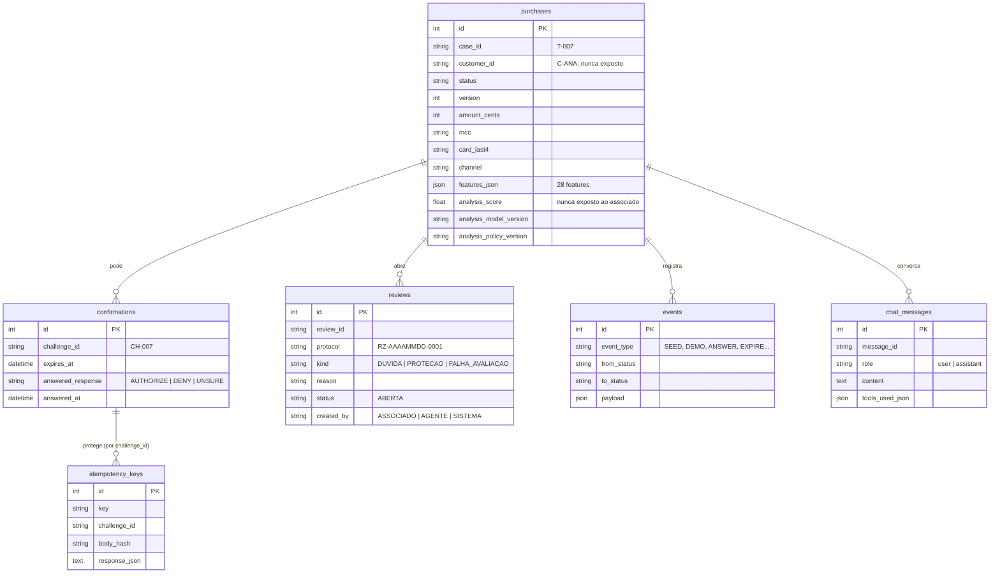

# Modelo de dados da aplicação

**Versão:** 1.0 · 04/11/2026 · **Estado:** descreve o código em `watson/backend/app/db/tables/purchases.py` e as migrações em `app/db/migrations/`.

O banco guarda o fluxo de **confirmação de compras pelo associado**: a compra, a análise do modelo, o pedido de confirmação, a resposta, as revisões humanas, a conversa com o agente e o histórico de eventos. O banco muda só pela `DATABASE_URL` (SQLite na demo; PostgreSQL ou Db2 pela mesma camada — [ADR 0002](../../03_computacao/arquitetura/decisoes/0002-banco-trocavel.md)).

> Este documento substitui a proposta v0.5 de 27/10, centrada no caso da analista (`fraud_case`, `alert`, `purchase_notice` e afins). Aquela proposta não foi implementada; está no histórico do Git.

## Diagrama



## Tabelas

| Tabela | O que guarda | Pontos de atenção |
|---|---|---|
| `purchases` | A compra sintética e a análise do modelo: valor em centavos, data, MCC, bandeira, final do cartão, canal, as 28 features e o resultado da avaliação (score, origem, versão do modelo e da política, lacunas) | `version` sobe a cada transição. `customer_id` e score nunca vão para a tela do associado |
| `confirmations` | O pedido de confirmação (`challenge_id`), o prazo e a resposta registrada | Uma resposta por pedido. Expiração verificada pelo servidor em cada leitura e resposta |
| `reviews` | Revisões humanas, com protocolo para o associado | `DUVIDA` (dúvida ou pedido de atendimento), `PROTECAO` (não reconhece), `FALHA_AVALIACAO` (modelo indisponível) |
| `events` | Trilha de auditoria imutável: cada transição ou ação, com estado anterior e novo | Estado e evento gravados na mesma transação |
| `chat_messages` | Perguntas do associado e respostas do agente, presas a uma compra | Guarda as ferramentas que o agente usou em cada resposta |
| `idempotency_keys` | Chave de idempotência da resposta à confirmação | Mesma chave e mesmo corpo devolvem o mesmo resultado; corpo diferente devolve 422 |

## Estados da compra

```
AGUARDANDO_ASSOCIADO ──AUTHORIZE──▶ LIBERADA_SIMULACAO
        │ ──DENY────────▶ RECUSADA_SIMULACAO  (+ revisão PROTECAO; o cartão não é bloqueado)
        │ ──UNSURE──────▶ REVISAO_PENDENTE    (+ revisão DUVIDA)
        └ ──prazo vence─▶ CONFIRMACAO_EXPIRADA (nada é liberado)

Falha do modelo na entrada ──▶ REVISAO_PENDENTE (+ revisão FALHA_AVALIACAO; sem pedido de confirmação; score nulo)
```

"Quero falar com alguém" abre uma revisão `DUVIDA`, mas **não** responde à confirmação nem estende o prazo. A política em uso é a **conservadora** do [plano](../../05_gestao/plano_implementacao.md) §3: toda compra avaliada pede confirmação. `LIBERADA_SIMULACAO` direta, sem confirmação, existe no contrato para quando o grupo validar um critério.

## Regras que o modelo garante

- **Identidade pela sessão:** o servidor deriva o associado da sessão; outro associado recebe 404 nas compras que não são dele.
- **Sem autorização pelo agente:** nenhuma ferramenta do agente grava `AUTHORIZE`, `DENY` ou `UNSURE`.
- **Sem score inventado:** se o modelo falha, o score fica nulo e a compra vai para revisão.
- **Minimização (LGPD):** só entram as colunas usadas pelo modelo e pela tela; documentos pessoais e número completo do cartão nunca entram, mesmo com dados sintéticos.
- **Persistência:** reiniciar a aplicação não apaga respostas, revisões nem conversas.

Contrato completo da API: [contrato_api.md](../../03_computacao/specs/contrato_api.md). Inventário de componentes: [D10](../../03_computacao/D10_arquitetura.md).
