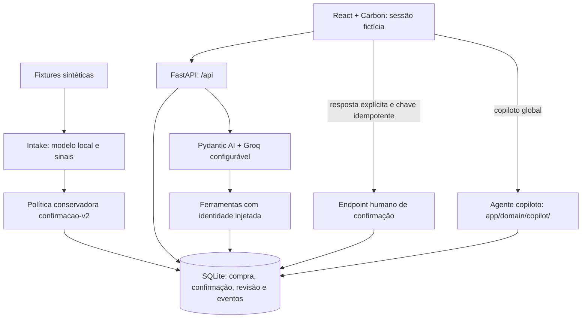
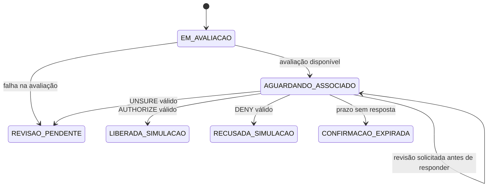

# D10 — Arquitetura técnica e limites de autonomia

**ID:** D10 · **Versão:** 0.3 · **Data:** 10/11/2026 (atualizado; base original 04/11/2026)\
**Responsável:** Arquitetura · **Revisor previsto:** Integração e validação\
**Estado:** revisado documentalmente contra develop `f741a35`; atualizado com copiloto do associado e nova interface da analista (PRs #28/#29); evidências de API em D11; LLM real e ensaio UI pendentes.\
**Fontes:** [D09](requisitos-da-solucao.md), [contrato JSON](specs/contrato-da-api.md), [código backend](../../../watson/backend/app), [cliente HTTP](../../../watson/frontend/src/api/client.js).\
**Decisão sustentada:** um agente com ferramentas e política externa, sem poder de resposta à confirmação.

## 1. Componentes



Padrão escolhido: um agente com quatro ferramentas é suficiente para consultar o contexto de uma compra e abrir revisão. A partir dos PRs #28/#29 foi adicionado um segundo agente — o copiloto global do associado — com ferramentas próprias (ver seção 3a). Política, autorização e transição ficam no backend. Alternativas RAG e múltiplos agentes não têm necessidade demonstrada neste recorte. Bob é ferramenta de desenvolvimento; watsonx.ai tem um teste histórico documentado e caminhos opcionais de risco, sem ser pressuposto do chat Groq atual.

## 2. Sequência da compra até a resposta

```mermaid
sequenceDiagram
    actor U as Associado
    participant F as React
    participant B as FastAPI
    participant DB as SQLite
    participant A as Agente
    U->>F: seleciona persona fictícia
    F->>B: POST /api/session {persona_id}
    B-->>F: sessão e cookie assinado
    F->>B: GET /api/purchases/T-007
    B->>DB: consulta vinculada ao associado
    B-->>F: purchase, alert, confirmation, version e status
    U->>F: dúvida contextual
    F->>B: POST /api/purchases/T-007/chat {message}
    B->>A: identidade/compra injetadas
    A->>DB: ferramenta abre sessão curta e consulta contexto
    A-->>B: explicação e ferramentas usadas
    B-->>F: reply estruturado e simulation
    U->>F: escolhe DENY
    F->>B: POST /api/confirmations/CH-007/response
    Note over F,B: Idempotency-Key no cabeçalho; response e version no JSON
    B->>DB: valida dono/prazo/versão, grava recusa e revisão de proteção
    B-->>F: RECUSADA_SIMULACAO e próximo passo
    F->>B: GET /api/purchases/T-007/status
    B-->>F: estado persistido
```

Chamadas ao LLM não mantêm a sessão de banco aberta. As ferramentas recebem o Engine e abrem sessões curtas (#18); o teste de lock cobre o agente de teste, não latência de provedor real.

## 3. Ficha do agente — chat da compra

| Campo | Regra |
|---|---|
| Objetivo | Esclarecer a compra selecionada sem pressionar uma decisão. |
| Implementação/configuração | `app/domain/agent/__init__.py`; `LLM_MODEL` padrão `groq:openai/gpt-oss-120b`; `GROQ_API_KEY` necessária. |
| Conhecimento | Somente retornos das ferramentas para customer_id/case_id injetados. Avaliação não expõe valor numérico de score ao agente. |
| Escolha de ferramentas | Compra/motivo → consultar_compra; prazo/status → consultar_status; avaliação → avaliar_transacao; atendimento → solicitar_revisao. |
| Instruções | Não inventar estabelecimento ou efeito financeiro; não pedir senha/PIN/cartão completo; sinais não provam causa do score; respostas em português. |
| Autonomia | Pode abrir revisão; não dispõe de ferramenta para AUTHORIZE/DENY/UNSURE. Ajuda não encerra confirmação válida nem estende prazo. |
| Falha | Chat pode retornar 503; resposta explícita válida continua disponível. Sem chave não há evidência de LLM real. |

## 3a. Ficha do copiloto do associado (PRs #28/#29)

O copiloto é um segundo agente Pydantic AI acessível pelo ícone no cabeçalho da interface do associado. Ele responde perguntas sobre qualquer compra da sessão, ao contrário do chat da compra que é contextualizado a uma compra específica.

| Campo | Regra |
|---|---|
| Objetivo | Responder perguntas gerais do associado sobre suas compras e status, sem pressionar uma decisão. |
| Implementação/configuração | `app/domain/copilot/`; mesma configuração de LLM (`LLM_MODEL`, `GROQ_API_KEY`). |
| Ferramentas | `listar_compras`, `consultar_compra`, `gerar_relatorio`, `solicitar_revisao`. |
| Autonomia | Pode listar compras e abrir revisão; não autoriza, recusa nem registra dúvida em nome do associado. Identidade injetada pelo backend. |
| Falha | Mesmo comportamento do chat: retorna indisponível sem impedir o fluxo de confirmação. |

## 4. Ferramentas implementadas

Versão de referência de todas: código `f741a35`, `app/domain/agent/__init__.py`. `RunContext` fornece dono, compra e Engine; o LLM não escolhe identidade nem outra compra.

| Ferramenta | Entrada do LLM | Saída / finalidade | Autorização e erro |
|---|---|---|---|
| consultar_compra | Nenhuma | Objetos purchase e alert com dados permitidos e sinais | Busca por dono+compra; erro se não encontrada. |
| consultar_status | Nenhuma | Status, confirmação e resultado conforme construtor de status | Mesmo vínculo de sessão; não lê compra alheia. |
| avaliar_transacao | Nenhuma | analysis_id, score_available, decision, policy_version, signals, gaps e evaluated_at | Análise gravada; sem valor numérico do score na saída atual; não inventa avaliação ausente. |
| solicitar_revisao | reason, details opcional | Revisão/protocolo, estado da compra e mensagem | Motivo inválido é normalizado para OUTRO; criada por AGENTE; compra não encontrada retorna erro; não responde à confirmação. |

> **Alinhamento de 05/11/2026:** login por e-mail/senha fictícios e decisão da analista conferidos no código; sem nova execução de backend nesta atualização.
> **Atualização de 10/11/2026 (PRs #28/#29):** copiloto do associado adicionado (seção 3a); interface da analista expandida com abas Pendentes, Histórico, Fluxo atual e Dados, e justificativa obrigatória nas decisões. Esses componentes não estavam presentes na base `f741a35` e não têm cobertura de teste documentada separadamente.

## 5. Contratos HTTP

O [contrato completo](specs/contrato-da-api.md) e os schemas são a referência; os exemplos abaixo são requisições mínimas, não transcrição parcial apresentada como resposta completa.

| Operação | Endpoint | Dados |
|---|---|---|
| Listar personas fictícias | GET /api/session/personas | Público |
| Iniciar/consultar/encerrar sessão | POST /api/session; GET /api/session; DELETE /api/session | POST com e-mail/senha fictícios; cookie assinado. `persona_id` é compatibilidade legada desabilitada por padrão |
| Listar/abrir compra | GET /api/purchases; GET /api/purchases/{case_id} | Dono derivado da sessão |
| Consultar status | GET /api/purchases/{case_id}/status | Polling; inclui expiração |
| Responder | POST /api/confirmations/{challenge_id}/response | JSON com response/version; cabeçalho Idempotency-Key |
| Histórico/enviar chat | GET/POST /api/purchases/{case_id}/chat | POST com message (1–1000 caracteres) |
| Solicitar revisão | POST /api/purchases/{case_id}/review | reason e details opcional |
| Exceções da analista | GET /api/reviews | Exige papel ANALISTA |
| Decisão da analista | POST /api/reviews/{review_id}/decision | AUTHORIZE ou DENY; encerra revisões abertas e atualiza a compra na simulação |
| Reiniciar demonstração | POST /api/demo/reset | Só com DEMO_MODE=true; apaga dados de demo e recarrega fixtures |

Exemplo humano, preservando a mesma chave em um retry do mesmo corpo:

```http
POST /api/confirmations/CH-007/response
Content-Type: application/json
Idempotency-Key: 4e42a9f4-3087-4364-9bea-2bfb1f534bfe

{"response":"DENY","version":1}
```

A versão deve vir do detalhe atual, não ficar fixa em produção. O schema de resposta inclui challenge_id, case_id, response, answered_at, version, status, status_label, review_protocol, result, replayed e simulation. Ausência de Idempotency-Key retorna 428; conflito/versão antiga usa 409; reutilização incompatível da chave usa 422; prazo expirado usa 410, conforme testes/contrato.

```http
POST /api/purchases/T-007/chat
Content-Type: application/json

{"message":"O que significa este estabelecimento?"}
```

A resposta de chat contém case_id, user_message, reply (objeto com content e tools_used), review_protocol e simulation. Não há POST /chat solto nem challenge_id no corpo dessa requisição.

## 6. Política e estados

Política atual: score disponível → SOLICITAR_CONFIRMACAO; avaliação indisponível → revisão de falha. Não apresentar o limiar do classificador como política de liberação bancária.



DENY abre revisão de proteção separada e mantém RECUSADA_SIMULACAO. UNSURE registra dúvida e leva a REVISAO_PENDENTE. Pedido de atendimento abre/reaproveita revisão sem registrar UNSURE nem reiniciar o prazo. Chave idempotente e versão impedem duplicação/sobrescrita conforme o contrato.

## 7. Persistência e falhas

`app/db/tables/purchases.py` contém compras, confirmações, respostas, revisões, conversas e eventos. A resposta e seus efeitos são transacionais. SQLite é padrão; DATABASE_URL permite outros drivers, cuja execução não foi demonstrada nesta revisão.

| Falha | Resultado esperado e verificação |
|---|---|
| Modelo ausente/erro | Análise indisponível e revisão; sem score inventado; testes de intake/análise |
| LLM indisponível | 503 explícito; confirmação válida continua; testes chat |
| Dono incorreto ou sessão inválida | 404/401 conforme recurso; testes acesso cruzado |
| Prazo/versão/chave inválidos | Rejeição sem autorização indevida; testes confirmations |
| Reinício | Banco durável mantém resposta e histórico; teste com segunda instância. Em deploy, configurar volume persistente. |
| Banco indisponível | Nenhuma escrita parcial deve ser aceita; requer ensaio de infraestrutura para o deploy escolhido. |

## 8. Evidências e aceite

[D11](reproducao-e-testes-do-fluxo.md) e [índice de evidências](../evidencias/README.md) registram a execução de testes desta revisão. O teste histórico de watsonx.ai está na [spec](specs/teste-historico-watsonx.md); não foi repetido. Ainda faltam rastro com LLM real, revisão técnica cruzada e ensaio UI por outro integrante. A arquitetura descreve o código presente e deixa esses limites explícitos.
