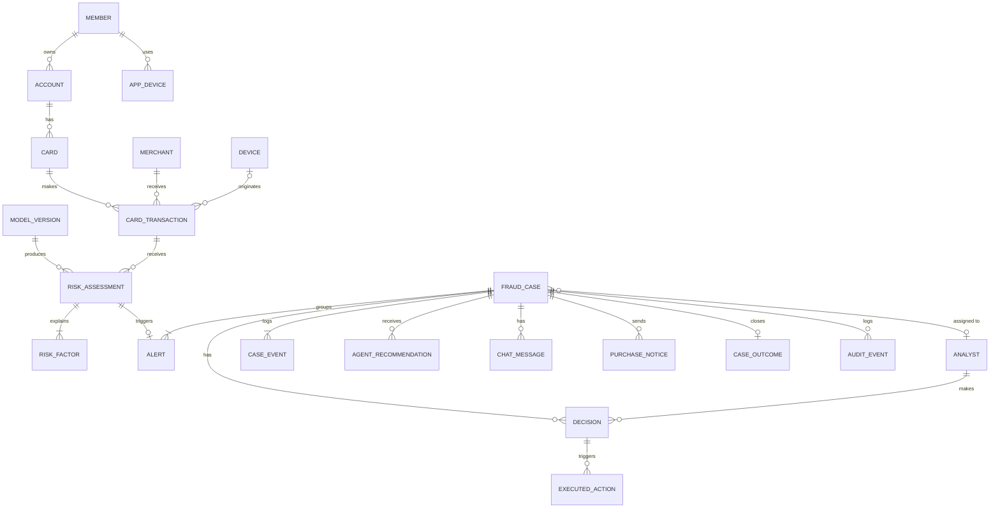

# Modelo de dados inicial do Watson (proposta v0.3)

> Proposta para discussão com o time, não é o schema final. Modelo **relacional** (ex.: PostgreSQL ou IBM Db2), porque o núcleo é transacional e auditável: casos, decisões e respostas precisam de integridade e histórico.
>
> **Nomes:** tabelas, colunas e valores de enum em **inglês**, `snake_case`, como as rotas e o código (decisão do Leo em 27/10/2026). Explicações e textos de tela continuam em português, com os termos do [glossário](../design/glossario.md). A [correspondência](#correspondencia) fica no fim. Toda tabela tem `id` e `created_at`; omitimos isso abaixo para encurtar.

## Visão geral: três blocos

| Bloco | Para que serve | Quem escreve |
|---|---|---|
| **A · Origem** | Retrato do associado, do cartão e das compras | Carga dos sistemas da cooperativa (no MVP, o dataset do case). Watson só lê. |
| **B · Risco** | Score, fatores explicáveis e versão do modelo | Modelo de risco |
| **C · Análise** | Alerta, caso, eventos do caso, recomendação do agente, decisão, aviso de compra, auditoria | Watson, analista e associado |

## Diagrama

---

## Bloco A · Origem (espelho do case)

**member** (associado) · quem é o Valdir
| Coluna | Tipo | Coluna do case | Uso |
|---|---|---|---|
| id | texto (PK) | `customer_id` | |
| name | texto | `customer_name` | app ("Olá, Valdir") e console (abreviado: "V. B.") |
| city, region, country_code | texto | `customer_city`, `customer_region`, `customer_country_code` | divergência geográfica |
| member_since | data | `customer_registration_date` | "associado desde 2006" |
| segment | texto | `customer_segment` | perfil |
| risk_rating | decimal | `customer_risk_rating` | fator do modelo |
| phone_changed, email_changed | booleano | `customer_phone_change_flag`, `customer_email_change_flag` | contramedida SIM swap |

**account** (conta) · id (`account_id`), member_id (FK), type, status, credit_limit, available_credit.

**card** (cartão)
| Coluna | Tipo | Coluna do case | Uso |
|---|---|---|---|
| id | texto (PK) | `card_id` | |
| account_id | FK | | |
| last4 | texto(4) | `card_last4` | "cartão final 4821". **Nunca guardamos o PAN completo.** |
| brand, type, category | texto | `card_brand`, `card_type`, `card_category` | crédito / débito |
| status | enum | `card_status` | active, blocked_by_watson, cancelled. Muda quando a analista bloqueia |
| credit_limit | decimal | `card_credit_limit` | |

**merchant** (estabelecimento) · id (`acceptor_id`), name (`acceptor_name`), mcc, city, region, latitude, longitude, risk (`acceptor_risk`), risky_flag (`acceptor_risky_flag`), is_online (derivado de `acceptor_url` / canal).

**device** (dispositivo da compra, não do app) · id (`device_id`), fingerprint, ip_country_code, ip_latitude, ip_longitude, language, malware_flag, proxy_flag.

**app_device** (aparelho do app) · aparelhos em que o associado usa o app da cooperativa: member_id, device_identifier, registered_at, is_active. Não existe no case; precisamos simular. Base da regra "aparelho trocado recentemente manda o caso para a analista".

**card_transaction** (transação). Não usamos `transaction`, que é palavra reservada em SQL.
| Coluna | Tipo | Coluna do case | Uso |
|---|---|---|---|
| id | texto (PK) | `event_external_id` | |
| card_id, merchant_id, device_id | FK | `card_id`, `acceptor_id`, `device_id` | |
| occurred_at | data-hora | `event_occurred_at` (+ `local_datetime`) | linha do tempo, horário atípico |
| amount, currency_code | decimal, texto | `amount`, `currency_code` | fila risco × valor |
| type | enum | `tipo_transacao` | credit / debit |
| modality | texto | `modalidade_transacao` | |
| card_present | booleano | `card_presence_flag` | "cartão não presente" |
| terminal_city, terminal_latitude, terminal_longitude | | `terminal_city`, `terminal_latitude`, `terminal_longitude` | mapa e distância |
| has_3ds | booleano | `secure_3d_indicator` | fator |
| status | enum | `transaction_status` + Watson | approved, held, declined, under_review. "RETIDA" na linha do tempo |
| fraud_label | booleano | `feedback_label` | só para treino e avaliação; **nunca aparece na tela** |

> Terminal entra como colunas da transação no MVP (é quase sempre 1:1). Vira tabela se precisarmos analisar terminais.

---

## Bloco B · Risco

**model_version** (versão do modelo) · name, version, alert_threshold (ex.: 0,70), high_risk_threshold (0,80, como no glossário), trained_at, metrics (json: PR-AUC, recall, precisão), is_active. Toda avaliação aponta para a versão que a gerou, para auditoria e drift.

**risk_assessment** (avaliação de risco) · uma por transação por versão do modelo.
| Coluna | Tipo | Uso |
|---|---|---|
| transaction_id, model_version_id | FK | |
| score | decimal 0 a 1 | "0,92" (o **score de risco** do glossário) |
| risk_level | enum | low, medium, high (high = acima de 0,80); cor **e** texto na fila |
| signals | json | features calculadas no momento: tentativas do cartão em 10 min e 1 h, distância da última compra (km), valor ÷ média do associado, hora fora do padrão, dispositivo novo |
| assessed_at | data-hora | |

**risk_factor** (fator de risco) · o "Por que é suspeito".
| Coluna | Tipo | Exemplo |
|---|---|---|
| assessment_id | FK | |
| code | enum | BURST, DISTANCE, UNUSUAL_AMOUNT, UNUSUAL_HOUR, NEW_DEVICE, CARD_NOT_PRESENT, ONLINE_HISTORY |
| business_text | texto (pt-BR) | "Rajada: 5 compras em 7 min" |
| weight | decimal | +0,31 ou −0,03 |
| direction | enum | increases / decreases |
| display_order | inteiro | ordem de exibição |

---

## Bloco C · Análise (o coração do Watson)

**alert** (alerta) · gerado só pelo sistema, quando o score passa do limiar. A analista não trata alertas, trata casos. assessment_id (FK, única), case_id (FK), created_at. Um alerta por transação suspeita.

**fraud_case** (caso) · a unidade de trabalho da Camila (e o cartão no quadro). Não usamos `case`, que é palavra reservada em SQL. Na rota e no código fica `case` / `cases` (ex.: `/cases/4821`).
| Coluna | Tipo | Uso |
|---|---|---|
| case_number | inteiro sequencial | "Caso #4821" |
| card_id, member_id | FK | atalho para a tela; o caso é sempre de um cartão |
| status | enum | new, in_review, awaiting_member, escalated, resolved (colunas do quadro) |
| priority | decimal | risco × valor, ordena a fila |
| max_score, total_amount | decimal | somatório dos alertas agrupados ("R$ 1.980,00 em 7 min") |
| grouping_reason | texto | "3 alertas do mesmo cartão em 7 min" (nulo se 1 alerta) |
| analyst_id | FK, opcional | quem está com o caso |
| created_at | data-hora | o caso entra na fila (primeiro alerta) |
| opened_at | data-hora | a analista abre o caso pela primeira vez |
| decided_at | data-hora | a analista registra a decisão. **Tempo até a decisão = decided_at − created_at** |
| resolved_at | data-hora | o caso fecha (pode ser depois da decisão, ex.: esperando o desfecho) |

**case_event** (evento do caso) · o registro de eventos do caso, só de inclusão. case_id, type (created, alert_grouped, opened, status_changed, notice_sent, notice_answered, decided, resolved, reopened), from_status, to_status, actor_type (analyst / agent / member / system), actor_id, occurred_at. Os campos `created_at`, `opened_at` e `decided_at` do caso são cópias dos eventos `created`, `opened` e `decided`, para a fila e o KPI **Tempo até a decisão** não precisarem varrer o log. Também alimenta "aberto há 3 min" e o arrastar entre colunas do quadro.

**analyst** (analista) · name, email, role (analyst, supervisor), is_active. Login fica no provedor de identidade (ex.: IBM App ID), não aqui.

**agent_recommendation** (recomendação do agente) · pode haver várias por caso (o agente reavalia quando o associado responde).
| Coluna | Tipo | Uso |
|---|---|---|
| case_id | FK | |
| suggested_action | enum | block, release, escalate, send_purchase_notice |
| confidence_level, confidence_score | enum + decimal | low, medium, high (▮▮▮▮▯), a **confiança do agente** do glossário |
| summary | texto (pt-BR) | "Parece fraude com cartão não presente: 5 tentativas em 7 min..." |
| gaps | texto (pt-BR) | "Ainda não sei: o associado não foi contatado." |
| factors_used | lista de risk_factor | "Baseado nos fatores 1 a 3" |
| similar_cases_count | inteiro | "Lembra 38 fraudes confirmadas em 90 dias" |
| agent_version, prompt_version | texto | reprodutibilidade |
| is_current | booleano | só uma vigente por caso |

**chat_message** (mensagem da conversa) · painel "Pergunte ao Watson": case_id, author_type (analyst / agent), analyst_id, body, sent_at. Guardamos para auditoria e para melhorar o agente.

**decision** (decisão) · o momento "Confirmar bloqueio".
| Coluna | Tipo | Uso |
|---|---|---|
| case_id, analyst_id | FK | a decisão é sempre humana |
| action | enum | block, release, escalate (as decisões do glossário). "Perguntar ao associado" não é decisão: cria um aviso de compra e move o caso para `awaiting_member` |
| recommendation_id | FK | qual recomendação estava na tela |
| followed_recommendation | booleano | métrica de confiança no agente |
| generated_justification | texto | texto do agente, como veio |
| final_justification | texto | texto que a analista confirmou (pode ser igual) |
| decided_at | data-hora | |

**executed_action** (ação executada) · o que o sistema fez depois da decisão (ou sozinho, quando a regra permite, como "Não reconheço" bloqueia na hora): decision_id (opcional), case_id, type (block_card, decline_held, release_held, send_purchase_notice, unblock_card), target_id, result (ok / failed), executed_at, origin (analyst / agent / member).

**purchase_notice** (aviso de compra) · a mensagem "Foi você?" no app do associado. Para o associado nunca se chama "alerta".
| Coluna | Tipo | Uso |
|---|---|---|
| case_id, member_id | FK | |
| channel | enum | in_app (único canal com resposta; push só avisa, sem link) |
| sent_at, read_at, answered_at | data-hora | Hill 2: resposta em menos de 30 s |
| answer | enum | it_was_me ("Fui eu"), not_recognized ("Não reconheço"), talk_to_person ("Prefiro falar com uma pessoa"), no_answer |
| biometrics_required, biometrics_passed | booleano | atrito assimétrico |
| app_device_id | FK | de qual aparelho respondeu |
| recent_device_change | booleano | regra anti SIM swap: se verdadeiro, "Fui eu" não fecha o caso |

**case_outcome** (desfecho) · o rótulo final, um por caso: result (confirmed_fraud, legitimate, inconclusive), source (member, analyst, dispute), defined_at. Liga as métricas contra o Impostor ("Fui eu" em casos que viraram fraude) e o retreino do modelo.

**audit_event** (evento de auditoria) · registro só de inclusão (nunca se apaga nem se edita): actor_type, actor_id, action, entity, entity_id, before, after (json), occurred_at. Toda decisão, edição de justificativa, mudança de status e ação executada gera um evento.

---

## Regras que o modelo garante
1. **Decisão humana:** `decision.analyst_id` é obrigatório. O agente só grava em `agent_recommendation` e, nas regras permitidas, em `executed_action` com origem registrada.
2. **Um caso, um cartão:** o agrupamento junta só alertas do mesmo cartão.
3. **Explicabilidade rastreável:** toda recomendação aponta para os fatores e a versão do modelo e do agente que a geraram.
4. **Rótulo isolado:** `card_transaction.fraud_label` e `case_outcome` nunca vão para a tela da analista antes da decisão (evita vazamento e viés).
5. **Minimização:** sem PAN completo nem documentos pessoais.

## Volume esperado (dataset do case)
- 900 mil transações, cerca de 900 fraudes (0,1%).
- Com limiar de alerta perto do topo do score, algo como alguns milhares de alertas e menos casos ainda depois do agrupamento. As tabelas de análise são pequenas; a de transação é a única grande.

## Correspondência: código (inglês) ↔ glossário (português)

| Código | Termo em português | Rota sugerida |
|---|---|---|
| `member` | Associado | `/members/{id}` |
| `account` | Conta | |
| `card` | Cartão | `/cards/{id}` |
| `merchant` | Estabelecimento | |
| `device` | Dispositivo (da compra) | |
| `app_device` | Aparelho do app | |
| `card_transaction` | Transação | `/cards/{id}/transactions` |
| `model_version` | Versão do modelo | `/models` |
| `risk_assessment` · `score` | Avaliação de risco · **Score de risco** | |
| `risk_factor` | Fator de risco ("Por que é suspeito") | |
| `alert` | **Alerta** | `/alerts` |
| `fraud_case` | **Caso** | `/cases/{case_number}` |
| `case_event` | Evento do caso | `/cases/{n}/events` |
| `analyst` | Analista | |
| `agent_recommendation` · `confidence_level` | Recomendação do agente · **Confiança do agente** | `/cases/{n}/recommendation` |
| `chat_message` | Mensagem ("Pergunte ao Watson") | `/cases/{n}/messages` |
| `decision` | Decisão | `/cases/{n}/decision` |
| `executed_action` | Ação executada | |
| `purchase_notice` | **Aviso de compra** | `/cases/{n}/notices` |
| `case_outcome` | Desfecho | |
| `audit_event` | Evento de auditoria | |
| `awaiting_member` | **Aguardando associado** | |
| `decided_at − created_at` | **Tempo até a decisão** | `/metrics/time-to-decision` |

## Decisões em aberto (para o time)
1. **Banco:** PostgreSQL (simples, roda em qualquer lugar) ou IBM Db2 / Databases for PostgreSQL na IBM Cloud (conta ponto no desafio IBM)?
2. **Carga do case:** importar as 900 mil linhas no banco ou só um recorte (ex.: últimos 30 dias simulados) para a demo?
3. **Tempo real:** o MVP avalia transações "chegando" (simulação de stream) ou faz lote e abre os casos de uma vez?
4. **Aparelho do app:** como simular `app_device` e as trocas recentes, já que o case não traz isso?
5. **Limiares:** quem define `alert_threshold` e `high_risk_threshold`? Sai da análise de custo de fraude do time de dados?
6. **Conversa com o agente:** guardar todas as mensagens ou só as que entram na justificativa?
7. **Contestação (autofraude):** fica fora do MVP, como na anti-persona? Se entrar, ganha uma tabela própria.
