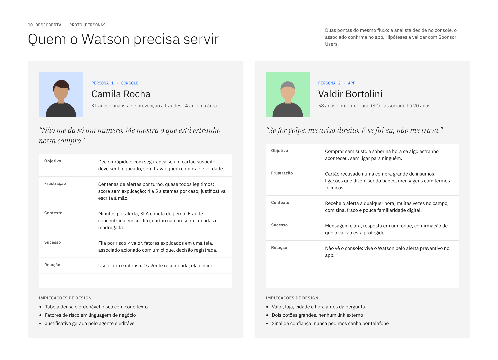
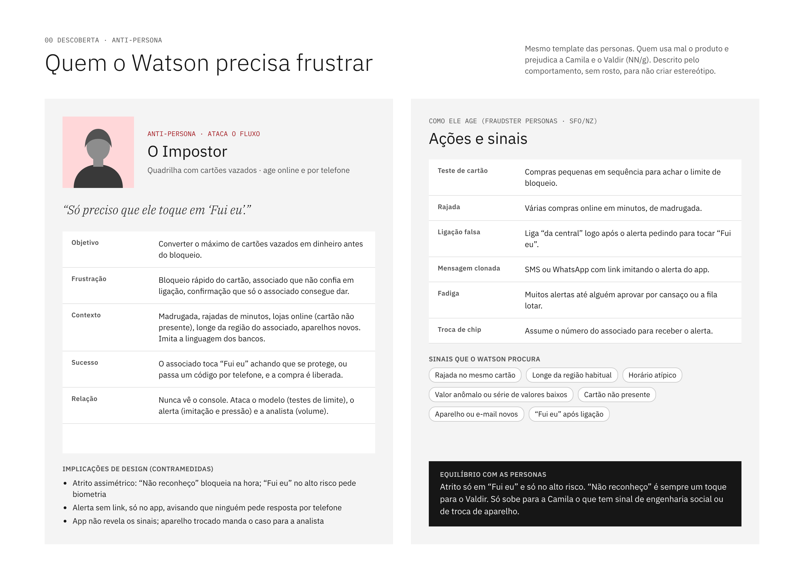
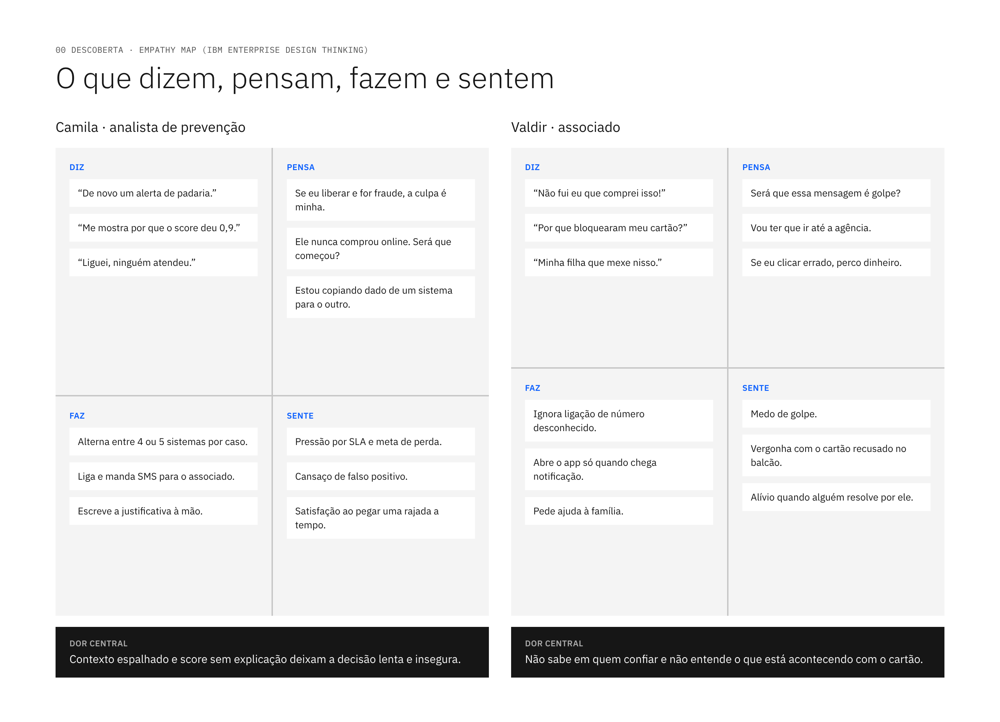
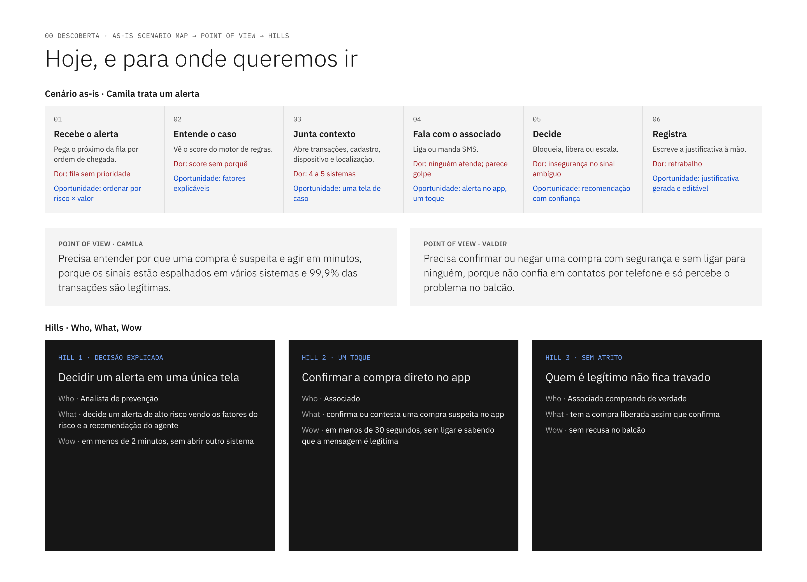

# 00 · Descoberta (Observe → Reflect)

Antes de desenhar telas: quem são as pessoas, o que vivem hoje e para onde queremos levá-las.

| Arquivo | Técnica IBM / UX |
|---|---|
| [personas.md](personas.md) | Proto-personas (NN/g) no formato do curso |
| [anti-persona.md](anti-persona.md) | Anti-persona (NN/g) + fraudster personas (SFO/NZ, CFPC/AU) |
| [mapas-de-empatia.md](mapas-de-empatia.md) | Empathy Map |
| [cenario-as-is.md](cenario-as-is.md) | As-is Scenario Map |
| [hills-e-pov.md](hills-e-pov.md) | Point of View, How Might We, Hills (Who/What/Wow) |
| [premissas-e-perguntas.md](premissas-e-perguntas.md) | Assumptions and Questions, Sponsor Users, roteiros de entrevista |

Versão visual: página **00 Descoberta** do canvas de design.

## Imagens

### Proto-personas

### Anti-persona

### Mapas de empatia

### Cenário as-is, POV e Hills

