# 02 · Mockup (Reflect → Make, Carbon)

**Decisão do Playback 2 (26/10/2026, Leo):** versão 3 "Agente sempre presente" com o tema da versão 1 "Carbon g10 clássico".

**Decisão do Playback 1 (26/10/2026, Leo):** B com a fila da A e o quadro da C para gerenciar o processo de análise.

## Técnicas aplicadas
- **Carbon Design System** e IBM Design Language (skill `ibm-estilo-materiais`): IBM Plex, 2x Grid, tokens, um primário por tela, status com cor + ícone + texto.
- **Carbon for AI**: AI label em todo conteúdo do agente e opção de aceitar, editar ou reverter a sugestão (gestor de fronteiras entre humano e IA).
- **Anti-persona** aplicada: no app, "Sim, fui eu" e "Não reconheço" têm o mesmo peso visual, não há link e há aviso contra golpe.
- **WCAG 2.2 AA**: alternativa ao arrastar no quadro (2.5.7), alvos ≥ 24 px, contraste ≥ 4,5:1.
- **Playback 2**: escolha entre as 3 versões.

## As três versões (4 telas cada: Fila, Quadro, Caso, App)
| Versão | Ideia | Para quem pesa mais |
|---|---|---|
| **1 · Carbon g10 clássico** | Mais fiel à documentação Carbon: side nav, tabela de 48 px, notificação inline sugerindo agrupar a rajada, painel do agente só no caso | Time que vai codar com `@carbon/react` (menos customização) |
| **2 · Central de operações g100** | Tema escuro para turnos de madrugada, tabela compacta (32 px), KPIs com tendência, SLA por caso, limite de WIP no quadro, painel do agente recolhível. App do associado fica claro | Camila no turno, alto volume |
| **3 · Agente sempre presente** | Trilho "Pergunte ao Watson" em todas as telas, mudando de contexto (ordem de ataque na fila, gargalos no quadro, recomendação no caso), com aceitar/editar/reverter | Mostrar IA agêntica na banca do desafio |

Fontes das telas: [canvas/](canvas/). Canvas visual: página **02 Mockup (3 versões)**.

## Imagens

Escolhida: versão 3 com o tema da 1.

### Versão 1

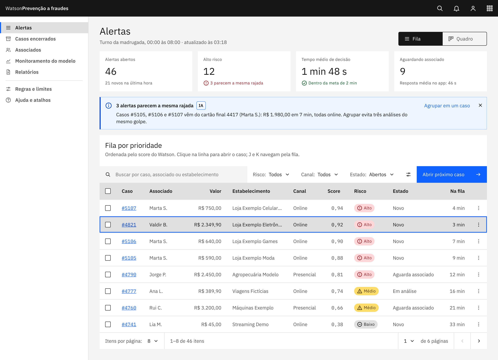

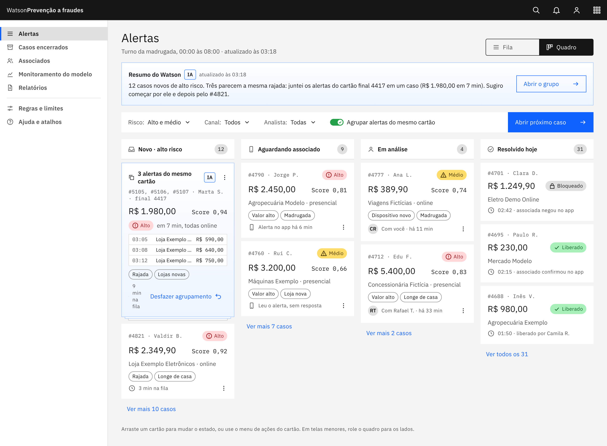

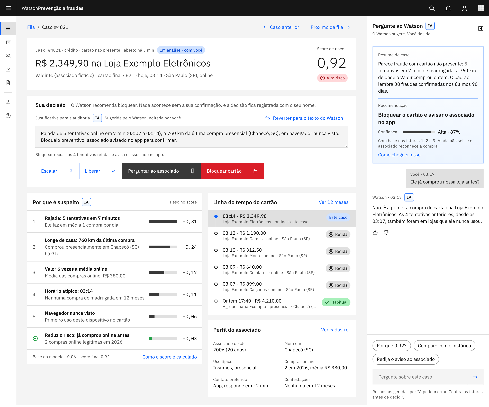

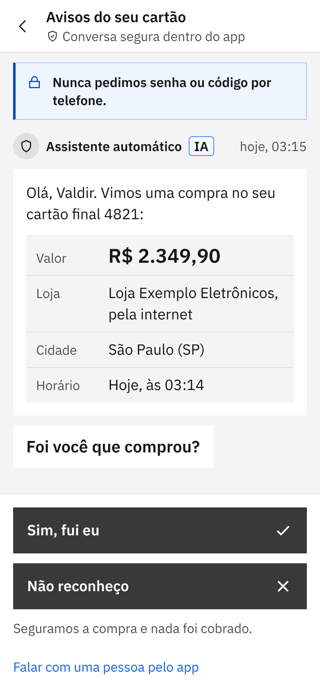

### Versão 2

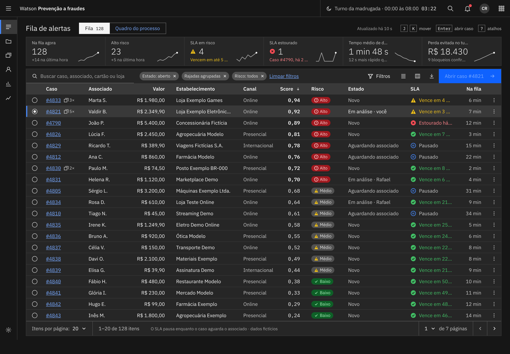

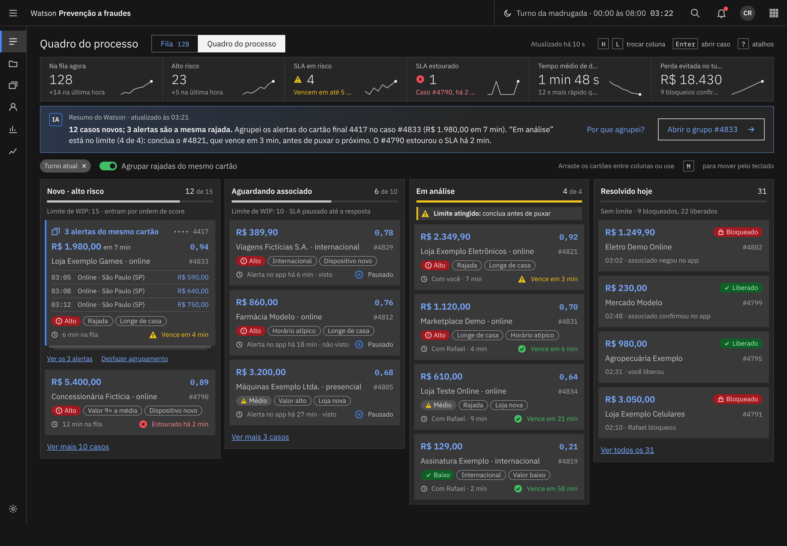

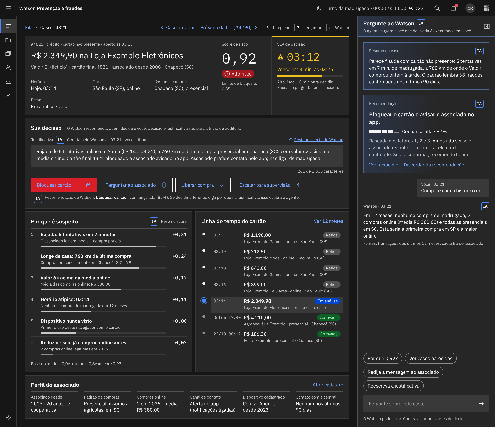

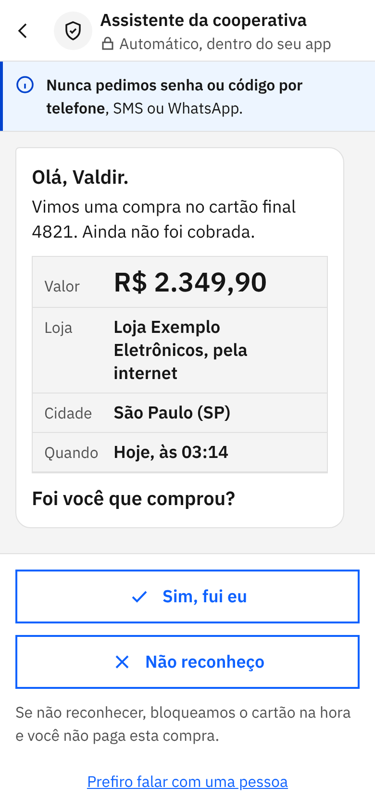

### Versão 3

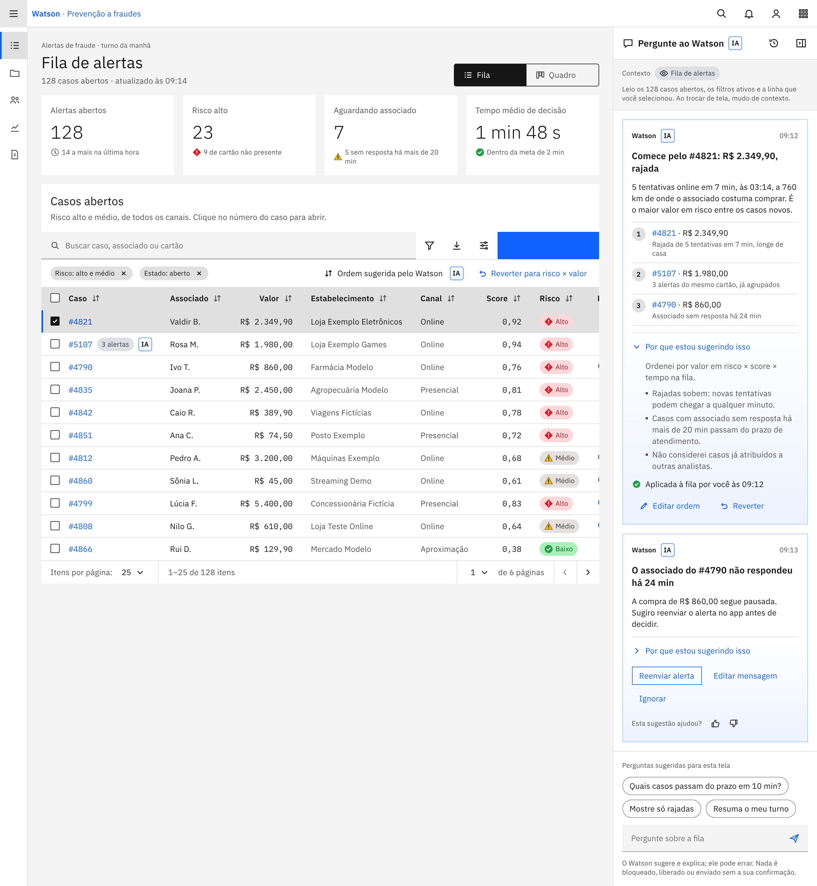

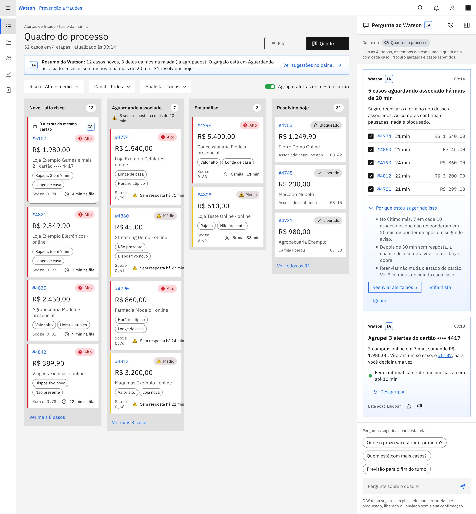

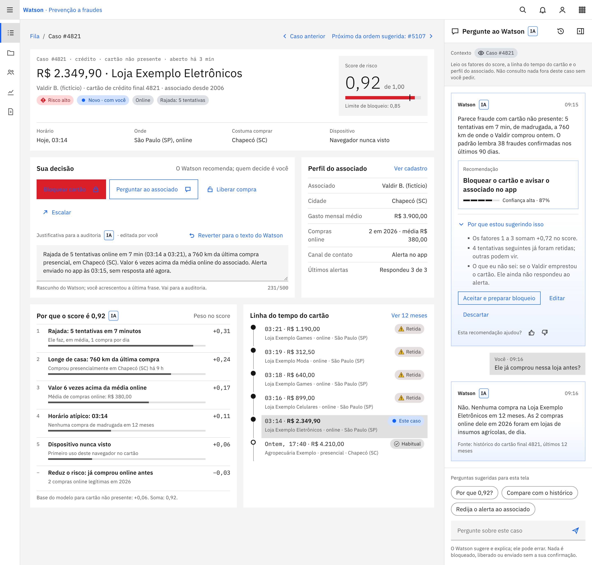

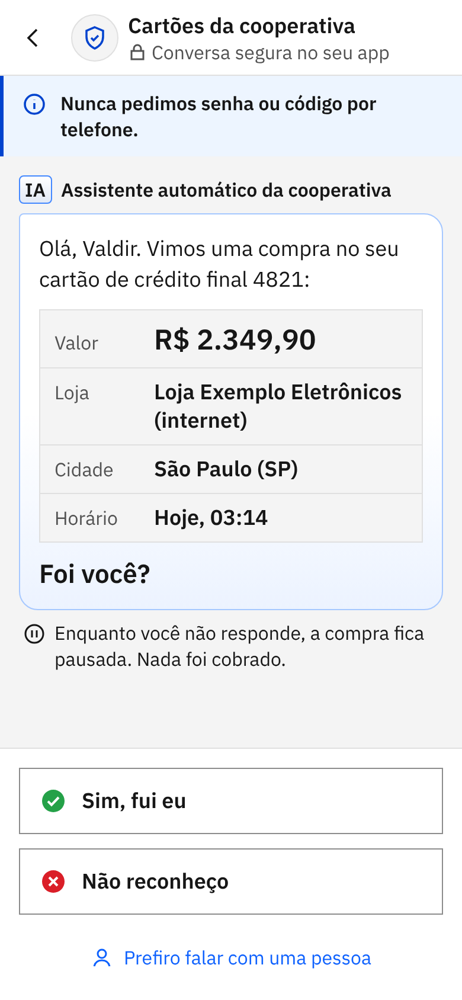

