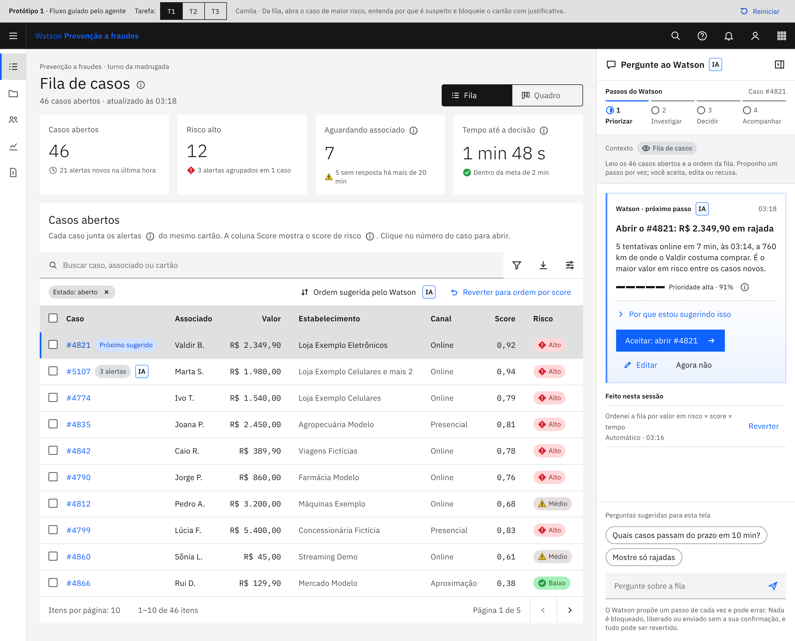
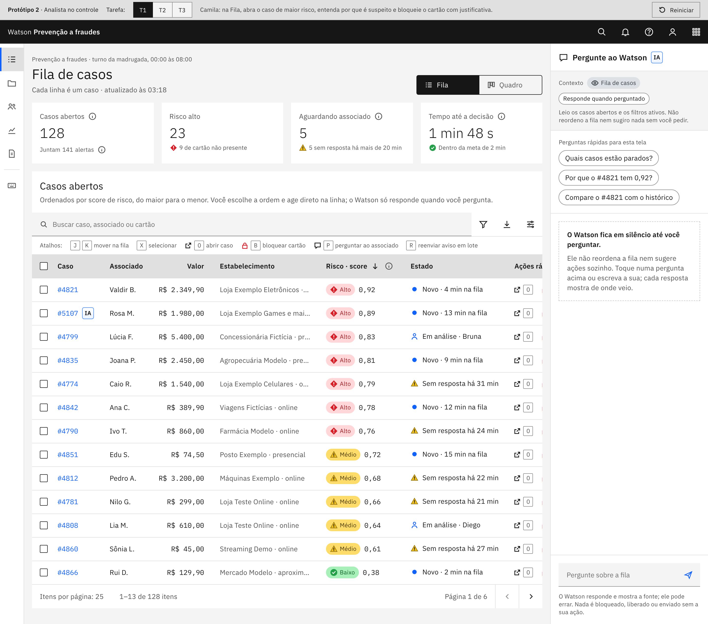
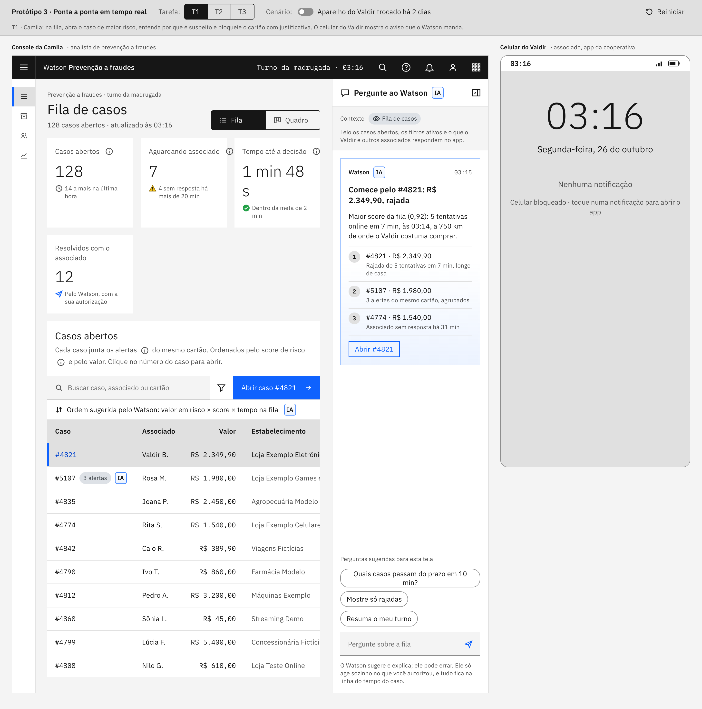

# 03 · Protótipo navegável (Make → Observe)

**Base:** mockup 3 "Agente sempre presente" com o tema g10 clássico da versão 1.

## Técnicas aplicadas
- **Protótipo navegável** com as tarefas de teste já embutidas (seletor T1 | T2 | T3 · Reiniciar).
- **Cognitive Walkthrough** (toolkit IBM / NN/g) com as personas e a anti-persona.
- **Feedback Grid** para consolidar o teste e o **Playback 3** para a escolha.

## As três versões (mesma base visual, hipóteses de interação diferentes)
| Versão | Hipótese |
|---|---|
| **1 · Guiado pelo agente** | A Camila decide mais rápido quando o agente propõe o próximo passo (Aceitar / Editar / Reverter) |
| **2 · Analista no controle** | Power user confia mais quando conduz e o agente responde sob demanda; ações rápidas e em lote |
| **3 · Ponta a ponta em tempo real** | O valor aparece quando o agente coordena analista e associado: console e celular lado a lado, eventos em tempo real, regra da troca de aparelho |

## Roteiro de cognitive walkthrough
Para cada passo de cada tarefa, responder: (1) a pessoa vai tentar o resultado certo? (2) vai perceber a ação certa? (3) vai associar a ação ao resultado? (4) depois de agir, vai ver que progrediu?

| Tarefa | Persona | Sucesso | Meta (Hill) |
|---|---|---|---|
| T1 · Abrir o caso de maior risco, entender e bloquear com justificativa | Camila | Cartão bloqueado com justificativa registrada | < 2 min, sem sair da tela (Hill 1) |
| T2 · Ver casos aguardando o associado e reenviar alerta / desfazer agrupamento errado | Camila | Alerta reenviado ou grupo desfeito | < 1 min |
| T3 · Responder ao alerta no app | Valdir | "Não reconheço" bloqueia em 1 toque; "Fui eu" no alto risco pede biometria | < 30 s (Hills 2 e 3) |
| T3b · Golpe com troca de aparelho | O Impostor | "Fui eu" não libera sozinho; caso volta para a analista | Contramedida da anti-persona |

## Feedback Grid (preencher no teste)
| Gostei | Críticas | Perguntas | Ideias |
|---|---|---|---|
| | | | |

Canvas: página **03 Protótipo (3 versões)**, botão Play em cada quadro.

## Imagens

Tela inicial de cada protótipo. Escolhido: 3 com os chips da 2.

### Protótipo 1

### Protótipo 2

### Protótipo 3

