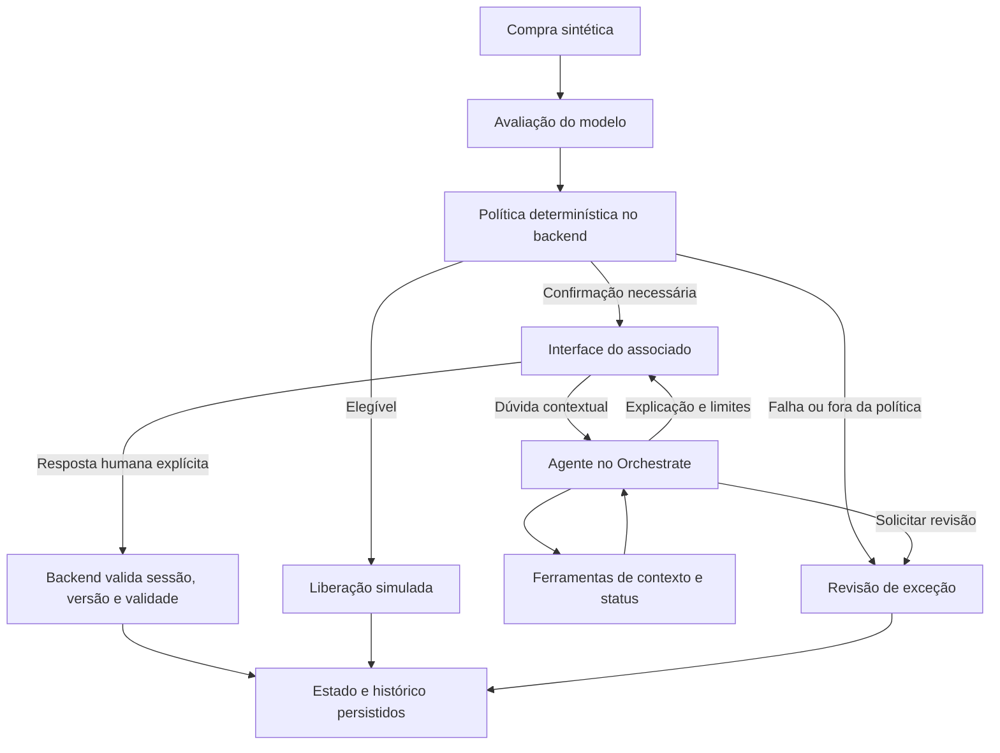

# Direcional de entregas — Da descoberta à confirmação de compras

**Versão 1 · 27/10/2026 · Complemento do [plano de implementação](plano_implementacao.md).**

Este guia transforma as entregas recomendadas das aulas em trabalhos que a equipe consegue produzir, revisar e demonstrar. O recorte vigente é o assistente de confirmação de compras pelo associado. O analista participa das exceções. Ações financeiras são simuladas.

**O que fazer primeiro:** reunir produto/negócios e pesquisa/design para preparar D01–D03; construir uma primeira versão com as fontes disponíveis e marcar o que é hipótese. Depois, revisar a escolha da solução em D04 e completar D06. Desenvolvimento pode avançar em contratos e exemplos sintéticos enquanto a pesquisa acontece. Antes de fechar a experiência, conferir se os achados sustentam as decisões tomadas.

As 11 entregas D01–D11 abaixo vêm dos slides. D12 e D13 são trabalhos de apoio à prototipação e validação ensinadas nas aulas. Os códigos, formatos, metas de pesquisa e critérios internos deste guia são sugestões de organização da equipe. O guia IBM estabelece quatro critérios de até 5 pontos cada; nossa ambição é reunir evidências fortes para os quatro, sem presumir uma nota.

## Visão geral: o que a equipe vai entregar

| ID | Título proposto para a entrega | Resultado concreto | Origem |
|---|---|---|---|
| D01 | Oportunidades de segurança e clareza na confirmação de compras | Problema delimitado, evidências, lacunas, oportunidades e pergunta de projeto | S1 p.60; S2 p.63 |
| D02 | Mapa de empatia do associado diante de uma compra suspeita | Necessidades e tensões organizadas, com fonte ou hipótese identificada | S1 pp.28, 47, 60 |
| D03 | Jornada atual: do alerta à resolução da dúvida | Cenário atual em 4–6 etapas, fricções e pontos de ruptura | S1 pp.47, 60 |
| D04 | Alternativas de solução e decisão de prioridade | Ideias agrupadas, avaliação comparável e justificativa da escolha | S2 pp.35–45, 54, 63 |
| D05 | Conceito da solução: confirmação assistida de compras | Conceito curto, capacidades, fronteiras e cenário de uso | S2 p.63 |
| D06 | Persona e transformação da experiência do associado | Persona funcional e comparação entre cenário atual refinado e futuro | S2 pp.47, 63 |
| D07 | Ideia preliminar: assistente de confirmação de compras | Descrição curta que qualquer integrante consegue explicar | S3 pp.5, 22 |
| D08 | Proposta de valor e necessidade de IA agêntica | Uma página com dor, solução, adoção, evidência, IA e “por que agora” | S3 pp.10–18, 22 |
| D09 | Estrutura da solução e critérios de sucesso | Problema, usuário, inteligência, arquitetura e critérios verificáveis | S4 pp.9–12, 27, 29 |
| D10 | Arquitetura técnica e limites de autonomia | Componentes, papéis, fluxo do agente, contratos e falhas | S4 pp.9–12, 29 |
| D11 | Fluxo principal do MVP e evidências ponta a ponta | Execução completa, registro persistido e reprodução por outra pessoa | S5 pp.19, 22 |
| D12 | Protótipo da experiência e decisões de interface | Percurso testável, textos e estados da confirmação | Apoio: S1 p.38 |
| D13 | Validação da experiência e registro de melhorias | Observações, resultados, correções e reteste da mesma versão | Apoio: S1 p.40; plano §9 |

É possível agrupar os resultados em poucos arquivos, preservando os títulos e IDs. Evitar repetir a mesma descrição em quatro documentos. D05, D07 e D08 podem compartilhar uma página com seções próprias; D02, D03 e D06 podem compor um único mural de pesquisa. O índice precisa permitir localizar cada entrega.

## Como usar as fontes e os modelos

Cada entrega distingue **orientação da aula**, **estrutura sugerida para o projeto** e **critério interno de qualidade**. As páginas citadas usam a posição da página no PDF local. As fontes completas estão no final deste documento.

Os links abaixo foram extraídos das anotações dos slides. A tentativa de abri-los em 27/10/2026 não retornou seu conteúdo. Portanto, este guia não transcreve campos internos dos templates. Ao conseguir acesso, conferir os campos e levar para o modelo o conteúdo organizado aqui, preservando evidências e decisões.

| Referência Box nos slides | Associação verificada no PDF | Como utilizar |
|---|---|---|
| [Modelo de oportunidades](https://ibm.box.com/s/m6bvwaqahmlwq2v8dfa31oonqz09ehid) | S1 p.60: oportunidades; S2 p.63: oportunidades e conceito; S4 p.29: estrutura/arquitetura | Consultar o modelo compartilhado para cada seção correspondente; não presumir que sejam arquivos diferentes |
| [Modelo de empatia](https://ibm.box.com/s/bsp0u5ozqqhh69jcpnhsk9kh5bzx9ogd) | S1 p.60 | Transferir D02 e manter a ligação com as fontes |
| [Modelo de cenário atual](https://ibm.box.com/s/j3b67flksbx0uvjijgl041iqe9njj63p) | S1 p.60 | Representar D03 com etapas e fricções |
| [Link adicional na área de agrupamento/priorização](https://ibm.box.com/s/w8mdbsb6d0fuuhcd041pmfcxc2iybrhy) | S2 p.63: anotação atravessa a região de agrupamento/conceito | Conferir o título do arquivo ao abrir; a anotação não confirma os campos |
| [Modelo ligado a agrupamento/priorização](https://ibm.box.com/s/dmcv55p0ywjh86ynov71kssxaq6wfq7w) | S2 p.63: agrupamento e priorização | Registrar alternativas, agrupamentos e escolha de D04 |
| [Modelo de persona e cenários](https://ibm.box.com/s/piv01ht7gm9a4c12vq5w6iv1rowumnaf) | S2 p.63 | Conectar persona, situação atual refinada e futuro em D06 |

## Regras comuns para produzir as entregas

Cada artefato deve ter ID, título, versão/data, autor, revisor, estado, fontes e decisão que sustenta. Usar estados **rascunho**, **em revisão**, **revisado** e **validado em teste**, conforme a evidência disponível. Um documento revisado não equivale a uma hipótese validada com usuários.

Manter um registro único de evidências: `ID | tipo | origem/página ou participante anonimizado | data | achado | limite | entregas afetadas`. Usar prefixos como `FON-01` para fonte documental, `OBS-01` para observação de pesquisa, `HIP-01` para hipótese, `DEC-01` para decisão e `TST-01` para teste. Os exemplos deste guia são pontos de partida; não representam entrevistas ou resultados já obtidos.

Para pesquisa, proposta interna: começar com 2–3 conversas sobre experiências recentes, se houver acesso, e complementar com fontes documentais e uma revisão de alguém próximo a atendimento/risco. Perguntar sobre o último episódio, ações, dúvidas e desfecho antes de apresentar a ideia. Registrar apenas informações necessárias e anonimizar participantes. Sem acesso a associados ou especialistas, identificar o alcance da pesquisa disponível.

O IBM Bob pode ajudar a organizar notas, questionar premissas, criar alternativas, produzir protótipos e cenários de teste, como orienta S1 p.51. Cada pessoa revisa os resultados e guarda suas evidências de uso. O Bob não substitui a conversa com pessoas nem produz evidência de que uma dor foi observada.

## D01 — Oportunidades de segurança e clareza na confirmação de compras

**Orientação da aula.** Entender o usuário antes de escolher a solução; definir uma tensão específica e formular uma oportunidade centrada nele. S1 pp.28, 32, 47, 60; S2 pp.38–41, 63. Referência: modelo Box de oportunidades.

**Pergunta que a entrega resolve:** qual problema vale resolver, para quem e com quais evidências?

**Partes do artefato:**

1. Contexto do desafio e recorte: compras com cartão, confirmação pelo associado e exceções.
2. Usuário prioritário e atores envolvidos: associado, atendimento, prevenção a fraudes e instituição; registrar necessidades e possíveis conflitos entre eles.
3. Evidências do problema: fonte, achado, alcance e implicação para o produto.
4. Dores e necessidades: descrever o resultado que a pessoa busca e o obstáculo, sem começar por funcionalidades.
5. Alternativas atuais: como a pessoa tenta resolver e o que permanece difícil.
6. Oportunidades priorizadas: fricção, resultado desejado, valor esperado e incerteza.
7. POV: `[usuário] precisa de [necessidade] porque [insight]`.
8. Pergunta HMW: “Como poderíamos...”, aberta a mais de uma solução.
9. Hipóteses mais arriscadas, como verificá-las e consequência caso sejam falsas.

**Como produzir.** Ler o desafio Sicredi p.6 e reunir fontes e relatos. Separar sinais do dataset de evidências de experiência: concentração de transações na madrugada não prova que o associado sente medo ao receber um alerta. Cruzar pesquisa e jornada, selecionar a fricção prioritária e formular o POV/HMW. Revisar se a pergunta ainda permite alternativas de D04.

**Exemplo de hipótese inicial:** “Como poderíamos ajudar o associado a decidir sobre uma compra sinalizada com clareza sobre o que está autorizando e sobre o próximo passo quando continua em dúvida?”. Verificar se essa é a tensão central na pesquisa.

**Para concluir:** toda dor prioritária aponta para evidência ou hipótese identificada; a equipe consegue justificar o recorte e explicar qual descoberta mudaria a solução.

**Para elevar a qualidade:** incluir evidência que contrarie a ideia inicial e registrar a mudança de decisão gerada por ela. Comparar alternativas pela mesma necessidade, com fontes, evitando uma lista de concorrentes sem análise.

**Liderança sugerida:** produto/negócios; revisão de pesquisa/design. **Saída sugerida:** `entregas/01_oportunidades.md`. Alimenta D02–D04 e D08.

## D02 — Mapa de empatia do associado diante de uma compra suspeita

**Orientação da aula.** Descrever a pessoa, seus objetivos, comportamentos, dores, expectativas e restrições; investigar o que ainda não se sabe. S1 pp.28, 47, 60. Referência: modelo Box de empatia.

**Pergunta que a entrega resolve:** o que a pessoa precisa compreender e sentir segurança para decidir?

**Partes sugeridas:** situação e objetivo; o que vê; o que ouve; o que fala/faz; o que pensa/sente; dores; ganhos desejados; dúvidas de pesquisa. Essa divisão é uma organização prática a conferir com o template quando acessível.

**Como produzir.** Recortar uma situação concreta, como receber uma solicitação enquanto tenta concluir uma compra. Preencher cada bloco com notas curtas e IDs de evidência. Distinguir fala literal, comportamento observado e interpretação. Quando não houver dado, escrever uma pergunta a investigar. Fechar com três implicações para interface, linguagem ou encaminhamento.

**Exemplo de hipótese, não fala de participante:** confundir “não reconheço” com “bloquear todo o cartão”. Implicação candidata: explicar o alcance da resposta e testar se a pessoa consegue descrevê-lo com as próprias palavras.

**Para concluir:** o mapa representa um contexto definido; as interpretações são rastreáveis; pelo menos uma decisão de design deriva dele. Uma pessoa não precisa aparecer em todos os blocos com citações inventadas.

**Para elevar a qualidade:** mostrar onde o comportamento difere do que a pessoa declara e investigar o motivo. Preservar diferenças relevantes entre participantes em vez de produzir um “usuário médio” sem contexto.

**Liderança sugerida:** pesquisa/design; revisão de produto. **Saída:** mural exportado ou seção `entregas/02_empatia.md`. Depende de D01 e das notas de pesquisa; alimenta D06 e D12.

## D03 — Jornada atual: do alerta à resolução da dúvida

**Orientação da aula.** Desenhar 4–6 etapas da jornada atual, identificar a principal fricção e registrar o que ainda precisa ser descoberto. S1 pp.47, 60. Referência: modelo Box de cenário atual.

**Pergunta que a entrega resolve:** em que momento a experiência atual se rompe e por quê?

**Estrutura para preencher:**

| Etapa atual | Objetivo/ação da pessoa | Canal e ator envolvido | Informação disponível ou ausente | Fricção e consequência | Fonte/hipótese |
|---|---|---|---|---|---|
| [etapa observada] | [o que tenta fazer] | [onde e com quem] | [o que sabe e precisa saber] | [esforço, espera, dúvida ou risco] | [ID] |

**Como produzir.** Reconstruir um episódio recente do início ao desfecho, perguntando “e depois?”. Uma sequência possível para investigar é perceber o alerta, consultar detalhes, tentar reconhecer a compra, buscar ajuda, responder e verificar o resultado. Ela é uma hipótese de pesquisa, não uma descrição confirmada do atendimento Sicredi. Destacar espera, repetição de informação, troca de canal e decisão sem contexto. Escolher uma ruptura principal para D01/D04.

**Para concluir:** o cenário atual aparece separadamente do futuro; etapas e canais têm fontes ou marcação de hipótese; o início e o desfecho são claros. Tempos só entram como medição ou relato identificado.

**Para elevar a qualidade:** adicionar uma faixa de bastidores com atendimento e prevenção a fraudes, identificando o que depende de confirmação do domínio. Mostrar qual passagem gera retrabalho para ambos os lados.

**Liderança sugerida:** pesquisa/design; revisão de produto e, se disponível, pessoa do domínio. **Saída:** `entregas/03_cenario_atual.md` e jornada visual. Alimenta D04, D06 e a comparação de D13.

## D04 — Alternativas de solução e decisão de prioridade

**Orientação da aula.** Gerar possibilidades antes de escolher; agrupar ideias e avaliá-las por impacto humano, necessidade de inteligência e valor para a organização. Explorar autonomia, raciocínio e coordenação. S2 pp.24–29, 35–45, 54, 63. Referências: dois links Box associados à área de agrupamento/priorização.

**Pergunta que a entrega resolve:** por que essa direção merece ser construída diante das alternativas?

**Partes do artefato:** HMW de partida; registro das ideias; agrupamentos com nomes; alternativas comparáveis; avaliação; escolha e motivos; hipóteses que podem reabrir a decisão.

**Como produzir.** Cada integrante propõe possibilidades individualmente; o grupo reúne ideias por necessidade ou capacidade, e não só por semelhança visual. Proposta interna: comparar ao menos três direções, incluindo uma alternativa simples sem agente. Para o recorte atual, candidatos a discutir são confirmação com texto fixo, ajuda contextual com ferramentas e encaminhamento humano assistido. São sementes de discussão, não registro de brainstorming já realizado.

**Matriz sugerida:**

| Alternativa | Impacto humano + evidência | Necessidade de inteligência | Valor organizacional | Viabilidade e risco | Decisão e justificativa |
|---|---|---|---|---|---|
| [direção] | [tensão que resolve] | [raciocínio/autonomia/coordenação necessários] | [resultado esperado] | [dados, acesso, esforço e limites] | [selecionada, combinada ou adiada] |

Os três primeiros critérios vêm da aula; viabilidade e risco são complementos internos. Se usar notas de 1 a 5, definir as âncoras antes e anexar justificativa. Necessidade de IA não significa qualidade por si só: uma alternativa simples que resolve melhor o problema deve permanecer competitiva.

**Para concluir:** a comparação é honesta e usa os mesmos critérios; fica claro o que foi descartado e por quê; a solução já escolhida no plano pode ser confirmada ou ajustada. Se a discussão ocorrer depois da escolha, registrá-la como revisão da decisão.

**Para elevar a qualidade:** verificar se a direção vencedora depende de uma premissa frágil. Registrar o experimento que poderia inverter a escolha e qual alternativa assumiria seu lugar.

**Liderança sugerida:** produto facilita; toda a equipe participa; pesquisa/design revisa a ligação com D01–D03. **Saída:** `entregas/04_priorizacao.md`. Alimenta D05 e D08.

## D05 — Conceito da solução: confirmação assistida de compras

**Orientação da aula.** Consolidar a direção escolhida, explicando a capacidade que o usuário ganha e por que depende de inteligência. S2 pp.43, 54, 63. O slide associa o conceito ao mesmo link Box de oportunidades.

**Partes do artefato:** usuário/situação; problema; solução em uma frase; capacidade nova; experiência em três momentos; papel do agente; limites; dependências e hipóteses.

**Ponto de partida já sustentado pelo plano:** “Um assistente que apresenta uma compra sinalizada, ajuda o associado a esclarecer dúvidas com o contexto disponível e permite registrar autorização, recusa ou dúvida, com revisão das exceções.” O modelo avalia sinais; uma política define o tratamento; o agente consulta e explica; o associado responde explicitamente; o backend valida e registra.

**Como produzir.** Reaproveitar o plano §§1–3 e confrontar a descrição com D04. Fazer um storyboard curto: recebe a solicitação → entende/responde ou pede ajuda → vê o status e o próximo passo. Incluir um caso em que o agente não sabe responder e encaminha para revisão.

**Para concluir:** qualquer integrante explica o conceito e seus limites sem recorrer a nomes de ferramentas; a solução cria uma capacidade observável e o usuário principal permanece o associado.

**Para elevar a qualidade:** mostrar um antes/depois concreto em que uma pergunta contextual muda o encaminhamento permitido, mantendo a autorização humana explícita.

**Liderança sugerida:** produto; revisão de pesquisa/design e backend/agente. **Saída:** seção própria em `entregas/05_conceito_valor.md`. Alimenta D07–D10.

## D06 — Persona e transformação da experiência do associado

**Orientação da aula.** Persona representa objetivo, frustração, contexto de decisão, resultado desejado e relação com o sistema. Evitar detalhes decorativos. Refinar o cenário atual e mostrar o futuro. S2 pp.42, 47, 63. Referência: modelo Box de persona/cenários.

**Partes do artefato:**

1. Perfil funcional: situação de uso e relação com a compra/serviço.
2. Objetivo, frustração, contexto e estado de sucesso.
3. Evidências que sustentam o perfil e diferenças ainda não explicadas.
4. Cenário atual refinado após a pesquisa, com referência a D03.
5. Cenário futuro, usando o mesmo episódio e objetivo para permitir comparação.
6. Exceções, transições para atendimento e condições de acessibilidade.

**Como produzir.** Sintetizar padrões de D01–D03. Sem pesquisa suficiente, nomear “protopersona — hipótese de trabalho”. Não inventar idade, renda ou rotina para preencher espaço. Comparar as duas experiências por: ação, informação disponível, esforço, decisão e próximo passo. Mostrar o que a pessoa deixa de fazer ou passa a compreender, e o que ainda exige atendimento.

**Exemplo a validar:** pessoa com uma compra sinalizada cujo nome do estabelecimento é ambíguo; seu sucesso é decidir com clareza ou chegar à revisão sabendo o status. No futuro proposto, ausência de vínculo verificável entre nomes gera transparência e revisão, em vez de uma identidade comercial inventada.

**Para concluir:** a persona orienta escolhas de texto/interação; o cenário futuro cobre autorizar, não reconhecer, dúvida e expiração; a comparação usa o mesmo problema, evitando apresentar um presente artificialmente ruim.

**Para elevar a qualidade:** testar um contexto de maior dificuldade, como uso por teclado ou baixa familiaridade digital, e mostrar qual decisão mudou após observação.

**Liderança sugerida:** pesquisa/design; revisão de produto. **Saída:** `entregas/06_persona_cenarios.md` e quadro atual/futuro. Alimenta D09, D12 e D13.

## D07 — Ideia preliminar: assistente de confirmação de compras

**Orientação da aula.** Registrar ideia e descrição como primeiro resultado da construção da proposta. S3 pp.5, 22. O material não apresenta um link de template específico nesta entrega.

**Estrutura sugerida:** nome descritivo; problema/usuário; solução em uma frase; três capacidades essenciais; resultado esperado; estágio e maior hipótese aberta. Cabe em uma seção curta, referenciando D05.

**Como produzir.** Escrever em linguagem que alguém de fora do grupo compreenda. Testar a explicação com uma pessoa: pedir que diga quem usa, o que faz e o que acontece quando não reconhece a compra. Ajustar termos vagos como “revolucionar a segurança” para comportamentos demonstráveis.

**Para concluir:** a descrição coincide com D05 e com o fluxo implementável. **Para elevar a qualidade:** ter uma versão de aproximadamente 30 segundos que preserve o limite de simulação e explique a utilidade antes das tecnologias.

**Liderança sugerida:** produto/negócios; revisão de comunicação e pesquisa/design. **Saída:** seção em `entregas/05_conceito_valor.md`. Alimenta o roteiro final.

## D08 — Proposta de valor e necessidade de IA agêntica

**Orientação da aula.** Preencher uma página com dor/público, solução, quem paga, por que precisa de IA/arquétipo e por que agora. Situar a ideia nos eixos vertical/horizontal e interno/externo; decompor saber, decidir e fazer. S3 pp.10–18, 22; S2 p.43.

**Estrutura da página:**

| Parte | O que escrever para este projeto |
|---|---|
| Dor e público | Fricção prioritária de D01, contexto da persona e evidência |
| Solução em uma frase | Conceito de D05, sem catálogo de tecnologias |
| Quem usa, quem adota e quem paga | Associado usa a experiência; instituição seria responsável pela adoção/custeio. Identificar o decisor a investigar, sem afirmar interesse comercial confirmado |
| Posicionamento | Solução vertical de serviços financeiros; explicitar que benefício ao associado e adoção pela instituição são papéis diferentes. Confirmar a tese de oferta, se houver |
| Valor para o associado | Clareza, conclusão correta e próximo passo compreensível; hipóteses mensuráveis |
| Valor para a organização | Possível redução de retrabalho/esforço de atendimento; custos e riscos a verificar |
| Por que IA e qual arquétipo | Capacidade contextual necessária, comparação com texto fixo e limite de autonomia |
| Por que agora | Condição verificável que torna a proposta explorável; tecnologias/dados disponíveis são meios, não prova de demanda |
| Evidência, custo e limites | O que já foi observado, o que será testado e quais premissas sustentam os cenários |

**Como produzir.** Comparar um fluxo com texto fixo ao fluxo com agente usando situações equivalentes. O agente precisa demonstrar escolha útil de ferramentas e resposta contextual. Candidato de enquadramento: especialista sensível ao contexto e gestor da fronteira humano–IA; são interpretações dos arquétipos do desafio, pp.7–10, a confirmar pelo comportamento executado. A autorização permanece na interface humana.

Explicitar o que o agente precisa **saber** (compra, status e sinais permitidos), **decidir** (consultar, explicar ou solicitar revisão) e **fazer** (consultas e encaminhamentos autorizados). Uma dúvida fora do contexto exige declaração de limite. RAG e múltiplos agentes só entram se houver necessidade demonstrável.

Para viabilidade, usar uma tabela de premissas: volume de casos, proporção enviada à confirmação, chamadas por caso, custo por chamada, esforço de atendimento e custo de operação. Estimativa de custo de IA = casos processados × chamadas médias por caso × custo médio por chamada; discriminar infraestrutura e revisão humana à parte. Uma eventual economia depende de tempo realmente evitado e da aceitação do fluxo. Produzir cenários conservador/base e registrar a fonte de cada premissa.

**Para concluir:** a página responde “por que um agente?” e “por que alguém adotaria?”; declara hipóteses de adoção/custo; separa métricas do protótipo de efeitos operacionais ainda não medidos.

**Para elevar a qualidade:** medir se a ajuda contextual melhora compreensão sem aumentar autorizações equivocadas no exercício. Valor das transações sinalizadas não equivale a perdas evitadas.

**Liderança sugerida:** produto/negócios; revisão de pesquisa/design, dados/modelo e backend/agente. **Saída:** seção em `entregas/05_conceito_valor.md`. Depende de D01, D04 e D05; é atualizada após D13.

## D09 — Estrutura da solução e critérios de sucesso

**Orientação da aula.** Definir problema, usuário, inteligência necessária, arquitetura e critérios de sucesso; responder objetivo, conhecimento, ferramentas, workflow e forma de testar. S4 pp.9–12, 27, 29. Referência: modelo Box compartilhado de oportunidades/estrutura.

**Partes do artefato:** problema/usuário; jornada prioritária; capacidades do agente; matriz saber/decidir/fazer; componentes; dados e limitações; requisitos; critérios de sucesso; dependências de acesso; versão e estado de cada componente.

**Como produzir.** Consolidar D05–D08 e reaproveitar requisitos R01–R12 do plano. Para cada capacidade, ligar necessidade, requisito e teste. Separar sucesso do classificador, sucesso do sistema e compreensão da pessoa.

| Dimensão | Medida proposta | Evidência a coletar |
|---|---|---|
| Experiência | Conclusão sem ajuda e entendimento do resultado | Tarefas e perguntas de compreensão de D13 |
| Segurança do fluxo | Nenhuma liberação sem resposta válida ou política prevista | Testes de autorização, expiração, acesso e concorrência |
| Agente | Consulta correta, explicação fiel e revisão quando faltar contexto | Rastro de ferramentas comparado à resposta |
| Modelo | Métricas na versão/corte declarados e comparação com baseline | Relatório reproduzível, contagem de positivos e limiar |
| Operação | Tempo do fluxo, falhas e persistência | Eventos com versão e ensaio por outro integrante |

**Para concluir:** métricas têm definição, método de coleta e responsável; metas são acordadas antes do teste. O alvo interno de falhas críticas de autorização é zero. Resultados pequenos de usabilidade devem ser apresentados como contagens, como `4/5`, e com perfil dos participantes.

**Para elevar a qualidade:** construir a cadeia `evidência → necessidade → decisão → requisito → teste → resultado`, incluindo uma decisão revisada após o teste.

**Liderança sugerida:** produto com equipe técnica; revisão cruzada de pesquisa e integração/testes. **Saída:** `entregas/09_estrutura_solucao.md`, referenciando o plano em vez de copiar tabelas que podem divergir. Alimenta D10–D13.

## D10 — Arquitetura técnica e limites de autonomia

**Orientação da aula.** Explicitar agentes, papéis, padrões de orquestração e workflow; cada tecnologia deve cumprir um papel. S4 pp.9–12, 29. O slide recomenda arquitetura técnica, mas não torna diagrama visual ou múltiplos agentes obrigatórios. Propomos o diagrama para tornar a decisão mais fácil de avaliar.

**Partes do artefato:** diagrama de componentes; sequência de execução; ficha do agente; catálogo de ferramentas; contratos/exemplos; política e máquina de estados; persistência; falhas; integração IBM; evidências de execução e decisões técnicas.

**Diagrama inicial de planejamento:**

Esse desenho representa a direção do plano, não prova integração já executada. A falha de avaliação também precisa de caminho de exceção testado.

**Como produzir.** Desenhar a sequência de um caso com IDs de compra, análise e confirmação. Reutilizar os contratos dos §§4–5 do plano. Para cada ferramenta registrar finalidade, entrada, saída, autorização, erros e versão. Mostrar separadamente o endpoint humano `POST /confirmations/{challenge_id}/response`; o agente não pode chamá-lo para autorizar pelo associado.

Na ficha do agente, escrever objetivo, conhecimento permitido, instruções, ferramentas, critérios de escolha e limites. Documentar o padrão realmente escolhido, por exemplo um agente com ferramentas e política externa, justificando por que é suficiente. A função do Bob é desenvolvimento; seu uso entra nas evidências, não como serviço presumido em tempo de execução.

**Para concluir:** desenho, contratos e aplicação concordam; cada integração tem estado **planejada**, **simulada** ou **executada com evidência**; origem/versão de scores e limiares aparecem nos registros; o fluxo de falha não inventa resultado.

**Para elevar a qualidade:** anexar uma sequência real de ferramentas e uma decisão técnica curta com alternativa, escolha, motivo e consequência. Comprovar isolamento entre dois associados fictícios e impossibilidade de autorização pelo agente.

**Liderança sugerida:** backend/agente; revisão de dados/modelo e integração/testes. **Saída:** `entregas/10_arquitetura.md`, diagrama editável e contratos versionados. Depende de D09 e dos contratos; alimenta D11.

## D11 — Fluxo principal do MVP e evidências ponta a ponta

**Orientação da aula.** Entregar um fluxo que funcione ponta a ponta, mesmo inicial; construir, testar, observar e refinar. S5 pp.19, 22. O slide não aponta um template específico para essa entrega.

**Partes do artefato:** pré-condições; versão; dados de demonstração; instruções de execução; cenários; resultado esperado/observado; registros persistidos; evidências e pendências.

**Como produzir.** Implementar o caminho do plano: compra sintética → avaliação → política → solicitação → resposta humana → estado persistido → resultado visível. Acrescentar dúvida contextual real, encaminhamento de revisão e expiração. Usar casos fixos identificados para repetir os testes; o rótulo histórico de avaliação não fica disponível ao agente como resposta pronta.

| Caso | O que demonstrar | Evidência mínima |
|---|---|---|
| Reconhece e autoriza | Liberação simulada após resposta válida | Estado/evento e tela após recarga |
| Não reconhece | Recusa e encaminhamento, sem presumir bloqueio do cartão | Registro e próximo passo mostrado |
| Está em dúvida | Contexto consultado e revisão quando necessário | Chamadas, protocolo e status |
| Expira sem resposta | Nenhuma autorização presumida | Horários do servidor e resposta fora do prazo |
| Outro usuário ou repetição | Acesso negado ou um único resultado consistente | Requisição/retorno e histórico |
| Serviço falha ou contexto falta | Limite explícito e caminho de revisão | Erro observado e tratamento registrado |

**Para concluir:** outra pessoa consegue reproduzir o fluxo seguindo o guia; uma mesma compra pode ser rastreada pelos componentes; recarregar/reiniciar preserva o resultado; os cenários críticos do plano §9 foram executados. Screenshots de telas desconectadas não comprovam integração.

**Para elevar a qualidade:** demonstrar também um caso de falha e sua recuperação; apresentar latência medida, identificação das versões e evidência de que o agente foi útil numa dúvida contextual.

**Liderança sugerida:** integração/testes, com autores técnicos; revisão de produto e pesquisa/design. **Saída:** `entregas/11_fluxo_mvp.md` com instruções e evidências. Depende de D10 e da implementação; alimenta D13 e a demonstração final.

## D12 — Protótipo da experiência e decisões de interface

**Orientação da aula.** Criar uma representação de baixa/média fidelidade que permita testar experiência e limites: telas, storyboard, conversa ou workflow. S1 p.38. É apoio à produção das entregas; não implica obrigação de desenvolver front-end próprio.

**Partes do artefato:** link ou arquivo do protótipo; objetivo do percurso; telas/estados; textos; decisões ligadas a D02/D06; roteiro de tarefas; achados e versão.

**Como produzir.** Começar com uma compra identificada e seus detalhes, motivo verificável do alerta, pergunta explícita e três respostas. Desenhar carregamento, falha, confirmação recebida, recusa, revisão e expiração. Mostrar como a ajuda contextual funciona e como a pessoa volta ao fluxo. A mensagem final identifica compra, resultado e próximo passo.

Revisar leitura em celular, teclado, foco visível, rótulos claros e status compreensível sem depender de cor. Testar se o texto distingue autorização da compra, indicação de fraude e bloqueio do cartão. O protótipo deve mostrar a identificação de dados fictícios e ações simuladas.

**Para concluir:** uma pessoa percorre o cenário e compreende a consequência de cada resposta. **Para elevar a qualidade:** registrar pelo menos uma comparação de alternativas de texto/interação e a razão da escolha após teste.

**Liderança sugerida:** produto e design; revisão de pesquisa e backend/agente. A implementação da interface continua com responsável a definir pela equipe; este guia não atribui front-end ao integrante de integração/testes. **Saída:** `entregas/12_prototipo.md` com acesso ao protótipo. Depende de D06 e D09; alimenta D13 e a implementação.

## D13 — Validação da experiência e registro de melhorias

**Orientação da aula.** Observar pessoas usando a proposta; testar situações normais, ambíguas e de falha; registrar evidências e transformar achados em ajustes. S1 p.40. O plano §9 propõe comparar o fluxo básico com o apoiado pelo agente.

**Partes do relatório:** perguntas/hipóteses; participantes e contexto; versão; tarefas; método e métricas; observações; problemas por gravidade; alterações; reteste; resultados e limites.

**Como produzir.** Preparar um roteiro com 3–5 pessoas, conforme acesso, e testar primeiro o próprio roteiro. Alternar a ordem entre fluxo básico e fluxo com agente, usando compras equivalentes. Pedir que a pessoa pense em voz alta; evitar ensinar o caminho durante a tarefa. Registrar ajuda do moderador quando ocorrer. Fazer perguntas sobre compra, consequência da resposta e próximo passo, sem revelar a resposta correta.

| Medida | Definição para o piloto |
|---|---|
| Conclusão independente | Tarefa concluída sem ajuda do moderador / tarefas tentadas |
| Compreensão | Respostas corretas segundo uma chave definida antes do teste / perguntas feitas |
| Decisão equivocada | Resposta incompatível com o cenário controlado, por exemplo autorizar uma compra explicitamente desconhecida |
| Tempo | Intervalo entre início da tarefa e resultado; registrar interrupções |
| Dúvidas e retrabalho | Pedidos de ajuda, voltas e interpretações equivocadas observados |

**Para concluir:** apresentar contagens e observações por condição, não apenas satisfação; registrar severidade e dono de cada correção; repetir o cenário afetado após corrigir. Identificar se os participantes são colegas, associados ou especialistas, e se usaram protótipo ou aplicação integrada.

**Para elevar a qualidade:** mostrar uma cadeia completa `observação → problema → alteração → reteste`, incluindo resultado que não melhorou. O piloto revela problemas e sinais de valor; não comprova redução de perdas financeiras nem generaliza a todos os associados.

**Liderança sugerida:** pesquisa/validação; revisão de produto e integração/testes. **Saída:** `entregas/13_validacao.md` e evidências anonimizadas. Depende de D12 para teste de design e D11 para teste do MVP. Atualiza D01, D06, D08 e D09 conforme os achados.

## Organização em quatro pessoas: responsáveis, sequência e revisão

A divisão abaixo organiza a produção e a revisão das entregas em quatro pessoas. Substituir Pessoa 1–4 pelos nomes do grupo; os rótulos não pressupõem quem saiu da formação anterior. Esta matriz prevalece sobre as sugestões de liderança por função em cada seção. O responsável consolida a entrega e responde pelo seu aceite; recebe contribuições dos demais.

| Pessoa | Frente principal | Entregas sob sua responsabilidade | Primeiro trabalho concreto |
|---|---|---|---|
| Pessoa 1 | Negócios, produto e narrativa | D01 Oportunidades; D04 Priorização; D05 Conceito; D07 Ideia; D08 Proposta de valor/IA | Abrir D01 com problema, fontes, hipóteses e perguntas; preparar a discussão de alternativas de D04 |
| Pessoa 2 | Pesquisa e compreensão do usuário | D02 Empatia; D03 Cenário Atual; D06 Persona e Cenários | Preparar roteiro de pesquisa e organizar as notas compartilhadas; desenhar a primeira jornada com hipóteses identificadas |
| Pessoa 3 | Estrutura da solução e arquitetura | D09 Estrutura; D10 Arquitetura | Conferir contratos e componentes do plano; relacionar requisitos, ferramentas, dados e testes |
| Pessoa 4 | Protótipo, evidências do fluxo e validação | D11 Registro do Fluxo MVP; D12 Protótipo; D13 Validação | Esboçar o percurso de confirmação a partir do plano e preparar tarefas/perguntas do piloto com Pessoa 2 |

Pessoa 1 reúne mais IDs porque ideia, conceito e proposta de valor compartilham conteúdo. Pessoa 3 tem menos IDs, mas concentra a especificação técnica. Pessoa 4 concentra trabalho de produção visual e teste. Distribuir o esforço por complexidade e disponibilidade, não pelo número de documentos.

Esta divisão cobre os artefatos deste direcional. Em D11, Pessoa 4 organiza o roteiro, reproduz o fluxo e consolida evidências; os autores técnicos precisam fornecer e corrigir a implementação executável. A liderança documental de Pessoa 3 não atribui automaticamente todo o desenvolvimento a ela. A implementação de interface própria segue a definição de escopo e alocação do plano.

### Matriz de responsabilidade e revisão por entrega

| Entrega | Responsável | Apoio necessário | Revisor principal | Saída para aceite |
|---|---|---|---|---|
| D01 Oportunidades | Pessoa 1 | Pessoa 2: pesquisa e fontes | Pessoa 2 | Fricção, evidências, lacunas e HMW/POV |
| D02 Empatia | Pessoa 2 | Pessoa 1: recorte e necessidades | Pessoa 1 | Mapa com fonte/hipótese por achado e implicações de design |
| D03 Cenário Atual | Pessoa 2 | Pessoa 1: contexto do problema | Pessoa 4 | Jornada em 4–6 etapas e ruptura prioritária |
| D04 Priorização | Pessoa 1 | As quatro pessoas: alternativas; Pessoa 3: viabilidade | Pessoa 3 | Matriz comparável e justificativa da direção escolhida |
| D05 Conceito | Pessoa 1 | Pessoa 3: capacidades e limites | Pessoa 2 | Conceito compreensível e cenário de uso |
| D06 Persona e Cenários | Pessoa 2 | Pessoa 4: representação da experiência | Pessoa 1 | Perfil funcional e comparação do mesmo episódio atual/futuro |
| D07 Ideia e Descrição | Pessoa 1 | Pessoa 2: linguagem do usuário | Pessoa 4 | Descrição curta coerente com conceito e fluxo |
| D08 Valor e IA | Pessoa 1 | Pessoa 3: inteligência/custos; Pessoa 2: dor/evidência | Pessoa 3 | Uma página com valor, adoção, justificativa de IA e premissas |
| D09 Estrutura | Pessoa 3 | Pessoa 1: escopo; Pessoa 2: sucesso para o usuário | Pessoa 4 | Requisitos ligados a necessidades, métricas e testes |
| D10 Arquitetura | Pessoa 3 | Autores técnicos: contratos e evidências | Pessoa 4 | Diagrama, sequência, papéis, contratos, limites e falhas |
| D11 Fluxo do MVP | Pessoa 4 | Pessoa 3 e autores técnicos: execução e correções | Pessoa 3 | Roteiro reproduzível, resultados e evidências da mesma versão |
| D12 Protótipo | Pessoa 4 | Pessoa 2: jornada/textos; Pessoa 3: viabilidade | Pessoa 2 | Percurso testável com respostas e estados previstos |
| D13 Validação | Pessoa 4 | Pessoa 2: recrutamento/moderação; demais: correções | Pessoa 2 | Achados, resultados, ajustes, reteste e limitações |

Em D10, Pessoa 4 confere a legibilidade, a rastreabilidade e a possibilidade de reproduzir o fluxo; questões técnicas específicas devem receber revisão de outro autor técnico disponível. Em D11, a revisão técnica de Pessoa 3 complementa a reprodução independente feita por Pessoa 4. Ninguém encerra sua própria entrega sem revisão.

### Passagens de trabalho entre as quatro pessoas

1. **Descoberta:** Pessoas 1 e 2 produzem D01–D03 com a mesma base de evidências. Pessoa 3 prepara contratos/componentes em paralelo; Pessoa 4 prepara esboço e roteiro de teste.
2. **Escolha:** Pessoa 1 facilita D04 com o grupo; Pessoa 2 consolida D06; Pessoa 1 fecha D05, D07 e D08 após a revisão da direção.
3. **Estrutura e experiência:** Pessoa 3 consolida D09–D10 e entrega restrições/contratos a Pessoa 4, que refina D12 com Pessoa 2.
4. **Teste e melhoria:** Pessoa 4 conduz a reprodução de D11 e consolida D13; Pessoa 2 modera sessões e registra observações. Cada autor corrige sua parte; Pessoa 4 verifica novamente o cenário afetado.
5. **Consolidação:** Pessoa 1 atualiza a narrativa e o valor com os resultados; Pessoa 3 fecha a declaração técnica; Pessoa 4 reúne vídeo, índice e evidências; Pessoa 2 revisa clareza e fidelidade aos achados.

**Pacote final:** Pessoa 1 responde pelo texto de problema/solução e roteiro de apresentação; Pessoa 2 revisa a narrativa do usuário e os resultados de pesquisa; Pessoa 3 responde pela declaração tecnológica e instruções técnicas; Pessoa 4 consolida vídeo/links/índice e confere acesso. Cada uma das quatro pessoas entrega suas próprias evidências do Bob. O envio é realizado pelo líder cadastrado na plataforma, sem presumir que seja uma dessas funções específicas.

O [plano operacional](../artifacts/planejamento/plano_15_dias.md) e o [backlog](../artifacts/planejamento/backlog.md) foram alinhados ao associado e à divisão em quatro pessoas. O plano mantém a correspondência dos antigos códigos A com as entregas D; os cards C preservam seus IDs, com descrições revisadas. Essa atualização de planejamento não representa execução ou conclusão dos cards.

**Sequência por dependência:** D01–D03 → D04 → D05–D08 → D09–D10. D12 começa após D06/D09; D11 avança com contratos e implementação. D13 pode começar no protótipo e deve verificar a aplicação integrada quando disponível. Resultados realimentam descoberta e valor; o trabalho é iterativo.

**Modelo de card para copiar:** `ID/título | entrega Dxx | responsável | revisor | entrada necessária | saída verificável | critérios de aceite | link da evidência | estado | próximo impedimento/ação`. Cada card deve produzir uma saída revisável; “melhorar design” vira, por exemplo, “testar compreensão dos três botões e publicar textos revisados com registro do teste”.

Não transformar “ir além” em mais telas ou tecnologias. Primeiro demonstrar uma experiência completa, útil, compreensível e reproduzível. Depois aprofundar a evidência que sustenta uma decisão importante.

## Como sustentar uma avaliação forte

Os quatro critérios abaixo vêm de G pp.13–14. A correspondência com entregas e evidências é nossa proposta de preparação.

| Critério IBM | Entregas que sustentam | Evidência convincente para a revisão |
|---|---|---|
| Completude e Viabilidade | D09–D11 | Fluxo real reproduzível, acesso testado, falhas tratadas e componentes com estado verdadeiro |
| Criatividade e Inovação | D01, D04, D05, D08 | Fricção específica, alternativas comparadas e capacidade contextual demonstrada |
| Design e Usabilidade | D02, D03, D06, D12, D13 | Decisões ligadas à pesquisa, percurso claro e melhoria observada/retestada |
| Eficácia e Eficiência | D08, D09, D11, D13 | Comparação com baseline, métricas definidas, custos com premissas e limites declarados |

**Matriz de rastreabilidade a preencher:**

| Evidência/hipótese | Necessidade | Decisão | Requisito do plano | Como verificar | Resultado/versão |
|---|---|---|---|---|---|
| HIP-01: pessoa pode confundir recusa e bloqueio do cartão | Entender o alcance da resposta | Texto de resultado e revisão explícitos | R03, R11 | Tarefa de não reconhecimento + pergunta de compreensão | Pendente |
| HIP-02: nome ambíguo gera dúvida | Ajuda contextual sem informação inventada | Consultar contexto; se insuficiente, informar limite e permitir revisão | R07, R08, R09 | Caso sem vínculo verificável de estabelecimento | Pendente |

Essas linhas ilustram a estrutura; nenhuma hipótese está validada por estar escrita nesta tabela.

## Consolidação do pacote final

G p.13 distingue tarefas recomendadas dos entregáveis obrigatórios: checkpoint intermediário e envio final. As entregas deste direcional fortalecem o trabalho e dão material à avaliação, mas não são 13 exigências independentes de submissão.

Para o envio final, consolidar:

1. **Vídeo de 3 minutos:** problema e usuário → fluxo executado → dúvida contextual e limite → resultado e evidência. Usar o roteiro do plano §10 como base e ensaiar o tempo.
2. **Declaração do problema/solução e link funcional:** sintetizar D01, D05 e D08; testar acesso com outra pessoa e explicar a sessão fictícia.
3. **Declaração de tecnologia:** derivar de D09–D11; informar versão, papel do Bob, componentes IBM usados e o que foi efetivamente executado.
4. **Relatórios/evidências do Bob:** cada integrante captura os resumos das tarefas relevantes, seguindo G pp.30–31, e os coloca em `bob_sessions/`. O índice associa pessoa, atividade e artefato.

Conferir os campos e a situação do checkpoint na plataforma, à qual o guia remete; este documento não inventa um formulário. O responsável formal pela submissão revisa as regras vigentes na plataforma e registra o comprovante do envio.

**Revisão final da equipe:** alguém de fora do fluxo de autoria localiza as 11 entregas, encontra as fontes, executa o MVP, entende os limites e consegue rastrear uma melhoria até a observação que a originou. Verificar que vídeo, documentos, links e resultados mostram a mesma versão.

## Fontes verificadas e páginas de referência

- **S1 — [Primeira sessão de Design Thinking](../contexto/First%20DT%20Session%20deck.pdf):** pp.28, 32, 36, 38, 40, 47, 51 e 60. Empatia, definição, ideação, prototipação, validação, atividade, papel do Bob e entregas.
- **S2 — [Segunda sessão de Design Thinking](../contexto/Updated_Second%20Session%20DT%20and%20AI%20Agents_BR_Saulo%20%281%29%20%281%29.pdf):** pp.24–29, 35–45, 47, 54 e 63. Ideação, lentes do agente, HMW/POV, priorização, persona e entregas.
- **S3 — [Empreendedorismo em IA](../contexto/Updated_Deck_Empreendedorismo_IA_PT_v9.pdf):** pp.5, 10–18 e 22. Ideia, saber/decidir/fazer, posicionamento, proposta de valor, necessidade de IA e pitch.
- **S4 — [Primeira sessão técnica](../contexto/1st%20Technical%20session-Prototyping%20AI%20Solutions%20with%20IBM%20AI%20Technologies%20%E2%80%93%20Technical%20Session_updated.pdf):** pp.9–12, 27 e 29. Anatomia, tecnologias, workflow, estrutura e arquitetura.
- **S5 — [Segunda sessão técnica](../contexto/sessa%CC%83o%202%20IBM%20Agentic%20AI%20Technologies%2C%20Innovative%20Architectures%20%26%20AI%20Depth%20%E2%80%93%20Technical%20SessionSession2_Deck_PT%20%281%29%20%281%29.pdf):** pp.19 e 22. Construir/testar/observar/refinar e fluxo ponta a ponta.
- **G — [Guia IBM](../contexto/2H26%20GuideBob_IBM%20SkillsBuild_AI%20Experiential%20Learning%20Lab%20BR.pdf):** pp.5, 13–14, 30–31. Bob obrigatório/central, pacote final, rubrica e evidências de tarefas.
- **C — [Desafios da indústria](../contexto/2026%20AI%20Experiential%20Learning%20Lab%20with%20Bob%20-%20Industry%20Challenges_Portuguese.pdf):** p.6 (Sicredi), pp.7–10 (arquétipos).
- **Plano local — [Confirmação de compras](plano_implementacao.md):** §§1–6 (produto, regras e contratos), §8 (execução), §9 (testes) e §10 (demonstração).

**Estado desta entrega:** o direcional e as estruturas de produção foram criados. Pesquisa com pessoas, preenchimento final dos artefatos, protótipo, integração e testes permanecem atividades a executar e comprovar. Os exemplos identificados como hipóteses não devem ser apresentados como achados.
