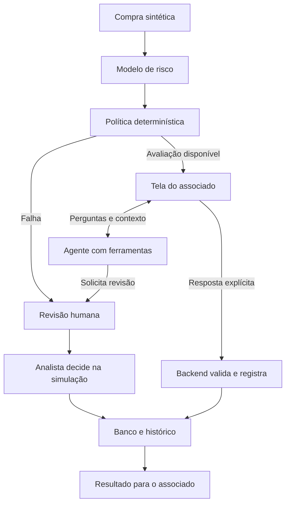

# Inteli-Raiz — Documentação do projeto

**Confirmação assistida de compras para associados do Sicredi**
Versão 1.1 · Atualizada em 08/11/2026 (consolidação original em 05/11/2026) · Estado: documentação para revisão da equipe.

**Acesse:** [aplicação publicada](https://raiz-jq28.onrender.com) · [vídeo de demonstração](../demonstracao/README.md) · [mapa do repositório](../README.md#como-navegar-pelo-repositório) · [tecnologias](tecnologias.md) · [guia de uso e logins](anexos/sistema/como-usar-a-demonstracao.md)

## O projeto em uma página

O projeto ajuda o associado a entender uma compra sinalizada e responder se reconhece e autoriza, não reconhece ou está em dúvida. A tela apresenta os dados da compra; um assistente de IA esclarece perguntas consultando informações autorizadas; o sistema registra a resposta e encaminha exceções para análise humana.

O objetivo é verificar se a conversa contextual melhora a compreensão do alerta e do próximo passo. O protótipo usa transações sintéticas e ações financeiras simuladas. Ainda não medimos redução de fraudes, economia operacional ou melhoria da experiência com participantes reais.

A construção reuniu análise de dados, um classificador de risco, regras de decisão, backend, interface e agente. O projeto começou com uma proposta centrada na analista e passou a priorizar o associado. Esta documentação explica essa evolução e os motivos registrados para as escolhas.

**Situação disponível:** há código de API, interface e agente; existe log de 207 testes de backend aprovados em 04/11/2026, na versão `f741a35`. Esses testes usam modelos controlados. Na integração de 05/11 foram executados 86 testes de sessão, confirmação, revisão e reset, aprovados em 64,16 s na base `9d54d1a`; não houve ensaio pelo navegador, treino ou teste com usuários. A documentação foi integrada à `develop` em 05/11/2026 (PR #25), preservando a reformulação do canvas e dos textos da Isadora (PR #24); o log de 04/11 se refere ao código `f741a35` e é distinto do subconjunto de 86 testes executado nesta integração. Em 08/11 a aplicação foi publicada em <https://raiz-jq28.onrender.com>; um teste pela API confirmou login, lista de compras, fila da analista, modelo de risco carregado e uma resposta real do copiloto com o LLM configurado.

**Custo de referência:** para 1.000 confirmações/mês, o cenário base prevê cerca de **R$ 159/mês de hospedagem, backup e IA**. Incluindo tempo humano de revisão, manutenção e uma licença Bob, o custo alocado chega a **R$ 986/mês**. São cálculos com preços públicos e hipóteses de consumo, detalhados na seção 5; não são faturas da equipe.

**Os valores financeiros não são despesas comprovadas do projeto.** São estimativas de orçamento; não foram apresentados comprovantes de pagamento nem registros de gastos efetivos da equipe ou da Sicredi.

### Como ler

1. [Contexto e desafio](#contexto)
2. [Usuário e pesquisa](#usuario)
3. [Discussões e escolhas](#escolhas)
4. [Solução e proposta de valor](#valor)
5. [Viabilidade financeira](#financeiro)
6. [Dados e modelo](#dados)
7. [Planejamento e evolução](#planejamento)
8. [Construção da solução](#construcao)
9. [Experiência e fluxo final](#fluxo)
10. [Testes, resultados e pendências](#validacao)
11. [Entrega final e fontes](#entrega)

Os [anexos](anexos/README.md) preservam documentos de origem, contratos, instruções de execução, imagens, registros e planos históricos. Os códigos D01–D13 identificam as entregas do curso. Aqui eles aparecem na correspondência ao final, sem interromper a história. Para localizar código, notebooks, dados e relatórios do Bob, use o [mapa do repositório](../README.md#como-navegar-pelo-repositório).

<a id="contexto"></a>
## 1. Contexto e desafio

O trabalho pertence à Trilha 4 do IBM AI Experiential Learning Lab 2026, na optativa IBM do Inteli. O desafio Sicredi aborda prevenção a fraudes em compras com cartão e inclui alerta preventivo e confirmação pelo associado. A equipe escolheu explorar o momento em que uma pessoa recebe uma compra para verificar e precisa decidir como responder.

A hipótese inicial é que pouco contexto, nomes de estabelecimentos difíceis de reconhecer e insegurança sobre a consequência dos botões podem dificultar essa decisão. Isso orienta a investigação; não demonstra que o Sicredi não tenha canais de confirmação nem descreve seu atendimento real. Os materiais disponíveis não incluem pesquisa primária concluída sobre esses processos.

A oportunidade escolhida foi apresentar a compra com clareza, permitir resposta explícita e oferecer ajuda contextual. O recorte permite avaliar compreensão e conclusão de tarefas em um protótipo, sem depender de integração financeira produtiva.

**Pergunta de projeto:** como ajudar o associado a decidir sobre uma compra sinalizada, entendendo o que está autorizando e qual é o próximo passo quando continua em dúvida?

**Fontes de origem:** [problema e oportunidades](anexos/produto/problema-e-oportunidades.md), [desafio e exigências IBM](anexos/gestao/exigencias-da-ibm.md) e PDFs em [contexto](../contexto/).

<a id="usuario"></a>
## 2. Usuário e pesquisa

### De Camila para Valdir

O design inicial representava duas pontas: Camila, analista de prevenção a fraudes, e Valdir, associado que recebe o alerta. Camila conduzia a experiência: fila de casos, avaliação, decisão e contato com o associado. O plano de 23/10 mudou a direção para confirmação pelo associado; o alinhamento de 28/10 resolveu a divergência com o console que vinha sendo construído.

Na direção atual, Valdir representa o usuário principal. Seu objetivo funcional é reconhecer a compra, entender o efeito da resposta e resolver a dúvida sem repetir todo o contexto em outro canal. Camila permanece como papel secundário, responsável pelas exceções. As sessões fictícias Ana, Bruno e Carla usadas na demonstração são identidades de teste; não são participantes de pesquisa nem substituem essas personas.

| Elemento | O que orienta no produto | Estado da informação |
|---|---|---|
| Uso esporádico e pouca familiaridade com termos financeiros | Linguagem simples, contexto antes dos botões e resultado explícito | Hipótese da protopersona |
| Nome de estabelecimento ambíguo | Mostrar informação disponível e explicar limites | Cenário de projeto; sem identidade comercial inventada |
| Confusão entre recusa e bloqueio do cartão | Resultado deve falar da compra e do encaminhamento | Hipótese a testar |
| Dúvida sobre pedir ajuda | Separar pedido de atendimento da resposta “Estou em dúvida” | Regra do produto; compreensão ainda a testar |
| Acesso em celular/conexão instável | Carregamento, erro, repetição segura e legibilidade | Requisito; inspeção humana pendente |

Os dados biográficos do Valdir e as falas ilustrativas dos materiais antigos são construções de design. Não vieram de entrevista. Não usamos idade, profissão ou região como perfil confirmado dos associados.

### Pesquisa preparada

Há roteiro para perguntar sobre episódios reais antes de apresentar a solução, registrar fontes, distinguir relato de interpretação e observar a pessoa realizando tarefas. O piloto propõe 3–5 participantes conforme acesso, declarando se são associados, usuários de serviços financeiros ou colegas. Essa quantidade serve para revelar problemas de uso; não é amostra representativa.

O teste comparativo deve manter os mesmos dados, botões e acesso à revisão nas duas condições. A única diferença será o chat: indisponível em A e disponível em B. A ordem deve alternar entre participantes. Os resultados continuam pendentes.

**Fontes de origem:** [perfil e cenários](anexos/experiencia-do-usuario/perfil-do-usuario-e-cenarios.md), [necessidades](anexos/experiencia-do-usuario/necessidades-do-usuario.md), [jornada atual](anexos/experiencia-do-usuario/jornada-atual-do-usuario.md), [entrevistas](anexos/experiencia-do-usuario/roteiro-de-entrevistas.md) e [descoberta histórica](anexos/experiencia-do-usuario/processo_design/00-descoberta/README.md).

<a id="escolhas"></a>
## 3. Discussões e escolhas

Esta seção reúne decisões encontradas nos documentos e no Git. Não é transcrição de reuniões. Quando o material contém apenas um roteiro de discussão, ele permanece como atividade proposta.

| Questão | Caminhos considerados | Escolha registrada e motivo |
|---|---|---|
| Quem conduz o produto? | Analista como protagonista ou confirmação direta pelo associado | Associado como usuário principal; analista nas exceções. O fluxo fica próximo da decisão que queremos esclarecer. |
| É necessário conversar com IA? | A: interface com texto fixo; B: mesma interface com agente; C: atendimento humano como caminho principal | Manter A como núcleo, investigar B e reservar C para exceções. A vantagem do agente ainda precisa de teste. |
| Onde o modelo e o agente rodam? | Orchestrate/watsonx.ai como dependência ou execução no backend | Retirar Orchestrate da dependência de execução e carregar o modelo localmente. O plano registra dificuldades com o serviço e alinhamento recebido; o teste watsonx.ai fica como histórico. |
| Como autorizar uma compra? | Resposta interpretada pelo chat ou controle explícito na interface | Somente os controles humanos registram a resposta. O agente consulta e solicita revisão. |
| “Estou em dúvida” é pedir atendimento? | Uma única ação ou duas ações com efeitos distintos | Separar. UNSURE responde e envia à revisão; pedir atendimento mantém a confirmação respondível até o prazo original. |
| Como aproveitar o frontend existente? | Descartar a base ou adaptar React + Carbon | Aproveitar a implementação, criar o percurso do associado e limitar a visão da analista às exceções. |
| Que complexidade adicionar? | RAG, múltiplos agentes, biometria, streaming, integração bancária | Não incorporar sem necessidade demonstrada; o protótipo trabalha com um agente e ferramentas. |

A matriz de alternativas é uma revisão documental de uma direção já escolhida. O arquivo de priorização informa que o brainstorming coletivo proposto ainda não foi executado. Não atribuímos consenso de reunião a essa comparação.

**O que poderia mudar a escolha:** se o fluxo sem chat tiver compreensão e conclusão equivalentes, sem mais erros, a camada conversacional precisa ser revista. Nome comercial ausente não passa a ser conhecido por usar IA.

**Fontes de origem:** [escolha da solução](anexos/produto/escolha-da-solucao.md), [regras do produto](anexos/gestao/regras-do-produto.md), [decisões técnicas](anexos/sistema/arquitetura/decisoes/) e [fontes e hipóteses](anexos/gestao/fontes-e-hipoteses.md).

<a id="valor"></a>
## 4. Solução e proposta de valor

A solução apresenta uma compra sinalizada, oferece contexto e permite registrar uma resposta consciente. O classificador calcula um indicador de risco; regras determinísticas definem o tratamento; a IA ajuda a interpretar os dados; o associado responde; o backend valida e persiste o resultado.

| Para quem | Benefício esperado | Como verificar |
|---|---|---|
| Associado | Entender o alerta, a consequência da resposta e o próximo passo | Tarefas e perguntas de compreensão, com contagens de acerto e erro |
| Equipe de atendimento | Receber exceções com contexto e evitar repetição desnecessária | Medir esforço e retrabalho antes/depois em operação comparável |
| Instituição | Melhor experiência e possível redução de esforço de atendimento | Validar uso, custos e atendimento; interesse de adoção ainda não confirmado |

A justificativa da IA é a possibilidade de responder perguntas livres sobre a compra usando ferramentas. A apresentação dos sinais, os botões, o registro e o acesso à revisão já podem existir sem LLM. Portanto, o valor adicional do chat deve ser demonstrado contra essa mesma interface.

O agente pode consultar compra, análise e status, informar uma lacuna e solicitar revisão. Não pode identificar uma empresa sem fonte, expor o score como probabilidade de fraude, responder por outra pessoa ou autorizar em nome do associado.

**Fontes de origem:** [conceito](anexos/produto/como-a-solucao-funciona.md), [proposta de valor](anexos/produto/proposta-de-valor.md) e [benefícios e IA](anexos/produto/beneficios-e-uso-da-ia.md).

<a id="financeiro"></a>
## 5. Viabilidade financeira

### 5.1. O que foi calculado e o que é preço pesquisado

Até 04/11, a análise financeira tinha fórmulas e volumes ilustrativos, sem cotações monetárias. Em 05/11/2026 completamos o orçamento com preços públicos e referências de remuneração. Continuam hipotéticos os volumes, tokens, tempos, horas produtivas e esforço de construção. Não foram consultadas faturas da equipe, contratos da Sicredi ou proposta comercial de implantação bancária.

| Item pesquisado | Referência adotada | Fonte e limite |
|---|---|---|
| LLM do código: Groq `openai/gpt-oss-120b` | US$ 0,15/milhão de tokens de entrada; US$ 0,60/milhão de saída | [Tabela oficial Groq](https://console.groq.com/docs/models), consulta 05/11. Sem desconto por cache ou plano gratuito. |
| Servidor para orçamento de demonstração | US$ 24/mês; 4 GiB RAM, 2 vCPU, 80 GiB SSD | [DigitalOcean Basic Regular](https://www.digitalocean.com/pricing/droplets). Dimensionamento candidato, sem teste de carga. |
| Backup semanal da VM | 20% da VM = US$ 4,80/mês | [Preço oficial de backups](https://docs.digitalocean.com/products/backups/details/pricing/). Restauração consistente do banco precisa de teste. |
| Conversão de moeda | R$ 5,4778/US$ | [BCB: PTAX venda fechada em 04/11/2026](https://ptax.bcb.gov.br/ptax_internet/consultarUltimaCotacaoDolar.do), consultada em 05/11. Não é o câmbio do cartão. |
| Referência salarial de atendimento | R$ 2.826,43/mês | [Documento público SINTTEL/SINDINFORMÁTICA-GO](https://sindinformatica.com.br/wp-content/uploads/2026/06/Termo-aditivo-SINTTEL-2026.pdf), p.2, registro GO000508/2026. Piso de atendimento/tráfego, usado como aproximação; não representa especialista antifraude nem remuneração da Sicredi. |
| Referência salarial de desenvolvimento | R$ 8.458,30/mês | [Portal Salário, CBO 2124-05](https://www.salario.com.br/profissao/analista-de-desenvolvimento-de-sistemas-cbo-212405/), página de 08/10/2026, consultada em 05/11. Média nacional de salário-base, não tarifa de consultoria. |
| IBM Bob Pro | A partir de US$ 20 por usuário/mês | [Preço oficial IBM](https://www.ibm.com/products/ai-coding-agent/pricing), consulta 05/11. Quota limitada; não garante Bobcoins suficientes. |

A VM orçada concentra aplicação, banco e modelo local, com armazenamento persistente. O código usa SQLite por padrão local e PostgreSQL no Compose. Não somamos banco gerenciado ou GPU: eles não fazem parte dessa configuração de orçamento. A VM não foi contratada nem teve capacidade comprovada. Esse cenário não cobre disponibilidade ou requisitos de uma implantação bancária.

### 5.2. Premissas de uso e trabalho

| Premissa mensal | Base | Uso intenso | Contexto longo |
|---|---:|---:|---:|
| Confirmações | 1.000 | 1.000 | 1.000 |
| Pessoas que usam chat, como fração das confirmações | 30% | 100% | 100% |
| Chamadas de LLM por sessão, incluindo ciclos de ferramentas | 2 | 4 | 8 |
| Tokens de entrada por chamada | 1.500 | 1.500 | 10.000 |
| Tokens de saída faturados por chamada | 250 | 250 | 2.000 |
| Fração das confirmações que exige revisão humana | 10% | 30% | 30% |
| Minutos por revisão | 5 | 10 | 10 |

A saída deve ser medida pelo consumo faturado, incluindo raciocínio quando contabilizado pelo provedor, não apenas pelas palavras visíveis. Entrada inclui instruções, ferramentas, histórico e resultados consultados. Os primeiros cenários podem subestimar conversas longas; o terceiro explicita esse risco. Não são teto de gasto nem medição do agente. O modelo usa raciocínio, conforme a [documentação Groq](https://console.groq.com/docs/reasoning).

Para transformar salário em custo de referência, adotamos **fator 2,0** e **160 horas produtivas/mês**: atendimento = R$ 35,33/h; desenvolvimento = R$ 105,73/h. Ambos são escolhas de orçamento, sem apuração de encargos ou produtividade da instituição. O fator não é uma alíquota legal. Uma equipe especializada pode custar mais.

Também reservamos **4 horas de manutenção/mês**, **uma licença Bob Pro na manutenção**, **quatro licenças por um mês na construção** e **160 horas-pessoa para construção**. São cenários novos de reposição de um protótipo equivalente, não horas realizadas pelo grupo. O orçamento pode mudar com acesso educacional, trial ou consumo maior de Bobcoins; não presumimos gratuidade.

### 5.3. Resultado mensal

<!-- custos-calculados:inicio -->
| Custo mensal de referência | Base | Uso intenso | Contexto longo |
|---|---:|---:|---:|
| Hospedagem e backup | R$ 157,76 | R$ 157,76 | R$ 157,76 |
| IA por consumo | R$ 1,23 | R$ 8,22 | R$ 118,32 |
| Subtotal de tecnologia | R$ 158,99 | R$ 165,98 | R$ 276,08 |
| Tempo humano de revisão (custo alocado) | R$ 294,42 | R$ 1.766,52 | R$ 1.766,52 |
| Manutenção técnica: 4 h/mês (hipótese) | R$ 422,92 | R$ 422,92 | R$ 422,92 |
| Bob Pro: 1 usuário na manutenção (hipótese) | R$ 109,56 | R$ 109,56 | R$ 109,56 |
| Total mensal estimado | R$ 985,88 | R$ 2.464,97 | R$ 2.575,07 |
| Custo alocado por confirmação | R$ 0,99 | R$ 2,46 | R$ 2,58 |
<!-- custos-calculados:fim -->

O total inclui alocação fracionária de trabalho. Não equivale à folha mínima necessária para manter uma equipe ou plantão. Hospedagem e licenças são preços de referência; horas humanas são custo econômico estimado. O subtotal de tecnologia não deve ser apresentado como custo completo da operação.

**Exemplo do cenário base:** 1.000 × 30% × 2 = 600 chamadas. Elas consomem 900.000 tokens de entrada e 150.000 de saída: US$ 0,225, equivalentes a R$ 1,23. A VM e o backup somam US$ 28,80, ou R$ 157,76. As 100 revisões de 5 minutos somam 8,33 horas, valoradas em R$ 294,42. Os cálculos usam precisão integral antes do arredondamento.

### 5.4. Construção e custo do primeiro ano

Com o custo de desenvolvimento de referência, quatro licenças Bob por um mês somam R$ 438,22. A sensibilidade por esforço total é:

| Horas-pessoa de construção | Trabalho estimado + Bob na construção |
|---|---:|
| 80 h | R$ 8.896,52 |
| 160 h — referência | R$ 17.354,82 |
| 320 h | R$ 34.271,42 |

No cenário base, **160 horas de construção + 12 meses de operação alocada = R$ 29.185,43**. Esse total já inclui Bob na construção e na manutenção; não somar as licenças novamente. É uma projeção condicionada ao esforço e uso supostos. Pesquisa, integração produtiva, auditoria e segurança adicionais precisam de escopo e estimativa próprios.

### 5.5. Quando poderia compensar?

Um contato humano de cinco minutos custa aproximadamente **R$ 2,94** usando a referência adotada. No cenário base, compensar todo o custo mensal estimado de R$ 985,88 apenas com redução adicional de atendimento exigiria **335 contatos de cinco minutos efetivamente evitados/mês**. Isso é um limiar aritmético; não demonstramos que esses contatos existem ou possam ser evitados. Não recupera o investimento de construção.

A comparação correta do valor da IA é B contra A: as duas condições já têm interface, contexto e revisão. Se esses custos forem iguais, o custo incremental de tokens do cenário base é R$ 1,23/mês. Um contato de cinco minutos a menos cobriria **somente os tokens**, sem demonstrar retorno total; manutenção adicional, avaliação, erros ou atendimento extra podem eliminar essa vantagem.

Antes de calcular retorno ou prazo de recuperação, medir: volume atual de contatos por dúvida, tempo por contato, revisões que continuam necessárias, erro de decisão, consumo faturado e esforço adicional de manutenção. Tempo liberado só vira economia de caixa quando permite uma redução real de despesa ou evita uma contratação. Nenhuma conta considera valor de compras sinalizadas como fraude evitada.

### 5.6. Sensibilidades, exclusões e reprodução

Câmbio 20% maior aumenta em 20% somente os componentes em dólar. Dobrar minutos ou custo-hora dobra a parcela de revisão. Crescimento de tokens/ciclos altera a IA e pode exigir redimensionar a VM; 1.000 confirmações é premissa de volume, não teste de capacidade. O orçamento exclui impostos, IOF, spread, domínio, mensageria paga, excedentes, integração bancária, estrutura de produção e Bobcoins adicionais. Não é cotação fechada para operação financeira real.

Preços, fontes e hipóteses estão em [premissas financeiras](anexos/gestao/premissas-financeiras.json). Para recalcular ou conferir a tabela:

```bash
python3 scripts/calcular_custos_projeto.py
python3 scripts/calcular_custos_projeto.py --check
```

<a id="dados"></a>
## 6. Dados e modelo

### O que a equipe analisou

O nome do case menciona 900 mil transações. O recorte local documentado tem **160.000 registros, 297 colunas e 146 fraudes confirmadas pelo alvo `feedback_label`**. Todas as contagens e métricas abaixo pertencem a esse recorte sintético.

A análise procurou qualidade e ausência de dados, concentração dos positivos, distribuição de valores, presença do cartão, horário, distância e sinais de velocidade. Também separou scores prontos e informações posteriores à decisão para investigar risco de vazamento. Essas associações ajudam a construir hipóteses e características; não explicam causalmente uma fraude ou a decisão do modelo.

A preparação gerou treino balanceado de **234 registros, sendo 117 positivos**, e teste com proporção real de **32.000 registros, sendo 29 positivos**. Foram criadas sete características, incluindo transformações de horário, valor e contexto. Há divergência documental de 31 versus 28 features; o código e a aplicação referenciam 28, e o manifesto precisa ser reconciliado antes de novas alegações de desempenho.

### O que o modelo mostrou

Foi construído um pipeline de pré-processamento e Random Forest. O relatório apresenta PR-AUC **1,000 com quatro features de velocidade pré-calculadas** e **0,146 sem elas**. São duas condições diferentes da análise, não métricas intercambiáveis de um único modelo em produção.

A queda indica forte dependência daqueles sinais na base sintética e exige investigar sua disponibilidade e generalização. Não prova, sozinha, vazamento temporal específico. O conjunto de teste já foi consultado em análise e escolha de limiar; não é um holdout intocado. A concentração temporal dos positivos também limita validação futura.

O score é um indicador de ranqueamento. Não o apresentamos como probabilidade calibrada nem como porcentagem de fraude ao associado. O limiar 0,817 aparece na configuração do classificador; a política conservadora do produto não o transforma em autorização automática.

**Resultados completos e figuras:** [análise](anexos/dados-e-modelo/analise-dos-dados.md), [preparação](anexos/dados-e-modelo/preparacao-dos-dados.md), [avaliação](anexos/dados-e-modelo/avaliacao-do-modelo.md), [notebooks](../notebooks/) e [dados na aplicação](anexos/dados-e-modelo/dados/README.md). Não treinamos ou reproduzimos essas métricas durante esta consolidação.

<a id="planejamento"></a>
## 7. Planejamento e evolução

A sequência abaixo foi reconstruída a partir de versões do Git e registros datados. Data de commit é evidência de versionamento; não comprova a data de uma reunião ou a execução de todo trabalho descrito.

| Momento | O que mudou | Registro recuperável |
|---|---|---|
| 19–22/10 | Organização inicial, análise dos dados e desenho de MVP centrado na analista; plano com prazo e escopo maior | [Plano inicial de 22/10](anexos/historico/plano-inicial-2026-10-22.md), commit `c09a672` |
| 23/10 | Novo plano passa a colocar o associado na confirmação | `70310de`, origem das [regras do produto](anexos/gestao/regras-do-produto.md) |
| 27/10 | Retirada de Orchestrate da dependência de runtime; modelo local; planejamento em quatro funções e entregas | `9321f6e`, `0985e0b`, `3f95da9`; teste watsonx.ai registrado em `5f9d8a9` |
| 28/10 | Alinhamento com Watson: aproveitar frontend, distinguir ajuda de UNSURE e manter política conservadora | `5812997`; [plano operacional](anexos/historico/plano-operacional-2026-10-28.md) e [backlog](anexos/historico/backlog-2026-10-28.md) |
| 28–29/10 | Pacotes documentais de pesquisa, estrutura/arquitetura, protótipo, fluxo e validação | `8a7aefc`, `466a4fc`, D09/D10 e registro comum de fontes |
| 03–04/11 | Integração de interface/API, correção do lock do banco durante chat e reset da demonstração; consolidação dos documentos | `ccb95f1`, `5e54b77`, `effc6df`; [revisão de 04/11](anexos/gestao/revisao-da-documentacao-2026-11-04.md) |
| 04/11 | Execução documentada de 207 testes de backend, com ambiente e hash do modelo | [Log](anexos/evidencias/2026-11-04/pytest.log), código `f741a35` |
| 05/11 | Consolidação contínua, cotações financeiras e integração à develop, incluindo o canvas da Isadora; prompt do agente alinhado ao pedido de revisão (TEC-01) | PRs #24, #25 e #27 |
| 05–06/11 | Evolução das telas: triagem automática de risco com bloqueio preventivo, contestações, justificativa obrigatória e histórico da analista, rotas por perfil, painel de dados da analista e copiloto global do associado | PRs #28 e #29 |
| 06/11 | Relatórios das sessões no IBM Bob de todos os integrantes | PRs #26 e #30; pasta [bob_sessions](../bob_sessions/) |
| 07–08/11 | Vídeo de demonstração, imagem única para publicação e aplicação no ar no Render | `30a5fb2`, `0b659b8`; [vídeo](../demonstracao/README.md) e [infraestrutura](../watson/infra/README.md#publicar-no-render) |

### Como o trabalho foi dividido

O planejamento antigo tinha cinco integrantes e janela de quinze dias. A revisão passou a quatro funções: Produto, Pesquisa, Arquitetura e Integração/validação. Não transportamos automaticamente nomes, datas ou estimativas antigas para a organização atual.

| Função | Responsabilidade documental | Passagem de trabalho |
|---|---|---|
| Produto | Problema, alternativas, conceito e valor | Usa fontes de pesquisa e restrições técnicas |
| Pesquisa | Necessidades, jornada, persona e roteiro | Informa textos, telas e perguntas do piloto |
| Arquitetura | Requisitos, componentes, contratos e viabilidade técnica | Orienta implementação e revisão técnica |
| Integração e validação | Registro do fluxo, protótipo e consolidação de evidências | Reproduz o trabalho dos autores e organiza testes/retestes |

Leonardo aparece nos registros como executor do frontend. Liderar um documento não atribui toda a implementação àquela função. A equipe ainda deve confirmar nomes e revisores de cada aceite. O plano operacional contém cards C01–C32; a existência do card não é prova de conclusão.

Os planos recuperados ficam identificados como históricos. Eles permitem entender o caminho percorrido, enquanto o estado atual está na seção 10 e na matriz de pendências. Não há registro suficiente para reconstituir todas as falas, reuniões ou razões informais do grupo.

<a id="construcao"></a>
## 8. Construção da solução

### Componentes

| Componente | Implementação no repositório | Papel |
|---|---|---|
| Interface | React + Carbon em `watson/frontend/` | Sessão fictícia, compra, respostas, chat, revisão e resultado |
| API | FastAPI em `watson/backend/` | Valida acesso, prazos, versões, repetição e operações |
| Banco | SQLAlchemy; SQLite no padrão local e na versão publicada, PostgreSQL no Compose | Preserva compra, confirmação, revisão, mensagens, eventos e chaves idempotentes |
| Classificador | Random Forest/scikit-learn, `outputs/modelo_rf.joblib` | Calcula indicador de risco local |
| Política | Código determinístico de intake/confirmação | Avaliação disponível solicita confirmação; falha encaminha à revisão |
| Agente | Pydantic AI, padrão Groq `openai/gpt-oss-120b`; chat na compra e copiloto global do associado | Consulta contexto e solicita revisão; depende de chave para uso real |
| Publicação | Render, imagem única em `watson/infra/docker/app.Dockerfile` e `render.yaml` | Serve interface, API e modelo na mesma origem; o SQLite volta ao estado inicial a cada reinício |
| IBM Bob | Ferramenta de desenvolvimento | Apoia tarefas da equipe, com relatórios em `bob_sessions/` e regras em `.bob/rules/` |



### Decisões técnicas e controles

FastAPI mantém modelo e backend no ecossistema Python; React + Carbon aproveita a interface existente. SQLAlchemy separa persistência da lógica. A possibilidade de configurar outro banco não prova compatibilidade testada com todos os drivers. O deploy histórico no watsonx.ai demonstra uma integração daquele momento; não é dependência presumida do chat atual.

A identidade da compra e da pessoa vem da sessão validada pelo backend, nunca de texto preenchido pelo LLM. A resposta humana usa uma confirmação específica, versão e chave de idempotência. Repetições devolvem o resultado anterior ou conflito apropriado, sem uma segunda ação financeira simulada. O servidor valida o prazo; o relógio da tela é apenas apresentação.

O banco reúne seis tabelas centrais: compras, confirmações, revisões, eventos, mensagens e chaves de idempotência. A análise fica associada à compra; a resposta e seus efeitos são persistidos com controle transacional. Não se extrai a decisão do texto do chat.

Os requisitos incluem avaliação com origem/versão, compra correta, três respostas, expiração, isolamento de usuários, idempotência, explicação fiel, ajuda contextual, erro explícito, persistência, transparência sobre simulação e reprodução por outra pessoa.

**Detalhes técnicos:** [tecnologias usadas](tecnologias.md), [requisitos](anexos/sistema/requisitos-da-solucao.md), [arquitetura](anexos/sistema/arquitetura-do-sistema.md), [modelo de dados](anexos/dados-e-modelo/dados/modelo-de-dados.md), [contrato da API](anexos/sistema/specs/contrato-da-api.md) e [código](../watson/README.md).

<a id="fluxo"></a>
## 9. Experiência e fluxo final

O percurso integrado começa no login com e-mail e senha fictícios, segue para lista e detalhe da compra e apresenta resposta explícita, ajuda e resultado. O console antigo permanece como legado visual; seus desenhos não representam o percurso atual de aceite.

| Etapa | Experiência proposta | Resultado esperado |
|---|---|---|
| 1. Abrir a compra | Identificação disponível, valor, data, cartão parcial, sinais e prazo | A pessoa entende qual compra está sendo verificada |
| 2. Esclarecer dúvida | Chat consulta a compra ou o status e responde com limites | Não inventar estabelecimento, score ou dado indisponível |
| 3. Reconhecer e autorizar | Controle explícito envia AUTHORIZE | Liberação simulada registrada |
| 4. Não reconhecer | Controle explícito envia DENY | Recusa simulada e revisão de proteção; sem bloqueio automático do cartão |
| 5. Declarar dúvida | Controle explícito envia UNSURE | Revisão pendente, sem autorização |
| 6. Pedir atendimento | Ação separada abre ou reaproveita revisão | Confirmação continua respondível enquanto válida; prazo não muda |
| 7. Não responder | Servidor verifica expiração | Confirmação expirada, sem aprovação presumida |
| 8. Ver resultado | Tela lê o estado persistido, inclusive após recarga | Compra, consequência e próximo passo claros |
| 9. Concluir a revisão | Analista abre a fila e decide liberar ou recusar na simulação | Revisões abertas da compra são encerradas; novo status fica disponível ao associado ao atualizar |

Falha do LLM gera indisponibilidade explícita e preserva os controles humanos. Informação ausente é apresentada como limite. Na direção atual, o modelo experimental não autoriza sozinho os casos avaliados.

Os textos e estados foram documentados a partir do código. Legibilidade em celular, teclado, foco, erros de rede e compreensão ainda precisam de inspeção e teste humano. Não apresentamos imagens antigas de console como capturas do fluxo atual.

A decisão da analista usa `POST /api/reviews/{review_id}/decision`, restrito ao papel ANALISTA. Ela é um encaminhamento humano de exceção e não altera a resposta originalmente registrada pelo associado. O endpoint grava `ANALYST_DECISION` e encerra as revisões abertas da compra.

**Para usar:** [guia da demonstração](anexos/sistema/como-usar-a-demonstracao.md). **Para entender as telas:** [telas e fluxo](anexos/experiencia-do-usuario/telas-e-fluxo-do-usuario.md).

<a id="validacao"></a>
## 10. Testes, resultados e pendências

| Dimensão | Evidência disponível | O que ela não comprova |
|---|---|---|
| Backend | Log histórico de 207 testes em `f741a35`; nova execução parcial em 05/11: 86 testes de sessão, confirmação, revisão e reset em `9d54d1a` | Navegação independente, LLM externo real ou experiência com pessoas |
| Modelo | Relatório e notebooks, com comparação de features de velocidade | Generalização em produção ou probabilidade calibrada |
| watsonx.ai | Spec relata teste real de 27/10 | Disponibilidade atual do deploy ou uso pelo chat |
| Pesquisa | Roteiro, hipóteses e protocolo preparados | Entrevistas, participantes, achados ou resultados já coletados |
| Financeiro | Cotações públicas em 05/11 e cálculo reproduzível | Despesa efetiva, capacidade do servidor, retorno ou economia comprovada |
| Documentação | Fontes, versões e decisões consolidadas; anexos preservados | Revisão cruzada por outra pessoa |

A suíte registrada cobre confirmação, prazo, isolamento, idempotência/concorrência, revisão, histórico, score local e falha do chat. O hash do modelo e o ambiente estão no registro original. A suíte integral de 207 testes não foi repetida. A integração de 05/11 executou o subconjunto de quatro arquivos: [registro de 86 testes aprovados](anexos/evidencias/2026-11-05/integracao-develop.json), com código conferido contra a árvore local.

### Próximos passos de validação

1. Outro integrante percorre a interface e salva versão, resultado, capturas e estado persistido dos casos críticos.
2. Registrar ferramentas, resposta e estado antes/depois com o LLM real, sem credenciais. O LLM já está configurado na versão publicada e o prompt passou a descrever o pedido de revisão (TEC-01, PR #27); falta o rastro completo de uma interação real.
3. Conferir manifesto de 28 features, tratamento de madrugada/nulos, classes e corte temporal; reconciliar referências antigas e preservar um novo holdout quando necessário.
4. Preparar A/B com informações idênticas e aplicar o piloto. Medir conclusão sem ajuda, compreensão, erros, tempo e intervenção do moderador. Corrigir os problemas e repetir os cenários afetados.
5. Medir tokens, ciclos de ferramentas, tempo de atendimento, memória/carga da aplicação e horas de manutenção. Substituir hipóteses financeiras por observações.
6. Fazer revisão cruzada da URL publicada, do vídeo e das declarações, conferindo que descrevem a versão demonstrada.

Cada resultado precisa de versão, método, contagens e limite. Uma autorização equivocada num cenário controlado é achado crítico, não uma tolerância automática. Um piloto pequeno não representa todos os associados.

**Estado detalhado:** [pendências](anexos/gestao/o-que-falta-concluir.md), [reprodução do fluxo](anexos/sistema/reproducao-e-testes-do-fluxo.md), [cenários](anexos/sistema/cenarios-e-evidencias-de-teste.md), [protocolo com pessoas](anexos/experiencia-do-usuario/plano-de-testes-com-usuarios.md) e [evidências](anexos/evidencias/README.md).

<a id="entrega"></a>
## 11. Entrega final e fontes

A documentação reúne o percurso de desenvolvimento e serve de base para a narrativa final. O pacote descrito no guia IBM reúne vídeo de três minutos, declaração do problema/solução com link funcional, declaração tecnológica e relatórios reais das sessões Bob. O checkpoint e os campos vigentes precisam ser conferidos pelo líder na plataforma. Os documentos de apoio D01–D13 não são treze submissões obrigatórias separadas.

Em 08/11 o pacote ganhou suas peças principais: a [aplicação publicada](https://raiz-jq28.onrender.com), o [vídeo de demonstração](../demonstracao/README.md) e as declarações de problema/solução e de tecnologia em versão para revisão. Ainda não há comprovante de submissão nem revisão cruzada dessas peças. [Entrega final IBM](anexos/gestao/entrega-final-ibm.md) mantém os textos e o checklist.

### Correspondência das entregas com esta história

| Entregas | Onde foram incorporadas |
|---|---|
| D01 — oportunidades | Seção 1: problema e recorte |
| D02, D03, D06 — empatia, jornada e persona | Seção 2: usuário, hipóteses e pesquisa |
| D04 — alternativas | Seção 3: escolhas e critérios |
| D05, D07 — conceito e ideia | Resumo, seções 4 e 9 |
| D08 — valor e IA | Seções 4 e 5 |
| D09, D10 — estrutura e arquitetura | Seções 6 e 8 |
| D11 — fluxo do MVP | Seções 8, 9 e 10 |
| D12 — experiência | Seções 2 e 9 |
| D13 — validação | Seções 2 e 10 |
| Planos, decisões, revisões e sessões | Seções 3, 7 e anexos históricos |
| Pacote IBM, referências e evidências | Seções 10 e 11; índice de anexos |

### Onde encontrar cada fonte

O [índice dos anexos](anexos/README.md) lista todos os arquivos de apoio por assunto, incluindo imagens e registros de execução. Contratos, roteiros e resultados detalhados continuam disponíveis para auditoria, sem exigir sua leitura para entender o projeto.

Os documentos FON/HIP/DEC permanecem com seus IDs no [registro de fontes e hipóteses](anexos/gestao/fontes-e-hipoteses.md). Fontes de mercado e premissas estão na seção 5 e no JSON financeiro. Planos históricos indicam o commit original. Sessões pessoais ficam em [bob_sessions](../bob_sessions/); sua existência não prova por si só a execução ou autoria de todas as tarefas descritas. Os arquivos `bob_sessions/pedro_faria/session_1.md` e `session_2.md` contêm roteiros de trabalho de pesquisa e validação preparados para o Bob; não devem ser apresentados como coleta com participantes.

Esta é a referência principal para leitura do projeto. O contrato da API continua normativo para detalhes HTTP; regras, resultados e histórico conservam suas versões nos anexos. Novas decisões devem atualizar esta história e apontar para sua evidência, preservando o que era hipótese e o que foi verificado.
