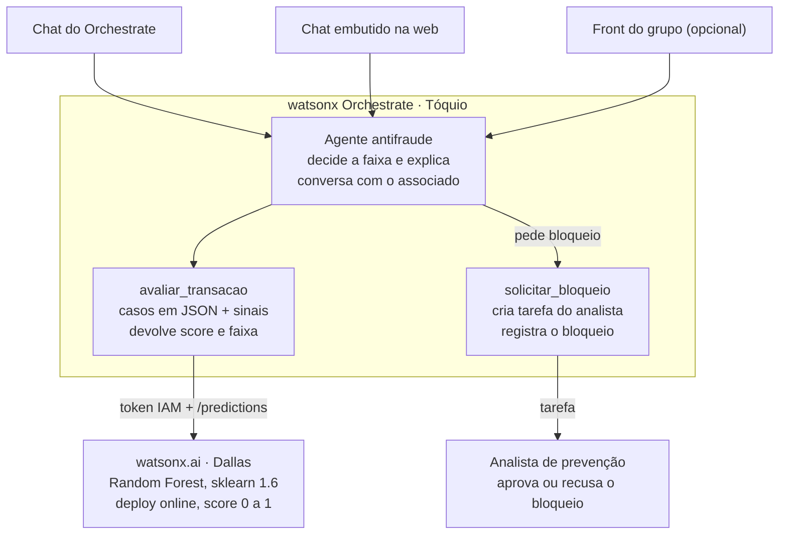
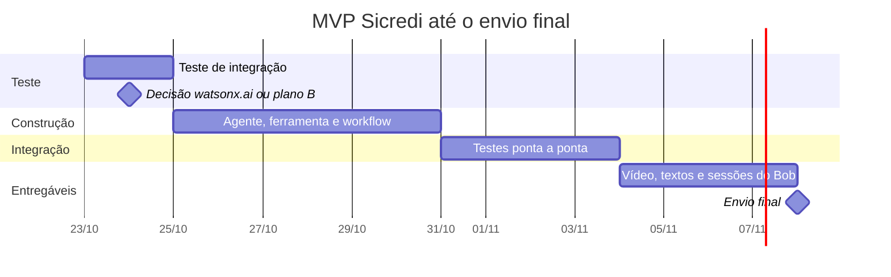

# Plano do MVP: Prevenção a Fraudes em Cartões (Sicredi)

> **Trilha 4, IBM AI Experiential Learning Lab 2026:** *Como podemos utilizar IA Agêntica para prever e intervir em possíveis fraudes relacionadas a compras com cartões, aumentando a segurança dos associados e reduzindo perdas para o Sicredi?*

O MVP é um agente no **watsonx Orchestrate**. Ele avalia a compra com o modelo hospedado no **watsonx.ai**, explica o risco, confirma com o associado e só bloqueia com aprovação do analista. A integração entre Orchestrate e watsonx.ai precisa estar provada até **24/10**. O envio final é em **08/11**.

> Este arquivo é a fonte da verdade do plano: mudanças entram aqui primeiro.

## Sumário

1. [Decisões fechadas](#1-decisões-fechadas)
2. [Arquitetura](#2-arquitetura)
3. [Fluxo do agente](#3-fluxo-do-agente)
4. [Cronograma](#4-cronograma)
5. [Tarefas por pessoa](#5-tarefas-por-pessoa)
6. [Teste de integração de 24/10](#6-teste-de-integração-de-2410)
7. [Riscos](#7-riscos)
8. [Fora do escopo do MVP](#8-fora-do-escopo-do-mvp)

---

## 1. Decisões fechadas

Decisões combinadas em 22/10. O critério geral é o MVP mínimo que mostra raciocínio, ação e humano no circuito.

| Tema | Decisão |
|---|---|
| Produto | Um agente avalia a compra, explica o risco, confirma com o associado na zona cinzenta e só bloqueia com aprovação do analista |
| Estrutura do agente | Um único agente no Orchestrate, com a ferramenta `avaliar_transacao` e o workflow `solicitar_bloqueio` |
| Faixas de decisão | Score abaixo de 0,30 libera; de 0,30 a 0,80 pede confirmação ao associado; acima de 0,80 pede bloqueio ao analista |
| Explicação | A ferramenta devolve sinais calculados por regra a partir da EDA; o agente só os coloca em palavras |
| Modelo | O Random Forest do [`03_modelo`](03_modelo.md), retreinado em scikit-learn 1.6 / Python 3.12, com as 4 features de velocidade |
| Onde o modelo roda | watsonx.ai Runtime (Dallas), chamado por uma ferramenta Python do Orchestrate (Tóquio) com token IAM |
| Transações da demo | De 10 a 15 casos escolhidos do conjunto de teste, guardados como JSON dentro da ferramenta |
| Cliente | A arquitetura não depende de cliente: chat do Orchestrate, chat embutido ou um front do grupo pela API |
| Código | Escrito no Bob IDE; cada membro tem sua pasta em `bob_sessions/` |
| Base | O arquivo do case tem 160 mil linhas, apesar do nome "900k"; os textos citam 160 mil |

---

## 2. Arquitetura

Qualquer cliente fala só com o agente, e o modelo fica atrás da ferramenta.

Os clientes chegam ao agente pelo chat ou pela API REST do Orchestrate. Se o grupo fizer um front, ele entra no lugar de qualquer cliente acima sem mudar o resto, porque toda a lógica fica no agente, na ferramenta e no workflow.

Todo o código é construído no Bob IDE, e as sessões de cada membro ficam em `bob_sessions/`.

---

## 3. Fluxo do agente

A demo começa com um pedido como "avaliar a transação T-07" e termina em uma de três saídas.

1. O agente chama `avaliar_transacao(id)`, que devolve `score`, `faixa` (`liberar`, `confirmar` ou `bloquear`) e a lista de `sinais`.
2. **Liberar**: o agente informa que a compra foi aprovada e por quê.
3. **Confirmar**: o agente explica o alerta ao associado ("compra de R$ 800 às 3h, 4× acima do seu padrão") e pergunta se ele reconhece a compra.
    - Reconhece: libera e registra.
    - Não reconhece: chama `solicitar_bloqueio`.
4. **Bloquear**: o agente chama `solicitar_bloqueio` direto, sem esperar o associado.
5. `solicitar_bloqueio` cria uma tarefa para o analista com o caso e a explicação. Se o analista aprovar, o bloqueio simulado é registrado; se recusar, a compra é liberada.

Nenhum bloqueio acontece sem aprovação humana.

---

## 4. Cronograma

O teste de 24/10 decide o caminho. O dia 07/11 fica só para a revisão final do repositório.

---

## 5. Tarefas por pessoa

Cada tarefa de código é feita no Bob e gera a sessão exportada em `bob_sessions/<nome>/`.

| Prazo | Responsável | Tarefa |
|---|---|---|
| 23/10 | Pedro R. | Ler as categóricas como texto, retreinar o pipeline em scikit-learn 1.6 / Python 3.12 e implantar no watsonx.ai Runtime (deploy online) |
| 24/10 | Lucas | Ferramenta Python mínima no Orchestrate que pega o token IAM e chama `/predictions` com um caso fixo |
| 24/10 | Todos | Decidir o teste de integração: segue com o watsonx.ai ou ativa o plano B |
| 27/10 | Pedro R. | Escolher de 10 a 15 casos do teste (fraude clara, legítima clara, zona cinzenta) e as regras dos sinais |
| 27/10 | Isadora e Pedro H. | Decidir se haverá front; rascunho do texto de problema e solução |
| 29/10 | Lucas | `avaliar_transacao` completa: casos em JSON, chamada ao modelo, faixa e sinais |
| 30/10 | Lucas | Agente com instruções para associado e analista, e o workflow `solicitar_bloqueio` com a tarefa do analista |
| 30/10 | Pedro R. | Atualizar o [`03_modelo`](03_modelo.md) com a versão 1.6 e o deploy |
| 31/10 | Isadora e Pedro H. | Roteiro do vídeo de 3 min, a partir do fluxo do agente |
| 03/11 | Lucas e Pedro R. | Rodar todos os casos ponta a ponta e corrigir o que falhar |
| 03/11 | Front (se houver) | Cliente chamando o agente pela API do Orchestrate |
| 05/11 | Isadora e Pedro H. | Gravar e editar o vídeo; publicar no YouTube |
| 06/11 | Todos | Texto de tecnologia, README final e sessões do Bob de cada membro em `bob_sessions/` |
| 07/11 | Pedro H. | Merge de `develop` em `main` e revisão final do repositório |
| 08/11 | Pedro H. | Envio final |

> Os nomes seguem a divisão combinada. Quem faz o envio final ainda precisa ser confirmado pelo grupo.

---

## 6. Teste de integração de 24/10

O teste passa quando a ferramenta Python rodando no Orchestrate de Tóquio recebe um score real do deployment em Dallas. O passo a passo, o contrato com o watsonx.ai e os pré-requisitos do modelo estão na [spec do teste](specs/teste_integracao_orchestrate_wml.md). A ferramenta está em [`agente/tools/pontuar_transacao.py`](../agente/tools/pontuar_transacao.py).

A documentação da IBM não garante três pontos, e é isso que o teste prova:

- a ferramenta Python consegue sair para a internet e alcançar `iam.cloud.ibm.com` e `us-south.ml.cloud.ibm.com`;
- o pacote `requests` passa na lista de pacotes permitidos do Orchestrate;
- a conexão `key_value` guarda a API key, a URL e o `deployment_id` e a ferramenta consegue lê-los.

**Plano B**, se o teste falhar até 24/10: a `avaliar_transacao` calcula o score por regras da EDA (madrugada, crédito sem cartão presente, valor acima da média do cartão, estabelecimento de risco). O agente, o workflow e a demo ficam iguais, e o modelo aparece só nos notebooks e na análise crítica.

---

## 7. Riscos

| Risco | Sinal | Resposta |
|---|---|---|
| Bob IDE não for o centro do projeto | Algum membro sem sessões exportadas | Cada pessoa exporta as sessões ao fim de cada tarefa, não só em 06/11 |
| Orchestrate não alcança o watsonx.ai | Teste de 24/10 falha | Plano B por regras |
| Deployment ocioso na gravação | Primeira chamada lenta ou com erro | Fazer uma chamada de aquecimento antes de gravar; o deploy fica ocioso após 1 dia |
| Cota do plano Lite | Mais de 20 CUH no mês | Testar com poucos casos; só rodar a bateria completa em 03/11 |
| Zona cinzenta vazia | Nenhum caso entre 0,30 e 0,80 | Escolher as transações legítimas de score mais alto; se faltar, ajustar os limiares e documentar |
| Agente inventar motivo | Explicação com sinal que a ferramenta não devolveu | Instrução explícita: explicar só com os `sinais` recebidos |

---

## 8. Fora do escopo do MVP

Ficam de fora:

- watsonx.governance;
- voz (Speech to Text e Text to Speech);
- Cloudant;
- calibração do score e custo da fraude em reais;
- agente supervisor com subagentes;
- qualquer retreino além de migrar a versão do scikit-learn.

O front só entra se o grupo decidir até 27/10.
