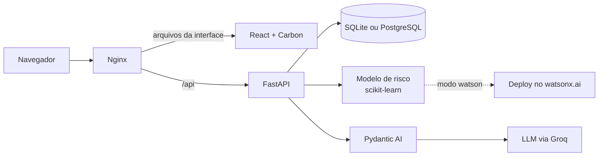

# Tecnologias do Raiz

**Atualizado em:** 08/11/2026 · **Base:** branch `develop` com a publicação no Render.

Este documento explica cada tecnologia usada no projeto: o que é, para que serve aqui e onde está no repositório. Para a história e as decisões, leia a [documentação principal](documentacao-do-projeto.md). Para localizar pastas, use o [mapa do repositório](../README.md#como-navegar-pelo-repositório).

## Sumário

1. [Visão geral](#1-visão-geral)
2. [Interface (frontend)](#2-interface-frontend)
3. [API e regras de negócio (backend)](#3-api-e-regras-de-negócio-backend)
4. [Banco de dados](#4-banco-de-dados)
5. [Inteligência artificial: chat e copiloto](#5-inteligência-artificial-chat-e-copiloto)
6. [Dados e modelo de risco](#6-dados-e-modelo-de-risco)
7. [Tecnologias IBM](#7-tecnologias-ibm)
8. [Infraestrutura e publicação](#8-infraestrutura-e-publicação)
9. [Testes e qualidade](#9-testes-e-qualidade)
10. [Segurança e privacidade](#10-segurança-e-privacidade)
11. [Ferramentas de trabalho](#11-ferramentas-de-trabalho)
12. [O que avaliamos e não usamos](#12-o-que-avaliamos-e-não-usamos)

## 1. Visão geral

| Camada | Tecnologia | Papel no Raiz |
|---|---|---|
| Interface | React 18, Vite 5 e Carbon Design System (IBM) | Telas do associado e da analista |
| API | Python e FastAPI | Login, compras, respostas, revisões, chat e reset da demonstração |
| Banco | SQLAlchemy com SQLite (padrão) ou PostgreSQL (Docker Compose) | Compras, confirmações, revisões, mensagens e eventos |
| IA conversacional | Pydantic AI com o modelo `openai/gpt-oss-120b` via Groq | Chat em cada compra e copiloto do associado |
| Modelo de risco | scikit-learn 1.6.1 (Random Forest), pandas e joblib | Score de cada compra e triagem automática |
| IBM | Bob, watsonx.ai, watsonx Orchestrate (ADK), Carbon e IBM Design Thinking | Desenvolvimento, publicação do modelo, teste de agente, interface e método de design |
| Infraestrutura | Docker, Docker Compose, Nginx e Render | Execução local e aplicação publicada |
| Testes | pytest | Suíte do backend |

No site publicado, Nginx, FastAPI e o modelo rodam juntos num único container. Localmente, frontend e backend podem rodar separados.

## 2. Interface (frontend)

**Onde:** [watson/frontend/](../watson/frontend/README.md)

| Tecnologia | Versão | O que faz aqui |
|---|---|---|
| React | 18.3 | Biblioteca das telas. Cada área tem sua pasta em `src/features/` (`session`, `associate`, `analyst`) |
| Vite | 5.4 | Servidor de desenvolvimento e geração dos arquivos finais. Em desenvolvimento, encaminha `/api` para o backend na porta 8000 |
| Carbon Design System (`@carbon/react`) | 1.119 | Sistema de design da IBM: botões, campos, tabelas, modais, ícones e tokens de cor, tipografia e movimento |
| React Router | 6.30 | Rotas por perfil: `/associate/purchases` para o associado e `/analyst/...` para a analista |
| Sass | 1.106 | Estilos em SCSS sobre os tokens do Carbon |

Como a interface funciona:
- O login (`SessionGate`) envia e-mail e senha à API, que devolve um cookie de sessão. O papel da pessoa decide qual app abre.
- O associado vê a lista de compras, o detalhe com os motivos do alerta e os botões de resposta, o chat da compra, o pedido de revisão e o copiloto global (ícone no cabeçalho).
- A analista tem as abas **Pendentes**, **Histórico**, **Fluxo atual** e **Dados**, e registra decisões com justificativa obrigatória.
- Todas as chamadas à API ficam em `src/api/client.js`. A resposta do associado envia o cabeçalho `Idempotency-Key`, para que um clique repetido não gere uma segunda ação.
- O console antigo da analista (`queue/`, `board/`, `case/`, `member-app/`) continua no código como referência visual, mas não faz parte do fluxo atual.

## 3. API e regras de negócio (backend)

**Onde:** [watson/backend/](../watson/backend/README.md) · **Contrato:** [contrato da API](anexos/sistema/specs/contrato-da-api.md)

| Tecnologia | O que faz aqui |
|---|---|
| Python 3.12 | Linguagem do backend e do modelo. Use 3.12 ou 3.13: o scikit-learn 1.6.1 não tem pacote pronto para o 3.14 |
| FastAPI | Framework da API. Gera a documentação interativa em `/docs` |
| Uvicorn | Servidor que executa o FastAPI |
| Pydantic e pydantic-settings | Validam os dados que entram e saem da API e leem a configuração do `.env` |
| Starlette SessionMiddleware e itsdangerous | Cookie de sessão `raiz_session` assinado com `SESSION_SECRET`, válido por 8 horas |
| httpx | Cliente HTTP, também usado nos testes |

O código segue camadas com dependência numa direção só:
- `app/api/`: recebe, valida e responde. Uma rota por recurso.
- `app/domain/`: regras do negócio (compras, confirmações, revisões, sinais, chat, copiloto), sem FastAPI nem SQL.
- `app/db/`: tabelas, repositórios e carga dos dados da demonstração.
- `app/risk/`: carrega o modelo, monta as 28 variáveis de entrada e calcula os fatores explicáveis.

Regras importantes implementadas no backend:
- **Prazo de resposta:** cada confirmação vence após `CONFIRMATION_TTL_SECONDS` (15 minutos por padrão; 30 dias na demonstração). O servidor decide se ainda vale; o relógio da tela é só informativo.
- **Idempotência e concorrência:** a mesma resposta enviada duas vezes devolve o resultado anterior; respostas conflitantes recebem erro, sem uma segunda ação simulada.
- **Isolamento:** cada associado só vê as próprias compras, e só a analista acessa a fila de revisões.
- **Modo de demonstração:** com `DEMO_MODE=true`, a rota `/api/demo/reset` recarrega os dados fictícios.

## 4. Banco de dados

| Tecnologia | Onde é usada | Observação |
|---|---|---|
| SQLAlchemy 2 | Todo o acesso ao banco | O banco muda só pela variável `DATABASE_URL` ([decisão 0002](anexos/sistema/arquitetura/decisoes/0002-banco-trocavel.md)) |
| SQLite | Desenvolvimento local e site publicado | Arquivo único. No site publicado, volta ao estado inicial a cada reinício, o que serve para a demonstração |
| PostgreSQL 16 | Docker Compose local | Dados persistem num volume do Docker |
| Alembic | Migrações (`app/db/migrations/`) | Na demonstração, as tabelas são criadas na subida do backend |
| Db2 | Opção prevista no código | Sem execução testada |

As tabelas centrais guardam compras, confirmações, revisões, eventos (histórico de auditoria), mensagens do chat e chaves de idempotência. Detalhes no [modelo de dados](anexos/dados-e-modelo/dados/modelo-de-dados.md).

## 5. Inteligência artificial: chat e copiloto

**Onde:** `watson/backend/app/domain/agent/` (chat da compra) e `app/domain/copilot/` (copiloto)

| Tecnologia | O que faz aqui |
|---|---|
| Pydantic AI | Framework de agentes: define instruções, ferramentas tipadas e chama o modelo de linguagem |
| Groq | Provedor que executa o modelo de linguagem com baixa latência. A chave `GROQ_API_KEY` fica fora do repositório |
| `openai/gpt-oss-120b` | Modelo de linguagem padrão (configurável em `LLM_MODEL`) |

Os dois agentes e suas ferramentas:

| Agente | Onde aparece | Ferramentas |
|---|---|---|
| Chat da compra | Detalhe de cada compra | `consultar_compra`, `consultar_status`, `avaliar_transacao` (sinais do alerta, sem o score) e `solicitar_revisao` |
| Copiloto do associado | Ícone no cabeçalho | `listar_compras`, `consultar_compra`, `gerar_relatorio` e `solicitar_revisao` |

Limites de projeto:
- A IA **não responde à confirmação**: só os botões da tela registram "Reconheço e autorizo", "Não reconheço" ou "Estou em dúvida".
- A identidade da pessoa e da compra vem da sessão validada pelo backend, nunca de texto gerado pelo modelo.
- O score interno do modelo de risco não entra no contexto da IA.
- Sem a chave do Groq, o chat responde como indisponível e o restante do fluxo continua funcionando.

## 6. Dados e modelo de risco

**Onde:** [notebooks/](../notebooks/), [data/](../data/), [outputs/](../outputs/) e `watson/backend/app/risk/` · **Detalhes:** [dados e modelo](anexos/dados-e-modelo/README.md)

| Tecnologia | O que faz aqui |
|---|---|
| Jupyter | Notebooks `01_eda` (análise exploratória), `02_base_balanceada` (preparação) e `03_modelo` (treino e avaliação) |
| pandas 2.2 e NumPy | Leitura e preparação da base sintética do desafio |
| scikit-learn 1.6.1 | Pipeline de pré-processamento e classificador Random Forest |
| matplotlib e seaborn | Gráficos da análise e da documentação |
| SciPy e openpyxl | Estatísticas da análise exploratória e leitura do dicionário de dados em Excel |
| joblib | Salva o modelo treinado em `outputs/modelo_rf.joblib`, o mesmo arquivo usado pelo backend e publicado no watsonx.ai |

Números principais (base sintética, recorte local):
- 160.000 registros, 297 colunas e 146 fraudes confirmadas.
- Treino balanceado com 234 registros (117 fraudes); teste com a proporção real, 32.000 registros (29 fraudes).
- O modelo usa 28 variáveis. A PR-AUC foi 1,000 com quatro variáveis de velocidade pré-calculadas e 0,146 sem elas, uma dependência que a [avaliação](anexos/dados-e-modelo/avaliacao-do-modelo.md) discute.

Como o score é usado na aplicação:
- **Triagem automática (política experimental, PRs #28/#29):** o código atual implementa três faixas — score ≤ 0,20 libera automaticamente na simulação; score ≥ 0,817 (limiar F2 do notebook 03) bloqueia preventivamente até a resposta; entre os dois, pede confirmação ao associado. A [política conservadora documentada nas regras do produto](anexos/gestao/regras-do-produto.md) define que, sem evidência validada para liberação automática, todos os casos avaliados devem ir à confirmação. As três faixas são uma extensão experimental; antes de apresentar como comportamento definitivo, conferir se estão habilitadas no deploy e reconciliar com as regras do produto.
- **Falha do modelo:** a compra vai direto para revisão humana. Nenhum score é inventado.
- **Fatores explicáveis:** para cada variável, o backend mede quanto o score cai se ela voltar ao valor típico de uma compra legítima. É um cálculo do projeto, não uma explicação nativa do Random Forest.
- **Associado não vê o score:** ele vê sinais descritivos, como "Feita de madrugada" e "Primeira compra registrada com este cartão". A analista vê o score interno.

## 7. Tecnologias IBM

### IBM Bob

Agente de desenvolvimento usado pelos cinco integrantes, principalmente no Bob IDE em modo Agent e, no backend, também pelo Bob Shell 2.0.9. Atuou no notebook do modelo, no backend, no frontend e na documentação.

- **Relatórios:** [bob_sessions/](../bob_sessions/), uma pasta por integrante, com ID da tarefa, custo, chamadas de ferramenta e o que a revisão humana conferiu.
- **Regras do projeto:** [.bob/rules/](../.bob/rules/). `backend.md` define o contrato da API como fonte da verdade; `docs.md` orienta as tarefas de documentação.
- **Arquivos ignorados:** `.bobignore` tira do contexto do Bob PDFs, dados brutos e dependências.

### IBM watsonx.ai

O Random Forest foi publicado no watsonx.ai Runtime como deploy online (space "Inteli Raiz Space", Dallas) pelo script [scripts/deploy_watsonx.py](../scripts/deploy_watsonx.py). No teste de 27/10, os scores foram idênticos aos do modelo local (fraude 0,9917; legítima 0,0089), com latência de 1,1 a 2,9 segundos. O backend escolhe a origem do score pela variável `RISK_MODEL_PROVIDER`: `watsonx` chama o deployment; `local`, usado no site publicado, lê o mesmo arquivo do modelo. Registro completo: [teste do watsonx.ai](anexos/sistema/specs/teste-historico-watsonx.md).

O backend também tem um provider de linguagem para o watsonx.ai (modelo `ibm/granite-3-8b-instruct`, variável `AGENT_PROVIDER`), usado apenas pelo console antigo. O chat atual usa Groq.

### IBM watsonx Orchestrate

Construímos com o ADK do Orchestrate um agente de teste ([agente/agents/agente_teste.yaml](../agente/agents/agente_teste.yaml)) e uma ferramenta Python ([agente/tools/pontuar_transacao.py](../agente/tools/pontuar_transacao.py)) que chama o deployment do watsonx.ai. O trial expirou antes da validação dentro do Orchestrate, e o time decidiu tirá-lo da dependência de execução. O código continua no repositório.

### Carbon Design System e IBM Design Thinking

A interface usa o Carbon, sistema de design open source da IBM. O processo de descoberta (personas, mapas de empatia, Hills, cenário as-is) seguiu o IBM Design Thinking, registrado em [processo de design](anexos/experiencia-do-usuario/processo_design/README.md).

## 8. Infraestrutura e publicação

**Onde:** [watson/infra/](../watson/infra/README.md) e [render.yaml](../render.yaml)

| Tecnologia | O que faz aqui |
|---|---|
| Docker | Empacota cada parte em imagens: `backend.Dockerfile`, `frontend.Dockerfile` e `app.Dockerfile` (imagem única da publicação) |
| Docker Compose | Sobe PostgreSQL, backend e frontend locais com um comando |
| Nginx | Entrega os arquivos da interface e encaminha `/api`, `/health` e `/model-lab` ao backend, na mesma origem, para o cookie de sessão funcionar sem CORS |
| Render | Hospeda o site publicado em <https://raiz-jq28.onrender.com> (plano gratuito, região Virginia, EUA) |

Na imagem única, um script inicia o Uvicorn e o Nginx no mesmo container, e o modelo e as bases processadas entram na imagem. No plano gratuito, o serviço dorme após 15 minutos sem acesso e leva cerca de 1 minuto para acordar.

## 9. Testes e qualidade

| Tecnologia | O que faz aqui |
|---|---|
| pytest | Testes de unidade e integração do backend em `watson/backend/tests/` |
| FastAPI TestClient (httpx) | Chama a API nos testes sem subir servidor |

A suíte cobre confirmação, prazo, isolamento entre usuários, idempotência e concorrência, revisão, histórico, score local e falha do chat. Execuções registradas: 207 testes aprovados em 04/11 ([log](anexos/evidencias/2026-11-04/pytest.log)) e 220 após a correção do prompt em 05/11. Testes com pessoas ainda não foram feitos; o protocolo está no [plano de testes com usuários](anexos/experiencia-do-usuario/plano-de-testes-com-usuarios.md).

## 10. Segurança e privacidade

- **Dados sintéticos:** nenhuma informação real de associado; ações financeiras apenas simuladas.
- **Segredos fora do Git:** `SESSION_SECRET` e `GROQ_API_KEY` ficam no `.env` local (ignorado pelo Git) ou no painel do Render.
- **Sessão:** cookie assinado, com `Secure` ativado no site publicado (`SESSION_SECURE=true`) e validade de 8 horas.
- **Logins fictícios:** as contas da demonstração são de teste e não devem ser reutilizadas.
- **IA com limites:** a IA não autoriza compras, não vê o score e só usa ferramentas de consulta e de pedido de revisão.

## 11. Ferramentas de trabalho

| Ferramenta | Uso |
|---|---|
| Git e GitHub | Versionamento em <https://github.com/PedroHaouliFaria/Inteli-Raiz>, com branches a partir de `develop`, pull requests e revisão |
| Markdown e Mermaid | Toda a documentação, com diagramas no próprio texto |
| Claude Code | Apoio em parte das tarefas: orquestração do Bob Shell nas sessões do Lucas, conforme os relatórios, e publicação no Render e revisão da documentação em 08/11 |

## 12. O que avaliamos e não usamos

| Opção | Por que ficou de fora |
|---|---|
| watsonx Orchestrate como parte do fluxo | Trial expirou; o modelo passou a rodar no backend ([decisões](documentacao-do-projeto.md#escolhas)) |
| Db2 em execução | Previsto no código, sem necessidade na demonstração |
| RAG, vários agentes, streaming e biometria | Sem necessidade demonstrada para o protótipo; o fluxo usa um agente com ferramentas |
| Integração bancária real | Fora do escopo: o protótipo é uma simulação com dados sintéticos |
