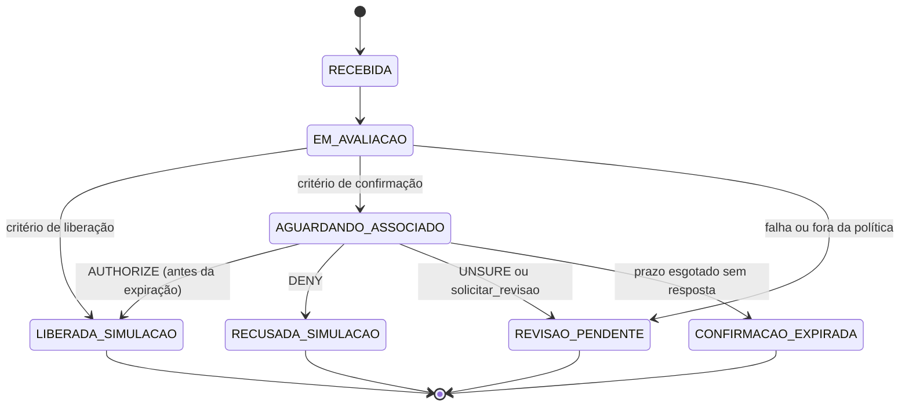

# D10 — Arquitetura técnica e limites de autonomia

**ID:** D10 · **Versão:** 0.1 · **Data:** 29/10/2026
**Responsável:** Pessoa 3 · **Revisor:** Pessoa 4
**Estado:** rascunho
**Depende de:** D09 (estrutura e requisitos); **Alimenta:** D11, D13

---

## 1. Visão geral

```mermaid
flowchart TD
    C[Compra sintética] --> M[Modelo RF no backend\noutputs/modelo_rf.joblib]
    M --> P[Política determinística\n+ máquina de estados]
    P -->|score baixo / critério de liberação| L[LIBERADA_SIMULACAO]
    P -->|critério de confirmação| I[Interface do associado\nReact + Carbon]
    P -->|falha / fora da política| R[REVISAO_PENDENTE]
    I -->|dúvida contextual| A[Agente Pydantic AI\nno backend]
    A --> T1[avaliar_transacao\nscore, sinais, versão]
    A --> T2[consultar_compra\ncontexto da sessão]
    A --> T3[consultar_status\nestado e próximos passos]
    A --> T4[solicitar_revisao\nprotocolo de exceção]
    T1 & T2 & T3 & T4 --> A
    A -->|explicação + limite ou revisão| I
    I -->|resposta humana explícita\nPOST /confirmations/{id}/response| B[Backend FastAPI\nvalida sessão, versão, expiração]
    B --> H[SQLite — estado e eventos\npersistência durável]
    L --> H
    R --> H
    I -->|pedido de atendimento\nnão é UNSURE| R
```

> Este diagrama representa a arquitetura planejada. Os componentes com estado **planejado** ainda não foram implementados ou integrados.

---

## 2. Componentes e papéis

| Componente | Tecnologia | Papel | Estado |
|---|---|---|---|
| **Modelo RF** | scikit-learn 1.6 · Python 3.12 | Produz score (0–1) e probabilidade da classe fraude; carregado em `outputs/modelo_rf.joblib` no processo do backend | A serializar do notebook 03 |
| **Política de decisão** | Python (determinístico) | Transforma score em tratamento (`LIBERADA_SIMULACAO`, `AGUARDANDO_ASSOCIADO`, `REVISAO_PENDENTE`); limiares versionados e configuráveis | Planejada |
| **Backend** | FastAPI · SQLAlchemy · SQLite | Valida sessão, vincula associado/compra, controla expiração, persiste estados/eventos, expõe API JSON; roda no mesmo processo do modelo | Planejado |
| **Agente** | Pydantic AI · LLM externo (Groq/Gemini/Granite) | Consulta ferramentas, explica sinais, informa limites, solicita revisão quando necessário; não autoriza compras | Planejado |
| **Interface do associado** | React + Carbon (`watson/frontend`) | Mostra compra, alerta, pergunta, três respostas e campo de dúvida; lê API JSON; console de exceções limitado | Em adaptação (Leonardo, PR #7); cards C10/C13 |
| **Bob IDE** | IBM Bob | Desenvolvimento, revisão, testes e documentação; sessões exportadas em `bob_sessions/` | Em uso; obrigatório |
| **watsonx.ai** | IBM Cloud (evidência) | Deploy do modelo como prova de execução em nuvem; `score_source=watsonx` disponível; fora do runtime da demo | Testado em 27/10 |

---

## 3. Sequência de execução — fluxo principal

```mermaid
sequenceDiagram
    actor A as Associado
    participant F as Frontend
    participant B as Backend
    participant M as Modelo RF
    participant Pol as Política
    participant DB as SQLite
    participant Ag as Agente

    Note over B,DB: Pré-condição: compra sintética criada (T-007)

    B->>M: avaliar(features de T-007)
    M-->>B: {score: 0.97, sinais: [...], versão: "rf-v1"}
    B->>Pol: decidir(score=0.97, policy_version="confirmacao-v2")
    Pol-->>B: AGUARDANDO_ASSOCIADO
    B->>DB: INSERT challenge CH-007 (status=AGUARDANDO_ASSOCIADO, expires_at=+15min)
    B-->>F: challenge CH-007 com compra e motivo do alerta

    A->>F: "Pode ser o nome da empresa na fatura?"
    F->>B: POST /chat {challenge_id: "CH-007", msg: "..."}
    B->>Ag: consultar(challenge_id="CH-007", msg)
    Ag->>B: consultar_compra("T-007")
    B-->>Ag: {estabelecimento: "BANDEIRA_A / MCC 5411", acceptor_risk: 70}
    Ag->>B: avaliar_transacao("T-007")
    B-->>Ag: {score: 0.97, sinais: ["madrugada", "cnp_credito", "primeira_compra_cartao"]}
    Ag-->>B: "Não consigo confirmar o nome fantasia. Os sinais disponíveis são: ..."
    B-->>F: resposta do agente

    A->>F: clica em "Não reconheço"
    F->>B: POST /confirmations/CH-007/response {response: "DENY", version: 1, idempotency_key: "xyz"}
    B->>DB: INSERT response; UPDATE challenge status=RECUSADA_SIMULACAO
    B->>DB: INSERT case REVISAO_PENDENTE
    B-->>F: {status: "RECUSADA_SIMULACAO", next_step: "Um analista vai avaliar o caso."}
```

---

## 4. Ficha do agente

| Campo | Descrição |
|---|---|
| **Objetivo** | Ajudar o associado a entender a compra sinalizada e tomar uma decisão informada — autorizar, recusar ou encaminhar para revisão. |
| **Conhecimento permitido** | Dados retornados pelas ferramentas autorizadas: score, sinais, contexto da compra, status da confirmação. Nenhum dado além do que as ferramentas retornam. |
| **Instruções principais** | (1) Usar apenas informações das ferramentas; (2) não inventar nomes de estabelecimentos, políticas da instituição ou resultados de bloqueio; (3) declarar explicitamente quando não houver contexto suficiente; (4) não pressionar o associado a autorizar; (5) não pedir senha, PIN ou dados completos do cartão; (6) nunca chamar `responder_confirmacao` — quem autoriza é o associado pelo controle da interface. |
| **Ferramentas disponíveis** | `avaliar_transacao`, `consultar_compra`, `consultar_status`, `solicitar_revisao` (ver catálogo abaixo). |
| **Critério de escolha de ferramenta** | Perguntas sobre o motivo do alerta → `avaliar_transacao`; perguntas sobre o estabelecimento ou valor → `consultar_compra`; perguntas sobre o andamento → `consultar_status`; dúvida irresolvível ou pedido de atendimento → `solicitar_revisao`. |
| **Limites de autonomia** | Não pode alterar o estado da confirmação. Não pode presumir identidade do estabelecimento. Se o LLM falhar, o backend retorna erro e o caminho explícito de confirmação continua funcionando. |

---

## 5. Catálogo de ferramentas

### `avaliar_transacao(case_id: str)`

| Campo | Detalhe |
|---|---|
| **Finalidade** | Retornar score de fraude, sinais que contribuíram para o alerta e versão do modelo. |
| **Entrada** | `case_id` — identificador da compra na sessão atual. |
| **Saída** | `{score: float, sinais: list[str], lacunas: list[str], score_source: str, model_version: str}` |
| **Autorização** | Acessível ao agente; dados disponíveis ao associado da sessão. Rótulo histórico de avaliação não exposto. |
| **Erros** | `{"ok": false, "etapa": "modelo", "erro": "..."}` — nunca retorna score inventado. |

### `consultar_compra(case_id: str)`

| Campo | Detalhe |
|---|---|
| **Finalidade** | Retornar o contexto permitido da compra: estabelecimento (identificação disponível), valor, data, cartão parcial, MCC e região. |
| **Entrada** | `case_id` — validado contra a sessão do associado autenticado. |
| **Saída** | `{estabelecimento: str\|null, valor: float, data: str, cartao_parcial: str, mcc: str, acceptor_region: str\|null, acceptor_risk: float\|null}` |
| **Autorização** | Só retorna dados da compra vinculada à sessão ativa. Nunca retorna dados de outro associado. |
| **Erros** | `{"ok": false, "etapa": "consulta", "erro": "..."}` |

### `consultar_status(case_id: str)`

| Campo | Detalhe |
|---|---|
| **Finalidade** | Retornar o estado atual da confirmação e os próximos passos permitidos. |
| **Entrada** | `case_id` |
| **Saída** | `{status: str, allowed_responses: list[str]\|null, expires_at: str\|null, next_step: str}` |
| **Autorização** | Acessível ao agente e ao frontend. |
| **Erros** | `{"ok": false, "etapa": "status", "erro": "..."}` |

### `solicitar_revisao(case_id: str, reason: str)`

| Campo | Detalhe |
|---|---|
| **Finalidade** | Criar um caso de exceção para revisão humana e retornar o protocolo. |
| **Entrada** | `case_id`, `reason` — motivo declarado pelo agente (ex: "contexto de estabelecimento insuficiente"). |
| **Saída** | `{protocolo: str, status: "REVISAO_PENDENTE", next_step: str}` |
| **Autorização** | O agente pode solicitar revisão; não pode encerrar a confirmação nem autorizar. |
| **Erros** | `{"ok": false, "etapa": "revisao", "erro": "..."}` |

---

## 6. Contratos da API (exemplos)

### `GET /confirmations/{challenge_id}`

```json
{
  "challenge_id": "CH-007",
  "case_id": "T-007",
  "analysis_id": "A-007-v1",
  "version": 1,
  "status": "AGUARDANDO_ASSOCIADO",
  "allowed_responses": ["AUTHORIZE", "DENY", "UNSURE"],
  "expires_at": "2026-10-29T15:02:00Z",
  "policy_version": "confirmacao-v2",
  "simulation": true,
  "compra": {
    "estabelecimento": "BANDEIRA_A / MCC 5411",
    "valor": 149.58,
    "data": "2025-02-14T03:12:00Z",
    "cartao_parcial": "**** **** **** 1234"
  },
  "motivo_alerta": "Compra de madrugada, cartão não presente, primeiro uso do cartão, estabelecimento de risco elevado."
}
```

### `POST /confirmations/{challenge_id}/response`

**Request:**
```json
{
  "response": "DENY",
  "version": 1,
  "idempotency_key": "cli-xyz-001"
}
```

**Response 200:**
```json
{
  "challenge_id": "CH-007",
  "status": "RECUSADA_SIMULACAO",
  "next_step": "Um analista vai avaliar o caso. Protocolo: REV-0042.",
  "simulation": true
}
```

**Response 409 (resposta conflitante):**
```json
{
  "error": "conflict",
  "detail": "Confirmação já registrada com resposta diferente.",
  "current_status": "RECUSADA_SIMULACAO"
}
```

### `POST /chat`

**Request:**
```json
{
  "challenge_id": "CH-007",
  "message": "Esse estabelecimento é confiável?"
}
```

**Response 200:**
```json
{
  "reply": "Não consigo confirmar o nome fantasia do estabelecimento — só tenho o código MCC 5411 e a região registrada. Os sinais disponíveis são: compra na madrugada, sem cartão presente e primeiro uso do cartão. Se precisar de mais informações, posso encaminhar para revisão.",
  "tools_called": ["consultar_compra", "avaliar_transacao"]
}
```

---

## 7. Política e máquina de estados

### Política de decisão inicial

| Condição | Tratamento | Status |
|---|---|---|
| Entrada válida + avaliação disponível + critério de liberação atendido | Liberar automaticamente na simulação | `LIBERADA_SIMULACAO` |
| Critério de confirmação atendido | Criar solicitação individual | `AGUARDANDO_ASSOCIADO` |
| Dados críticos ausentes / serviço falha / caso fora da política | Encaminhar para revisão; não inventar score | `REVISAO_PENDENTE` |

> **Nota:** limiares numéricos serão definidos na etapa de validação (C16), não neste documento. A política inicial conservadora envia todos os casos avaliados para confirmação.

### Máquina de estados



**Regras de transição:**
- Pedir atendimento (`talk_to_person`) → abre revisão sem registrar `UNSURE` nem encerrar a confirmação válida.
- Resposta duplicada → retorna o resultado existente sem duplicar ação.
- Resposta a versão antiga ou outra compra → rejeitar; orientar o associado a abrir a solicitação correta.
- O agente nunca provoca transição de estado — apenas `solicitar_revisao` cria um caso de exceção.

---

## 8. Persistência e falhas

### O que é persistido (mesma transação)

| Entidade | Campos mínimos |
|---|---|
| `purchase` | `case_id`, `challenge_id`, `associate_id`, `amount`, `mcc`, `acceptor_risk`, `created_at` |
| `analysis` | `analysis_id`, `case_id`, `score`, `score_source`, `model_version`, `policy_version`, `created_at` |
| `challenge` | `challenge_id`, `case_id`, `status`, `version`, `expires_at`, `policy_version`, `simulation` |
| `response` | `response_id`, `challenge_id`, `associate_id`, `response`, `idempotency_key`, `created_at` |
| `event` | `event_id`, `challenge_id`, `type`, `payload`, `created_at` |

### Tratamento de falhas

| Falha | Comportamento esperado |
|---|---|
| Modelo indisponível | Retornar `REVISAO_PENDENTE`; log com `score_source=indisponivel`; nunca inventar score |
| LLM indisponível | Chat retorna erro explícito; caminho de confirmação (três botões) continua funcionando |
| Resposta duplicada | Retornar resultado existente; não duplicar estado |
| Sessão expirada | Rejeitar; orientar o associado |
| Banco de dados indisponível | Retornar 503; nenhuma transação parcial |
| Reinício da aplicação | Estado preservado no SQLite com volume durável; em hospedagem efêmera, usar armazenamento persistente |

---

## 9. Uso de tecnologia IBM

| Tecnologia | Papel neste projeto | Estado |
|---|---|---|
| **IBM Bob** | Desenvolvimento, revisão, testes e documentação; sessões exportadas por integrante em `bob_sessions/` | Em uso; obrigatório pelo guia |
| **watsonx.ai** | Deploy do modelo RF como evidência de execução em nuvem IBM; `score_source=watsonx` disponível como opção | Testado em 27/10 (spec: `docs/specs/teste_integracao_orchestrate_wml.md`); fora do runtime da demo |

---

## 10. Decisões técnicas registradas

| # | Tema | Decisão | Motivo |
|---|---|---|---|
| DEC-01 | Runtime do modelo | Backend local via `joblib`; watsonx.ai como evidência, não runtime | Elimina dependência de chave IBM Cloud e cota Lite em tempo de execução |
| DEC-02 | Backend | FastAPI + SQLAlchemy + SQLite | Mesmo processo do modelo; SQLite atende R06 e R10; `DATABASE_URL` configurável para PostgreSQL |
| DEC-03 | Agente | Pydantic AI com LLM externo (Groq/Gemini/Granite) | Troca de provedor é configuração; Granite no watsonx.ai como opção se houver chave |
| DEC-04 | Autorização | `responder_confirmacao` é endpoint do backend acessível à sessão humana; o agente não possui essa ferramenta | Mantém isolamento: só o controle da interface registra a resposta do associado |
| DEC-05 | Frontend | React + Carbon existente do Watson (PR #7), adaptado por Leonardo | Evita reescrever do zero; backend expõe só API JSON e não depende da escolha de frontend |
| DEC-06 | Identidade | Login fictício com 2–3 associados identificados como fictícios e cookie de sessão assinado | Atende R05 sem fingir autenticação bancária produtiva |

---

## 11. Evidências de execução (a preencher)

| Item | Descrição | Responsável | Estado |
|---|---|---|---|
| Deploy watsonx.ai | Resultado do teste 7.1 da spec | P3 | Concluído em 27/10 |
| Modelo local | Scores idênticos ao notebook para casos fixos de `pontuar_transacao.py` | P3 | Planejado (C06) |
| Política + estados | Todos os cenários do §9 do plano documentados e executados | P3 | Planejado (C12) |
| Isolamento de sessão | Dois associados fictícios; acesso cruzado negado | P3 | Planejado (C26) |
| Expiração | Confirmação expirada não libera; `CONFIRMACAO_EXPIRADA` persistido | P3 | Planejado (C17) |

---

## 12. Limitações e próximos passos

- [ ] Publicar versão revisada após C06 (viabilidade de acesso e interface) estar concluído.
- [ ] Definir e documentar os limiares da política após validação (C16).
- [ ] Ampliar casos de demonstração para cobrir todos os cenários do §9 do plano.
- [ ] Confirmar provedor LLM e documentar substituição como configuração.
- [ ] Após integração (C13), adicionar diagrama de sequência para os casos de dúvida e expiração.
- [ ] Registrar resultado real de cada evidência da seção 11 ao executar os cards correspondentes.
